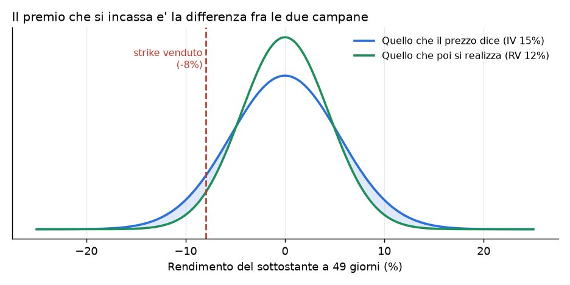
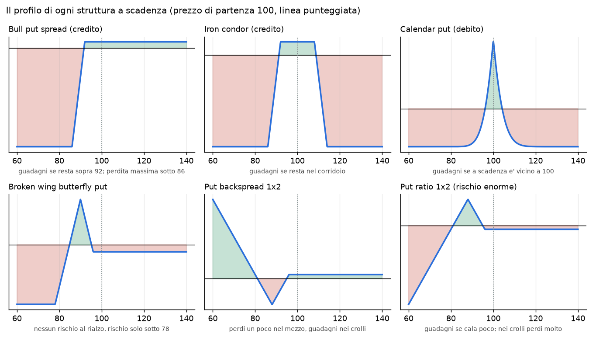
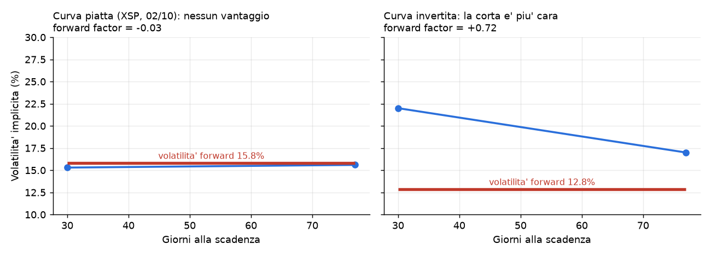
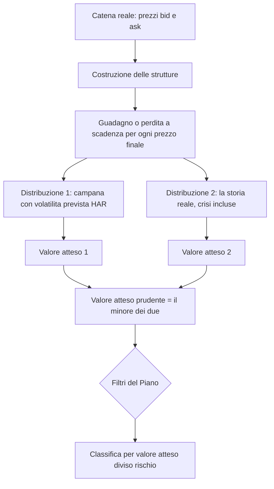
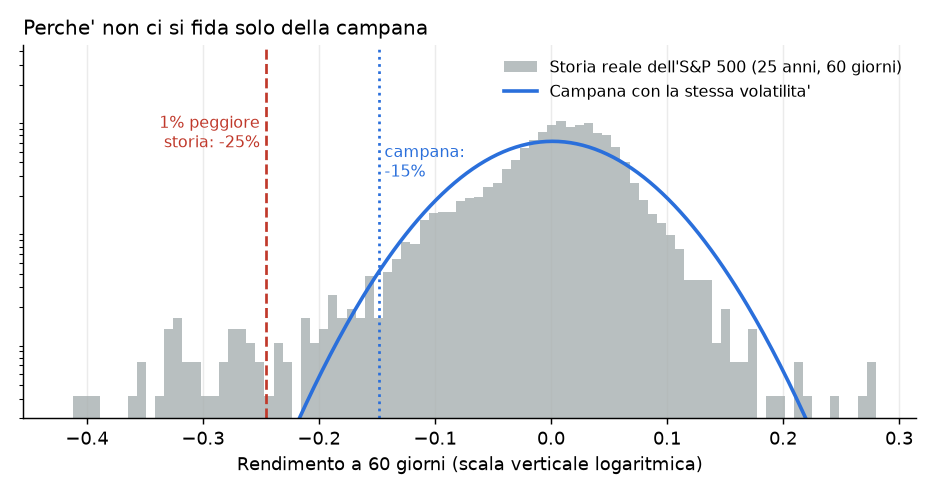
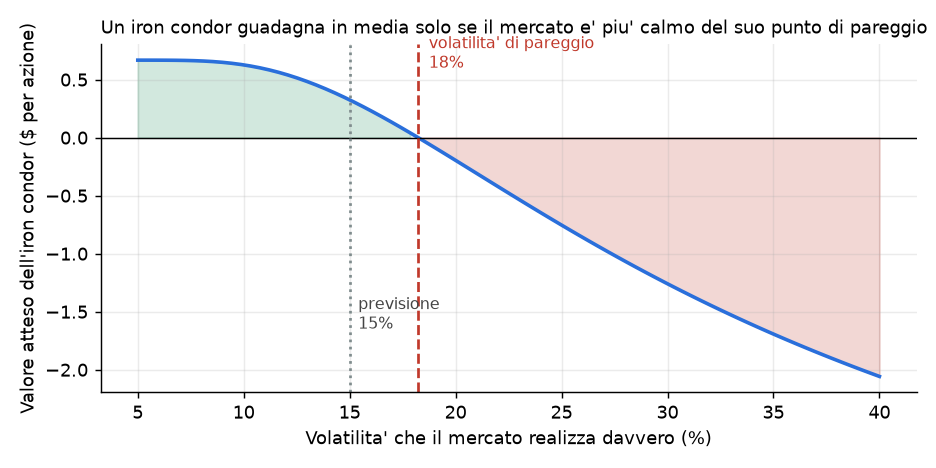

# Come ragionano le strategie dello scanner

> Guida per capire, non per consultare. Spiega **perché** lo scanner costruisce certe strutture e **che cosa vuol dire** che una di esse sia "un'occasione". I numeri degli esempi sono illustrativi, tratti da casi reali e ritoccati. Dove un numero è stato calcolato con un metodo precedente lo dico.

## Come leggerla

Procedi in ordine: ogni parte usa le idee della precedente. Alla fine ci sono 10 domande di verifica con risposta a scomparsa: se non sai rispondere a una, rileggi la parte indicata.

- **Parte 1**: l'idea di fondo, da dove può nascere un guadagno.
- **Parte 2**: anatomia di una posizione (perdita massima, profitto massimo, pareggio).
- **Parte 3**: le famiglie di strategie, che scommessa è ciascuna.
- **Parte 4**: che cosa rende una struttura un'occasione, il cuore del metodo.
- **Parti 5 e 6**: i filtri e come leggere una scheda.
- **Parte 7**: dove il metodo sbaglia.

---

## 1. L'idea di fondo: un prezzo è una previsione

Il prezzo di un'opzione non è un numero casuale: contiene una **previsione di quanto si muoverà il sottostante**. Quella previsione si chiama **volatilità implicita** (IV). Se la IV di XSP è 15%, il mercato sta dicendo: "nel prossimo anno il sottostante oscillerà più o meno del 15% attorno a dove sta, un giorno dopo l'altro".

Poi il tempo passa e si scopre quanto il sottostante si è mosso davvero: la **volatilità realizzata** (RV). Il guadagno di chi compra e di chi vende opzioni dipende da una sola domanda:

> **Il mercato si è mosso più o meno di quanto il prezzo prevedeva?**

- Se si è mosso **meno** (RV < IV), ha vinto chi aveva venduto le opzioni: ha incassato un premio per un rischio che non si è presentato.
- Se si è mosso **più** (RV > IV), ha vinto chi le aveva comprate.

Una compagnia di assicurazioni funziona così. Incassa premi per coprire eventi che nella maggior parte dei casi non accadono. Guadagna nel lungo periodo perché fa pagare l'assicurazione un po' più di quanto costa in media, e perde molto in un anno di catastrofi. Il mercato delle opzioni sugli indici ha la stessa struttura: la IV è in media **più alta** della RV, perché chi si assicura contro un crollo è disposto a pagare un sovrapprezzo. Questa differenza si chiama **premio al rischio di volatilità** (VRP).

La campana blu è quello che il prezzo dice, la verde è quello che poi si realizza (qui con IV 15% e RV 12%, valori vicini a quelli di XSP). Chi vende uno strike a −8% vende un evento che il prezzo considera più probabile di quanto lo sia: la zona colorata è il sovrapprezzo.

**I numeri di un caso reale.** Volatilità realizzata contro volatilità implicita su quattro sottostanti:

| Sottostante | Implicita | Realizzata | Che cosa vuol dire                                                                        |
| ----------- | --------- | ---------- | ----------------------------------------------------------------------------------------- |
| ESTX50      | ~19,9%    | ~13,9%     | realizzata = 0,70 volte l'implicita: sovrapprezzo grande, vendere premio ha vantaggio     |
| XSP         | ~14-15%   | ~12,2%     | sovrapprezzo c'è, più piccolo                                                             |
| Titolo A         | ~36-38%   | ~39,3%     | **al contrario**: il titolo si muove più di quanto prezza l'opzione, vendere premio perde |
| Titolo B        | ~45%      | ~48,3%     | idem                                                                                      |

Questa tabella è il motivo per cui il core del Piano è sugli **indici** e non sui singoli titoli: dove il sovrapprezzo non c'è, non c'è nulla da incassare.

### Le quattro fonti di guadagno che lo scanner cerca

1. **Vendere premio** (bull put, bear call, iron condor, iron butterfly): incassare il sovrapprezzo di cui sopra.
2. **Struttura a termine** (calendar, double calendar, diagonal): sfruttare il fatto che scadenze diverse hanno volatilità diverse.
3. **Forma del rischio** (broken wing butterfly, backspread, ratio): scegliere *dove* si è esposti, per guadagnare in certi scenari e perdere poco negli altri.
4. **Prestito** (box spread): non è un vantaggio sul mercato, è un tasso d'interesse sulla liquidità.

Le strutture direzionali a debito (bull call, bear put) sono la quinta famiglia, ma **non** hanno un vantaggio proprio: le tiene lo scanner solo se passano un controllo severo (vedi §3.4).

---

## 2. Anatomia di una posizione

Ogni struttura si descrive con quattro numeri, e lo scanner li conosce tutti prima di proporla.

- **Perdita massima**: il peggio che può succedere. Se la struttura è a **rischio definito** è un numero noto all'apertura.
- **Profitto massimo**: il meglio che può succedere.
- **Pareggio** (breakeven): il prezzo del sottostante a scadenza al quale non guadagni né perdi.
- **Forma del payoff**: *dove* guadagni e *dove* perdi.

Come si legge: l'asse orizzontale è dove finisce il sottostante a scadenza (parte da 100), l'asse verticale è il guadagno (verde sopra la linea nera) o la perdita (rosso sotto). Ogni struttura è una **forma** diversa:

- il bull put spread e l'iron condor sono "piatti": guadagno piccolo e quasi certo, perdita grande e rara;
- il calendar è "a tenda": guadagna solo se il sottostante resta vicino allo strike;
- la broken wing butterfly e i ratio hanno forme asimmetriche: scelgono in quale direzione tollerare di sbagliare.

**Perché le forme contano più delle sigle.** Quando si dice "questa strategia ha il 74% di probabilità di vincere" si descrive solo *quanto spesso* si vince. Non dice *di quanto*. Una struttura che vince 74 volte su 100 incassando 291 e perde 26 volte su 100 pagando 709 ha un valore medio di: 0,74×291 − 0,26×709 = 215 − 184 = **+31**. Basta che la probabilità scenda al 70% perché il risultato medio diventi negativo. La parte 4 spiega come si fa questo conto.

---

## 3. Le famiglie, una per una

Per ciascuna: l'idea, come la costruisce lo scanner, quando fa male.

### 3.1 Vendere premio: bull put, bear call, iron condor, iron butterfly

**L'idea.** Vendi un'opzione che il mercato considera rischiosa ma che probabilmente non lo sarà, e per non rischiare tutto ne **compri una più lontana** che fa da paracadute. Ottieni un **credito** e una perdita massima nota.

- **Bull put spread**: vendi una put, ne compri una più bassa. Guadagni se il sottostante **non scende** sotto lo strike venduto.
- **Bear call spread**: vendi una call, ne compri una più alta. Guadagni se **non sale** sopra lo strike venduto.
- **Iron condor**: un bull put e un bear call insieme sulla stessa scadenza. Guadagni se il sottostante resta **nel corridoio** fra i due strike venduti. Incassi di più, ma puoi sbagliare da due lati.
- **Iron butterfly**: come il condor ma con i due strike venduti **al denaro**. Credito enorme, ma guadagni davvero solo se il prezzo non si muove: lo scanner la guarda e quasi sempre la scarta (valore atteso negativo).

**Come la costruisce lo scanner.**
- La gamba venduta ha **delta fra 0,08 e 0,32**. Il delta è un'approssimazione grezza della probabilità che l'opzione scada in-the-money: delta 0,15 significa circa 15% di probabilità di finire "dentro". Più basso è il delta, più sicuro (e più povero) è il credito.
- L'ala (la gamba comprata) sta a una distanza fissa, la **larghezza**: per ESTX50 50 e 100 punti, per XSP 5 e 10, per i titoli scelta sul prezzo.
- Per il condor accoppia un put spread e un call spread con delta vicini (0,10, 0,15, 0,20, 0,25, 0,30).

**La regola che devi avere in testa.** Perdita massima = larghezza − credito. Per pareggiare bisogna vincere almeno una frazione di volte pari a:

> **probabilità necessaria = perdita massima ÷ larghezza**

Un bear call XSP 800/810 ha larghezza 1000 $, credito 291 $, perdita massima 709 $: servono almeno il **70,9%** di casi vincenti. Il mercato, con la sua IV, ne assegna il 74%. Il margine (3 punti) è sottile: tutto il vantaggio sta in quei 3 punti.

**Quando fa male.** Un movimento forte nella direzione sbagliata ti fa perdere l'intera larghezza (meno il credito) in pochi giorni. Per questo il Piano chiede una perdita massima ≤ 2% del NAV: senza stop loss, la perdita massima è la perdita vera.

Approfondimenti: Bull Put Spread, Bear Call Spread, Iron Condor, Iron Butterfly.

### 3.2 Struttura a termine: calendar, double calendar, diagonal

**L'idea.** Il tempo non fa scadere tutte le opzioni alla stessa velocità. L'opzione che scade tra 30 giorni perde valore temporale più in fretta di quella che scade tra 77. Un **calendar** **vende** la scadenza vicina e **compra** quella lontana, **allo stesso strike**. Paghi un **debito** (la lontana costa più della vicina) e la perdita massima è quel debito.

- Guadagna **in due modi**: (1) la vicina decade più in fretta della lontana, finché il sottostante resta vicino allo strike; (2) se la volatilità implicita sale, la lontana, che ne è più sensibile (ha più "vega"), vale di più.
- Il **double calendar** ne mette due, uno sotto e uno sopra il prezzo: allarga la zona di guadagno. Il **double diagonal** sposta le gambe lunghe ancora più lontano.

**Come la costruisce lo scanner.** Strike fuori dal denaro, entro il 2,5% dal prezzo (per il double: put al 96,5-99% del prezzo, call al 101-103,5%). Ogni scadenza nuova viene accoppiata con fino a 3 scadenze precedenti che distano da 14 a 90 giorni.

**Il forward factor: il criterio che decide se un calendar ha vantaggio.** Dalle due volatilità implicite si ricava quanta volatilità il mercato prezza *solo per il periodo in mezzo*. È la **volatilità forward**:

> volatilità forward = √[(IV lunga² × T lunga − IV corta² × T corta) ÷ (T lunga − T corta)]
> **forward factor = IV corta ÷ volatilità forward − 1**

Se è **positivo** (curva invertita), la scadenza corta costa **più** del periodo successivo: vendi caro e compri a buon mercato, e il calendar ha un vantaggio di struttura. Se è **zero o negativo**, curva piatta o in contango: compri volatilità futura più cara di quella che vendi, e il calendar non ha niente in più. Il Piano chiede forward factor **≥ +0,20** per aprirne uno nuovo.

A sinistra una curva reale di XSP: IV 15,3% a 30 giorni, 15,6% a 77. La volatilità forward è circa il 16%, un po' sopra la corta: **forward factor −0,03**. A destra un esempio **estremo** (non reale) con la curva invertita. Aprire un calendar con forward factor circa −0,04 è una **deroga al Piano**: può essere indicato dal valore atteso, che però per i calendar è la misura meno robusta (vedi §4.6 e §7).

**Quando fa male.** Se il sottostante si allontana molto dallo strike, in qualunque direzione, perdi il debito. Per questo la zona di guadagno è stretta e la probabilità di chiudere in utile è bassa (circa 44% per i nostri): si guadagna meno spesso ma di più, il contrario di un credit spread.

Approfondimenti: Calendar Spread, Diagonal Spread, [DC Time Machine](METODI_OPERATIVI.md).

### 3.3 Cambiare la forma del rischio: broken wing butterfly, backspread, ratio

Queste strutture non cercano un sovrapprezzo di volatilità: scelgono **dove accettare di perdere**.

**Broken wing butterfly (BWB) put.** Compri una put, ne vendi **due** più in basso, ne compri una terza ancora più in basso, con le due "ali" di larghezza diversa (la lontana è il triplo della vicina nello scanner). Si costruisce a un credito piccolo o nullo. Il profilo: **nessun rischio al rialzo** (se il sottostante sale ti tieni il credito), guadagno massimo vicino ai due strike centrali, perdita **solo** se il sottostante crolla sotto l'ala lontana. È una scommessa "il mercato non crollerà", ma con un credito d'ingresso anziché un debito. Un BWB XSP 725/715×2/695 incassa 55 $, può guadagnare fino a circa 1.055 $ e perdere al massimo circa 945 $ (e solo sotto 695).

**Put backspread 1×2.** Vendi 1 put e ne compri **2** più in basso. È l'**opposto** di una vendita di premio: perdi poco o niente se il sottostante resta fermo, perdi **un poco** se scende moderatamente (nel punto dove la put venduta vale più delle due comprate), ma **guadagni molto** in un crollo. È una protezione che si paga poco o nulla, a rischio definito.

**Put ratio 1×2.** Compri 1 put e ne vendi **2** più in basso: il rovescio del backspread. Guadagni se il sottostante scende un po', poi **perdi sempre di più** mentre crolla. La perdita massima è finita (si realizza con il sottostante a zero) ma **enorme**: per XSP 737/747 sarebbe 72.021 $ a fronte di un profitto massimo di 1.679 $. Lo scanner lo valuta **dimensionandolo sulla perdita se il sottostante cala del 20%, al netto delle protezioni di coda**, e non su quella teorica: è un modo onesto di dire "quanto rischio davvero, dato che ho già delle protezioni?". Anche così quasi sempre supera il 2% del NAV e resta fuori.

**Cosa non costruisce e perché.** Il call ratio, il jade lizard, il risk reversal e gli strangle venduti hanno una perdita **non definita** (in teoria illimitata): sono esclusi per decisione tua, finché il capitale non cresce.

Approfondimenti: Butterfly Spread, Ratio Put Spread.

### 3.4 Direzionali a debito: bull call e bear put

**L'idea.** Compri un'opzione vicina al denaro e ne vendi una più lontana per ridurre il costo. Ti serve che il sottostante vada **nella direzione prevista** oltre il pareggio.

**Perché lo scanner li guarda con sospetto.** Una struttura direzionale non ha un vantaggio *strutturale*: guadagna se hai ragione sulla direzione. Lo scanner non prevede direzioni, quindi un suo valore atteso positivo può essere solo un **artefatto del modello**. Il caso tipico è lo **skew**: le opzioni più basse hanno IV più alta di quelle più alte. Un modello che usa **una sola volatilità** per tutti gli strike vede un bear put (compri l'alta, vendi la bassa) come "venderei a un prezzo gonfiato": sembra un guadagno e non lo è. Il controllo è semplice: se il valore atteso è **già positivo usando la volatilità implicita** (dove per costruzione dovrebbe essere zero), il vantaggio è un'illusione e la struttura viene scartata.

Approfondimenti: Bull Call Spread, Bear Put Spread.

### 3.5 Box spread: non è una scommessa, è un prestito

Un **box** combina un bull call spread e un bear put spread sugli stessi due strike (K1 e K2). Qualunque cosa faccia il sottostante, a scadenza paga **sempre** K2 − K1. Quindi se lo compri a meno di K2 − K1 hai fatto un **prestito a tasso fisso**: oggi paghi 9.650 $, fra otto mesi ne incassi 10.000 $, il rendimento è determinato. Lo scanner calcola il **rendimento annuo implicito** con i prezzi eseguibili (compri all'ask, vendi al bid). Non confronta con nessun tasso: lo fai tu con i T-bill. Ha senso solo su indici **europei** (SPX, XSP), perché non possono essere esercitati in anticipo.

### 3.6 Lo screener del forward factor

Non è una struttura ma un modo di cercare. Per ogni titolo legge la volatilità al denaro di ogni scadenza e calcola il forward factor di ogni coppia: ti dice **dove, fra molti titoli, il tuo calendar avrebbe un vantaggio di struttura**. Da lì premi "Cerca occasioni" sul titolo che ti interessa e lo scanner fa la valutazione completa.

---

## 4. Che cosa rende una struttura "un'occasione"

Una struttura compare in pagina se supera, in ordine, questi passaggi:

### 4.1 Prezzi eseguibili: il costo di entrare è già nel conto

Il "prezzo" di un'opzione non è uno: c'è un **bid** (a cui qualcuno compra da te) e un **ask** (a cui qualcuno vende a te). La media si chiama **mid**. Per comprare paghi l'ask, per vendere incassi il bid. Lo scanner usa sempre questi, non il mid: **se una struttura è un'occasione solo al mid, non lo è**.

Esempio: un calendar XSP costava 365 $ al mid, 387 $ a prezzi eseguibili. I 22 $ di differenza sono il **6% della posizione** pagato solo per entrare.

### 4.2 Che cos'è il valore atteso, con un esempio da tre scenari

Il **valore atteso** (EV) è il risultato **medio** della struttura se potessi ripeterla infinite volte nelle stesse condizioni. Si calcola pesando ogni risultato per la sua probabilità. Tre scenari, per un credit spread con credito 100 e perdita massima 900:

| Scenario | Probabilità | Risultato | Contributo |
|---|---|---|---|
| Il sottostante resta sopra lo strike venduto | 85% | +100 | +85 |
| Scende un po' (perdita parziale) | 9% | −400 | −36 |
| Scende molto (perdita massima) | 6% | −900 | −54 |
| **Valore atteso** | | | **−5** |

Questa struttura vince l'**85%** delle volte e ha comunque un valore atteso **negativo**. È il punto più importante di tutta la guida: **la percentuale di successo non dice niente senza la dimensione dei risultati**. Per questo il nostro bull put ESTX50 (credito 100, rischio 900) ha bisogno del 90% di probabilità per pareggiare e ne ha il 79%.

Lo scanner fa lo stesso conto non con 3 scenari ma con **1.500 prezzi finali possibili**, ciascuno con la sua probabilità, e somma i contributi.

### 4.3 Quale distribuzione dei prezzi finali: due risposte indipendenti

Il conto dipende da *quali* prezzi finali consideri probabili. Lo scanner ne usa due e prende **il più prudente**.

**Risposta 1: la campana con volatilità prevista (HAR).**
Assume che i rendimenti seguano una campana (log-normale) la cui larghezza è la volatilità attesa. Ma quale volatilità? Non quella recente (troppo rumorosa) né il massimo delle ultime finestre. Usa un modello semplice chiamato **HAR** (Heterogeneous AutoRegressive): la volatilità di domani somiglia a quella di ieri, a quella dell'ultima settimana e a quella dell'ultimo mese, con pesi stimati su 12 anni di storia. Tre "memorie" di durata diversa, combinate. Il modello tende a **tornare verso la media di lungo periodo**, per questo oggi prevede per l'S&P circa 15-17% quando la volatilità recente è 12%: è più prudente del dato recente.

**Risposta 2: la storia reale (bootstrap).**
Non assume nessuna forma. Prende **tutti i periodi storici** della stessa durata (60 giorni, per esempio) degli ultimi 20-25 anni, sovrapposti, e chiede: "se il prossimo periodo fosse uno qualunque di questi, che cosa farebbe la mia struttura?". Dentro ci sono 2008, 2018, 2020, 2022, agosto 2024.

La campana grigia-blu è un'approssimazione che **sottostima le code**: un periodo a 60 giorni cade nell'1% peggiore con un −15% secondo la campana, ma con un −25% secondo la storia vera dell'S&P. Chi vende put lontane vive proprio in quella coda. Il bootstrap è il modo di non dimenticarla.

**Una correzione importante: si toglie il premio azionario.** I rendimenti storici includono la tendenza dell'azionario a salire (circa +8% l'anno). Se la lasciassimo, vendere put sembrerebbe sempre vincente solo perché "il mercato sale". Ma noi vogliamo isolare **il vantaggio sulla volatilità**, non scommettere sul rialzo. Quindi si spostano tutti i rendimenti storici in modo che la media dei prezzi finali sia quella neutrale (tasso 2%). Resta la forma della distribuzione, code incluse, senza la deriva.

**Il valore atteso prudente è il minore dei due.** Una struttura passa solo se è positiva **sia** con la volatilità prevista **sia** nella storia. Se un metodo dice sì e l'altro no, non è un'occasione: è un'incertezza.

### 4.4 La volatilità di pareggio: "di quanto posso sbagliarmi?"

Per ogni struttura lo scanner trova anche la **volatilità realizzata alla quale il valore atteso va a zero**: la **volatilità di pareggio** (RV0).

Il grafico è di un iron condor di esempio. A sinistra, con un mercato calmo, il valore atteso è positivo. Man mano che il mercato realizza più volatilità il valore atteso scende e a circa 18% diventa zero. Se la nostra previsione è 15%, abbiamo **3 punti di margine di sicurezza**.

Il **margine** = volatilità di pareggio − volatilità realizzata attesa. È una misura più robusta del valore atteso in euro, perché dice "quanto devo sbagliare la previsione prima di perdere". Il Piano chiede **almeno +2 punti**. Un bull put ESTX50 con margine +0,3 è quasi neutro, non perdono ma non hanno vantaggio. I calendar hanno +6,3: i migliori del libro.

(Per le strutture da compratore di volatilità, come il backspread, il verso è invertito: guadagnano se la volatilità realizzata è **più alta** del pareggio.)

### 4.5 Probabilità e valore atteso non sono la stessa cosa

La **probabilità di chiudere in utile** che vedi in pagina è calcolata con la **volatilità implicita**: è quella che il mercato stesso assegna. Il valore atteso, invece, usa la volatilità **prevista**. Se l'implicita è più alta della realizzata, la probabilità vera è **più alta** di quella mostrata (per chi vende premio): la mostrata è una stima prudente.

Un esempio (metodo precedente): un iron condor ESTX50 con credito 298 € e rischio 702 € ha bisogno del 70,2% per pareggiare. Il mercato assegna il 65%: al **prezzo di mercato** il valore atteso è negativo (per un condor simile misurammo circa −36). Ma se la volatilità realizzata è più bassa di quella implicita, la probabilità vera sale sopra il 70% e il valore atteso diventa positivo (circa +66). **L'intera differenza fra −36 e +66 è il vantaggio che stiamo scommettendo di trovare**: dipende da quanto crediamo alla previsione.

### 4.6 Perché alcuni valori attesi positivi sono falsi

Due casi che lo scanner riconosce e scarta o corregge:

- **Artefatto dello skew** (§3.4): una struttura a debito il cui valore atteso è positivo già alla volatilità implicita.
- **Coda dimenticata**: i put ratio 1×2 su XSP mostravano un valore atteso di **+480 $** su un rischio teorico di **72.000 $**. Il modello assegna alla coda estrema una probabilità trascurabile, quindi sembra un guadagno certo. Ma in un vero crollo si perde tutto e il valore atteso non è un'assicurazione contro quel caso. Il bootstrap e il dimensionamento sulla perdita a −20% servono proprio a questo.

**Un terzo caso più sottile: i calendar.** Per un calendar il valore atteso assume che la gamba lunga **mantenga la sua volatilità implicita** fino alla scadenza della corta. Se la volatilità implicita crolla (cosa che succede dopo un evento), il guadagno si riduce. Perciò dei calendar fidati meno del valore atteso e più del forward factor.

---

## 5. I filtri e perché ci sono

Una struttura con valore atteso positivo deve superare altri controlli. Ognuno risponde a una domanda pratica:

| Filtro | Domanda a cui risponde |
|---|---|
| **Valore atteso prudente > 0** | Ha un vantaggio, anche nel caso peggiore dei due modelli? |
| **Non già posseduta** | Non sto per aprire una cosa che ho già? (si controllano le singole gambe e il verso) |
| **Rischio ≤ 2% del NAV** | Se perdo il massimo, sopravvivo? **Senza stop loss la perdita massima è la perdita vera**: il dimensionamento è l'unico controllo del rischio. |
| **Margine di volatilità ≥ +2 punti** | Ho spazio per sbagliare la previsione? |
| **Spread denaro-lettera ≤ 10%** | Il costo di entrare e uscire non si mangia il vantaggio? |
| **Open interest ≥ 100** | Posso uscire quando voglio? Pochi contratti aperti significano pochi compratori. Se il dato manca, è escluso. |
| **Niente utili prima della scadenza** (strutture a credito) | Un'azienda che presenta i conti può fare un salto del 10% in una notte, e nessuna previsione lo vede. I calendar sono esenti: sono costruiti intorno a quell'evento. |

Due regole di buon senso vengono dall'esperienza del libro:

- **Concentrazione.** Strutture sullo stesso sottostante e stessa scadenza tendono a perdere **tutte insieme**. La pagina somma le perdite massime per (sottostante, mese) e avvisa sopra il 2% del NAV. Per esempio, quattro calendar su XSP con strike a 1-2 punti l'uno dall'altro sono *una sola scommessa*, non quattro.
- **Ordinamento per valore atteso diviso rischio.** Due strutture: A con valore atteso +50 e rischio 700, B con +40 e rischio 300. A "vale di più" in euro, ma B rende il 13% del rischio contro il 7%. Con un capitale limitato conviene B. Per questo l'ordine predefinito è per rendimento sul rischio.

---

## 6. Leggere una scheda passo per passo

Prendi un bear call XSP 800/810 a dicembre (valori di esempio):

| Voce | Valore | Come si legge |
|---|---|---|
| Credito incassato | 291 $ | Tutto il profitto massimo |
| Rischio massimo | 709 $ | 1.000 − 291, perso se XSP supera 810 |
| Probabilità di chiudere in utile | 74% | La assegna il mercato; per pareggiare serve il 70,9% |
| Valore atteso | +40 $ | Mediamente guadagneresti 40 $ per contratto, con la previsione di volatilità |
| Margine | +2,9 punti | Quanta volatilità in più del previsto sopporterebbe |
| Open interest 88 | sotto 100 | Poca liquidità: è una deroga al Piano |
| Concentrazione XSP dicembre | 0,43% del NAV | Lontano dal 2% |

Cosa ne deduci: è una struttura **marginale ma coerente**: vantaggio piccolo (3 punti di probabilità), ben sopra la soglia di margine, ma con liquidità sotto soglia. Con i filtri attivi non passerebbe per l'open interest: eseguirla sarebbe una deroga al Piano, da dichiarare.

Nelle schede nuove trovi in più il **valore atteso con la volatilità prevista**, quello **sulla storia**, il **5° percentile** (il caso storico sfavorevole: "una volta su venti vai peggio di così") e il **P/L se il sottostante cala del 20%** a scadenza.

---

## 7. Dove il metodo sbaglia

Conoscere i limiti fa parte del metodo. Questi sono i più importanti.

1. **La previsione di volatilità può essere sbagliata.** Il modello HAR e la storia dicono come sono andate le cose, non come andranno. Una nuova crisi di natura diversa dal passato non è nei dati.
2. **La campana sottostima le code** (§4.3): i margini sulle put lontane sono sovrastimati. Il bootstrap aiuta ma non risolve: ci sono pochi periodi di crisi, quindi la stima della coda è fragile.
3. **I titoli sono opzioni americane, il modello è europeo.** Per i titoli l'esercizio anticipato (vicino ai dividendi) non è modellato.
4. **Il calendar assume una volatilità costante** sulla gamba lunga (§4.6).
5. **Lo skew non è modellato bene.** Il modello usa la volatilità ATM per la densità: cambia di poco i risultati, ma non li rende esatti.
6. **Le posizioni non sono indipendenti.** Il valore atteso è calcolato per struttura; se hai dieci strutture sullo stesso indice, il rischio del portafoglio è molto più alto della somma dei singoli rischi quando arriva il crollo. La concentrazione è un avviso, non un calcolo completo.
7. **L'edge misurato è una stima.** Un margine di +0,3 punti non è un vantaggio: è rumore. Capita che il core (bull put su indici) risulti proprio in quella zona.
8. **Un'occasione non è un segnale.** Lo scanner dice che *se* le sue ipotesi sono giuste la struttura ha un vantaggio. Non dice quando entrare, né che sia il momento giusto. Decidi tu, con la checklist del Piano.

---

## 8. Verifica

Rispondi a voce prima di aprire la risposta.

> [!question]- 1. Perché chi vende premio guadagna "in media"? E perché guadagna meno su un titolo che su ESTX50?
> Perché la volatilità implicita è in media più alta di quella che poi si realizza: il sovrapprezzo è il guadagno del venditore. Su ESTX50 la realizzata è circa 0,70 volte l'implicita (sovrapprezzo grande); sul titolo A la realizzata (39%) è **più alta** dell'implicita (~37%): il sovrapprezzo non c'è, anzi è negativo. (Parte 1.)

> [!question]- 2. Un bear call spread ha larghezza 1.000 e credito 300. Che probabilità di successo ti serve almeno per pareggiare?
> Perdita massima = 700. Probabilità necessaria = 700 ÷ 1.000 = **70%**. Con meno del 70% di casi vincenti il valore atteso è negativo. (Parte 3.1.)

> [!question]- 3. Una struttura vince l'85% delle volte. Basta questo per dire che è buona?
> No. Dipende da quanto si vince e quanto si perde nel restante 15%. L'esempio dei tre scenari (credito 100, perdita massima 900) vince l'85% e ha valore atteso −5. (Parte 4.2.)

> [!question]- 4. Che cosa misura il forward factor e quando un calendar ha vantaggio di struttura?
> Misura quanto la volatilità implicita della scadenza corta supera la volatilità "forward" (quella implicita nel periodo fra le due scadenze). Se è positivo (≥ +0,20 per il Piano), vendi la scadenza cara e compri la economica. Se è zero o negativo (curva piatta, come XSP al 02/10 con −0,03) non c'è vantaggio. (Parte 3.2.)

> [!question]- 5. Perché lo scanner calcola il valore atteso in due modi e prende il minore?
> Perché ciascun modello ha un punto cieco. La campana con volatilità HAR è sensibile alla previsione ma sottostima le code; il bootstrap storico include le code ma dipende da pochi periodi di crisi. Se una struttura è positiva in entrambi, è più difficile che il vantaggio sia un artefatto di uno dei due. (Parte 4.3.)

> [!question]- 6. Perché dai rendimenti storici si toglie la deriva (il rialzo medio dell'azionario)?
> Per isolare il vantaggio sulla volatilità. Se la deriva restasse, vendere put sembrerebbe sempre vincente perché "il mercato sale", e lo scanner proporrebbe scommesse sul rialzo travestite da vendita di premio. (Parte 4.3.)

> [!question]- 7. Che cos'è la volatilità di pareggio e perché il Piano chiede un margine di almeno +2 punti?
> È la volatilità realizzata alla quale il valore atteso della struttura va a zero. Il margine è quanto la previsione può essere sbagliata (in punti di volatilità) prima di perdere vantaggio. +2 punti significa che anche se il mercato si muove 2 punti più del previsto la struttura è ancora in pareggio o meglio. I bull put ESTX50 hanno +0,3/+1,7: quasi nessuna tolleranza. (Parte 4.4.)

> [!question]- 8. I put ratio 1×2 su XSP mostravano un valore atteso di +480 $. Perché lo scanner li esclude?
> Perché la perdita teorica (sottostante a zero) è di 72.000 $ e il modello assegna alla coda una probabilità trascurabile: il valore atteso positivo è un'illusione della coda dimenticata. Il bootstrap e il dimensionamento sulla perdita a −20% al netto delle protezioni servono a questo; anche così superano quasi sempre il 2% del NAV. (Parti 3.3 e 4.6.)

> [!question]- 9. Perché un bear put a debito con valore atteso positivo già alla volatilità implicita viene scartato?
> Perché per costruzione, alla volatilità implicita, il valore atteso di una struttura prezzata correttamente dovrebbe essere zero. Se è positivo, il vantaggio non viene da un'occasione ma dal fatto che il modello usa una sola volatilità per strike diversi (skew): è un errore di misura, non un profitto. (Parte 3.4.)

> [!question]- 10. Senza stop loss, perché il limite del 2% del NAV sul rischio massimo è così importante?
> Perché non c'è nessun meccanismo che interrompa la perdita prima del massimo: la perdita massima è la perdita vera nel caso peggiore. Il dimensionamento è l'unico controllo del rischio. Se una sola struttura può farti perdere più del 2% del NAV, un evento sfavorevole ti costa troppo prima che tu possa aggiustarla. (Parte 5.)

---

## Dove trovare il resto

- Le regole in vigore: [Piano](PIANO.md) (§3 per i filtri, §6 per gli aggiustamenti).
- Il metodo del valore atteso passo per passo: [Come si calcola se un trade ha edge](METODI_OPERATIVI.md).
- Il perché di ogni greca e struttura: [Manuale](MANUALE.md) e Strategie.
- Il codice (per chi vuole sapere dove): `scan_vrp.py` (le strutture), `stat_ev.py` (HAR, bootstrap, valore atteso), `occ_render.py` (filtri e classifica). Dettaglio in [Init](INIT.md).
