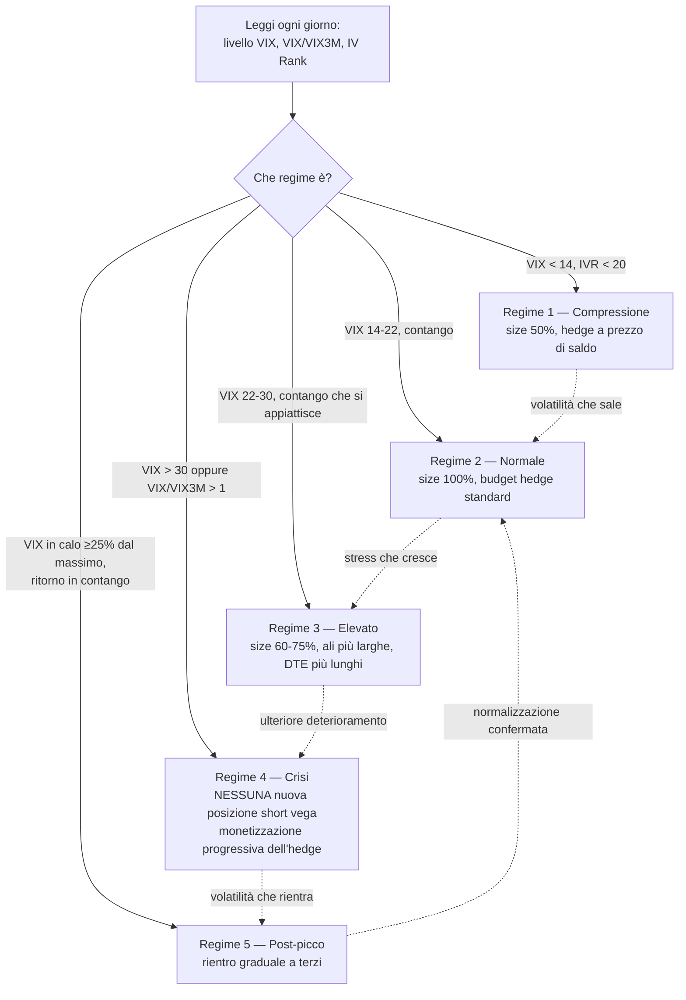
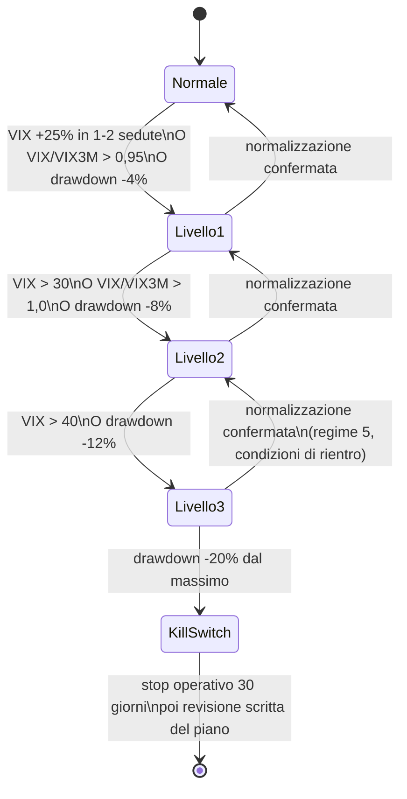

# Manuale — Dalle Opzioni alla Strategia

> Documento didattico e autocontenuto. Obiettivo: che tu possa, alla fine, capire **ogni singola riga** del [Piano](PIANO.md) — non solo cosa dice, ma perché dice esattamente quello. Non è consulenza finanziaria: gli esempi numerici sono illustrativi (XSP a 600 come prezzo di comodo), da verificare sempre contro i prezzi reali di mercato prima di operare.
>
> Come è organizzato: quattro capitoli. Il primo ti dà le fondamenta (principi di investimento + meccanica delle opzioni + greche) senza le quali il resto non si può capire davvero. Il secondo spiega il motore di reddito della strategia (bucket A). Il terzo spiega le protezioni (bucket C e i circuit breaker) — probabilmente la parte più importante dell'intero piano. Il quarto guarda oltre: cosa si potrebbe affiancare, e quando, senza intaccare l'impianto di sicurezza. Non saltare capitoli: ognuno usa concetti definiti nel precedente.

## Indice

1. [Principi generali di investimento e le opzioni da zero](#1-principi-generali-di-investimento-e-le-opzioni-da-zero)
2. [Il core: costruire reddito vendendo volatilità (Bucket A)](#2-il-core-costruire-reddito-vendendo-volatilità-bucket-a)
3. [Le protezioni: sopravvivere ai picchi di volatilità (Bucket C e circuit breaker)](#3-le-protezioni-sopravvivere-ai-picchi-di-volatilità-bucket-c-e-circuit-breaker)
4. [Strategie satellite e più speculative da affiancare (Bucket B e oltre)](#4-strategie-satellite-e-più-speculative-da-affiancare-bucket-b-e-oltre)

---

## 1. Principi generali di investimento e le opzioni da zero

### 1.1 Cosa stai davvero facendo: vendere assicurazioni, non scommettere sulla direzione

C'è un'immagine classica, un po' cruda, che descrive chi vende opzioni senza protezioni: **"raccogliere monetine davanti a un rullo compressore"**. Si guadagna poco ma spesso, finché un giorno non si viene travolti. Tutto questo manuale — e tutto il [Piano](PIANO.md) — esiste per una ragione sola: **prendere l'edge di chi vende opzioni senza finire sotto il rullo compressore.**

Per capire perché l'edge esiste, serve distinguere tre modi diversi di mettere capitale a rischio:

| Approccio                                 | Cosa fai                                                                | Fonte del guadagno atteso                                                                     | Esempio                                                                                                                               |
| ----------------------------------------- | ----------------------------------------------------------------------- | --------------------------------------------------------------------------------------------- | ------------------------------------------------------------------------------------------------------------------------------------- |
| **Investire**                             | Possiedi un pezzo di qualcosa che produce valore nel tempo              | Crescita economica, utili aziendali, dividendi                                                | Un ETF azionario mondiale (vedi `strategia-investimento.md` in radice al vault — è questo tipo di approccio, orizzonte pensionistico) |
| **Speculare**                             | Scommetti sulla direzione futura di un prezzo                           | Avere ragione più spesso/di più di quanto si ha torto                                         | Comprare un'azione perché "sale"                                                                                                      |
| **Vendere volatilità** (questa strategia) | Vendi un'assicurazione contro un movimento di prezzo, incassi un premio | La differenza tra quanto il mercato *teme* che il prezzo si muova e quanto *si muove davvero* | Vendere una put su un indice                                                                                                          |

Il terzo approccio è quello del [Piano](PIANO.md). Non stai scommettendo che l'indice salga o scenda (nel bucket A, quello core): stai vendendo protezione a chi ha paura che scenda, e sei pagato per quel servizio. Il resto di questo capitolo spiega **perché** quel servizio è pagato più di quanto costa in media (il tuo edge) e **cosa** stai davvero rischiando quando lo vendi.

### 1.2 Cos'è un'opzione: diritti, obblighi, premio

Un'**opzione** è un contratto tra due parti su un sottostante (un'azione, un indice, un future):

- Una **call** dà al compratore il **diritto** (non l'obbligo) di **comprare** il sottostante a un prezzo fissato (lo **strike**) entro (o a) una data di scadenza.
- Una **put** dà al compratore il **diritto** di **vendere** il sottostante allo strike entro (o a) la scadenza.

Chi **compra** l'opzione paga un prezzo, il **premio**, e ha solo diritti: la perdita massima è il premio pagato, il guadagno può essere ampio (call) o comunque significativo (put, limitato dal fatto che il prezzo non può scendere sotto zero).

Chi **vende** l'opzione (la "scrive", *write*) incassa il premio subito, ma si assume un **obbligo**: se il compratore esercita il diritto, il venditore deve consegnare il sottostante (call) o comprarlo (put) allo strike, indipendentemente da dove sia arrivato il prezzo di mercato. Il guadagno massimo del venditore è il premio incassato; la perdita può essere molto maggiore.

**Questa asimmetria è il punto di partenza di tutto il piano.** Vendere opzioni significa incassare un guadagno limitato e conosciuto in cambio di un rischio potenzialmente aperto. Il piano intero è un sistema per rendere quel rischio **conosciuto e limitato anch'esso** (con gli spread, capitolo 2) e per proteggersi dalla coda residua che nessuno spread elimina del tutto (con l'hedge, capitolo 3).

**Dettagli tecnici che userai spesso:**

- **Cash-settled vs a consegna fisica.** Le opzioni su indice come SPX/XSP ed Euro Stoxx 50 sono *cash-settled*: a scadenza si regola solo la differenza in denaro, non ti ritrovi mai azioni in portafoglio. Le opzioni su singole azioni sono invece a consegna fisica: se una put che hai venduto viene esercitata, ti ritrovi 100 azioni comprate allo strike, con tutto il capitale che questo immobilizza. È uno dei motivi per cui il [Piano](PIANO.md) (§3) preferisce gli indici.
- **Stile europeo vs americano.** Le opzioni su SPX/XSP sono di stile *europeo*: si possono esercitare solo a scadenza, mai prima. Le opzioni su singole azioni sono quasi sempre *americane*: il compratore può esercitare in qualsiasi momento, il che espone il venditore a un'assegnazione anticipata inattesa (tipicamente vicino a un dividendo o quando l'opzione è molto in the money). Un altro motivo per preferire gli indici: elimina questo rischio del tutto.
- **Moneyness.** Un'opzione è *in the money* (ITM) se ha valore intrinseco (una call con strike sotto il prezzo attuale, una put con strike sopra), *at the money* (ATM) se lo strike coincide col prezzo, *out of the money* (OTM) altrimenti. Il piano vende quasi sempre OTM: si incassa un premio più piccolo, ma la probabilità di dover pagare qualcosa a scadenza è più bassa.

### 1.3 Come si forma il prezzo di un'opzione: l'edge del piano

Il premio di un'opzione si divide in due componenti:

```
Premio totale = Valore intrinseco + Valore estrinseco

Valore intrinseco (put) = max(0, Strike − Prezzo sottostante)
Valore intrinseco (call) = max(0, Prezzo sottostante − Strike)

Valore estrinseco = tutto il resto: tempo rimanente + volatilità attesa
```

Il valore estrinseco è ciò che rende le opzioni interessanti da vendere: è il prezzo che il mercato paga per **l'incertezza** su dove sarà il sottostante a scadenza. Più tempo rimane e più il mercato teme oscillazioni forti, più alto è questo valore. A scadenza, il valore estrinseco è sempre zero: l'opzione vale esattamente il suo valore intrinseco, non un centesimo di più.

**Il cuore dell'edge — il variance risk premium.** In media, storicamente, la **volatilità implicita** (quanto il mercato *si aspetta* che il sottostante oscilli, incorporata nel prezzo delle opzioni) è superiore alla **volatilità realizzata** (quanto il sottostante *oscilla davvero*). Il mercato, in aggregato, paga un piccolo sovrapprezzo per l'assicurazione contro l'incertezza — un po' come una compagnia assicurativa incassa più premi di quanti sinistri liquida, nella media di lunghi periodi. Vendere opzioni sistematicamente cattura questa differenza.

**Il problema, ed è il motivo per cui esiste l'intero capitolo 3:** questa media nasconde una distribuzione molto asimmetrica. Nella maggior parte dei periodi, il venditore di opzioni incassa un piccolo premio con regolarità. Ma in alcuni episodi rari — febbraio 2018, marzo 2020, agosto 2024 (vedi la simulazione) — la volatilità realizzata esplode ben oltre quella implicita, e chi ha venduto opzioni senza protezione perde in un colpo solo molti mesi di guadagni accumulati. **Il variance risk premium è reale e positivo in media, ma va raccolto in una forma che sopravviva a quei rari episodi.** È la frase con cui si apre il [Piano](PIANO.md) (§1), ed è la tesi centrale di questo intero manuale.

### 1.4 Le greche: come si misura il rischio di un'opzione

Le "greche" sono derivate del prezzo dell'opzione rispetto a diverse variabili. Non sono un dettaglio tecnico da esperti: sono lo **strumento con cui il piano controlla il rischio** (vedi limiti in Piano §5.2). Le vediamo una per una, sempre chiedendoci: *cosa significa per questa strategia?*

#### Delta — l'esposizione direzionale

Il delta misura quanto si muove il prezzo dell'opzione per un movimento di 1 punto del sottostante. Va da 0 a 1 per le call, da −1 a 0 per le put (in gergo si dice "delta 15" per 0,15, omettendo spesso il segno per le put). Approfondimento completo in [Glossario — Delta](GLOSSARIO.md).

**Impatto sulla strategia:** il delta dello strike scelto (10–20 nel piano) determina sia quanto rischio direzionale prendi sia — usato come proxy di probabilità — quanto è probabile che l'opzione scada in the money. È la prima leva con cui bilanci premio incassato contro probabilità di perdita. A livello di portafoglio, il delta beta-weighted aggregato è il primo limite del Piano (§5.2): se cresce troppo, stai facendo una scommessa direzionale involontaria mascherata da vendita di volatilità.

#### Gamma — l'accelerazione del delta, il vero nemico del venditore

Il delta non è costante: cambia man mano che il prezzo si muove. La **gamma** misura quanto velocemente cambia il delta. È massima per le opzioni **at the money** e cresce moltissimo mano a mano che ci si avvicina alla scadenza.

```
Delta di una put venduta (strike 570, XSP che scende)

Delta
 0,00 ┤                                          ●  (XSP a 650, molto OTM)
      │                                    ●
      │                              ●
-0,15 ┤                        ●   ← qui l'abbiamo venduta (XSP 600)
      │                  ●
      │            ●
-0,50 ┤      ●            ← XSP arriva a 570: delta ormai vicino a -0,50
      │  ●
-1,00 ┤●                  ← XSP crolla molto sotto 570: delta verso -1
      └──┬─────┬─────┬─────┬─────┬─────┬─────┬─────┬──
        520   540   560   570   580   600   620   650   Prezzo XSP
```

**Impatto sulla strategia:** chi vende opzioni è **short gamma** (per simmetria, chi compera è *long gamma*). Essere short gamma significa che le tue perdite **accelerano** proprio quando il mercato si muove forte contro di te — l'opposto di quello che vorresti. È il motivo esatto per cui:
- Il piano chiude sempre a **21 giorni alla scadenza** (Piano §6): più ci si avvicina alla scadenza, più la gamma cresce, e un piccolo movimento del sottostante genera un cambiamento sproporzionato nel valore della posizione.
- Esiste un limite esplicito: "≤ 20% del rischio in posizioni con meno di 14 DTE" (Piano §5.2).
- Le protezioni del capitolo 3 sono fatte con **opzioni comprate** (put lunghe, ratio backspread): sono posizioni **long gamma**, che accelerano a tuo favore proprio quando il mercato crolla, controbilanciando la gamma negativa del core.

#### Theta — il tempo che lavora per te (finché non lo fa contro)

Il **theta** misura quanto valore perde l'opzione ogni giorno che passa, a parità di tutto il resto. Per chi ha **venduto** l'opzione, il theta è un guadagno quotidiano; per chi l'ha **comprata**, è una perdita quotidiana. Il decadimento non è lineare: accelera vistosamente mano a mano che ci si avvicina alla scadenza.

```
Valore estrinseco residuo di un'opzione OTM
(stesso strike, stessa volatilità, tempo che passa)

Valore
estrinseco
  100% ┤●
       │  ●
       │     ●
   70% ┤        ●●
       │            ●●
   40% ┤                 ●●●
       │                      ●●●●
   15% ┤                            ●●●●●●●
    0% ┤                                     ●●●●●●●●●●●●●●
       └───┬────┬────┬────┬────┬────┬────┬────┬────┬────┬──
          60gg  50gg  40gg  30gg  21gg  15gg  10gg  5gg  0gg
                                    ↑
                            il Piano chiude qui:
                       da qui in poi il decadimento
                    residuo non compensa più il rischio
                         di gamma che cresce
```

**Impatto sulla strategia:** è la ragione per cui si vende a **30–60 giorni** dalla scadenza (Piano §6): è la finestra in cui il theta giornaliero è già significativo in proporzione al capitale a rischio, ma la gamma è ancora contenuta. Sotto i 21 giorni il rapporto si inverte: si guadagna sempre meno per giorno restante, ma si rischia sempre di più per ogni punto di movimento del sottostante — per questo si esce, qualunque sia il P&L (Piano §6, "uscita temporale").

#### Vega — la sensibilità alla paura del mercato

Il **vega** misura quanto cambia il prezzo dell'opzione per un aumento di 1 punto percentuale della volatilità implicita, **indipendentemente da come si muove il sottostante**. Chi vende opzioni è **short vega**: se il [VIX](GLOSSARIO.md) sale, le posizioni vendute perdono valore anche se l'indice non si è ancora mosso, perché il mercato sta ripagando più caro lo stesso rischio futuro.

**Impatto sulla strategia:** è il canale attraverso cui un crollo colpisce il portafoglio *prima ancora* che il prezzo scenda molto — nell'agosto 2024 (vedi simulazione) il VIX è quintuplicato mentre l'indice perdeva "solo" l'8,5%: gran parte del danno/guadagno si è giocato sul vega, non sul delta. Per questo il Piano ha un limite di vega dedicato (§5.2: perdita ≤ 6% NAV per +10 punti di VIX) ed è per questo che l'hedge (bucket C) è fatto di strumenti **long vega** (put lunghe, opzioni su VIX): guadagnano proprio quando il vega del core fa perdere.

**Come si calcola a livello di portafoglio (non solo per una singola opzione):**

```
Vega posizione = Vega dell'opzione (per contratto) × numero di contratti × moltiplicatore × segno
segno: +1 se comprata (long), −1 se venduta (short)
```

Esempio: put credit spread su XSP con gamba corta vega 0,08 e gamba lunga vega 0,05 (moltiplicatore 100):

```
Gamba corta (venduta): 0,08 × 1 × 100 × (−1) = −8
Gamba lunga (comprata): 0,05 × 1 × 100 × (+1) = +5
Vega netto dello spread: −3
```

I vega di più posizioni sullo **stesso sottostante** si sommano algebricamente (a differenza del delta, additivi senza effetti di secondo ordine nel breve). Tra sottostanti **diversi** (XSP ed Euro Stoxx 50) non si possono sommare direttamente — un punto di IV su XSP non "vale" lo stesso di un punto di IV su ESTX50 — per questo si usa il **beta weighting** verso un indice di riferimento (SPX per la parte USD, ESTX50 per la parte EUR, pesati separatamente: vedi [Setup e Watchlist](SETUP_BROKER.md)).

**Confronto col limite:** perdita stimata = vega di portafoglio (beta-weighted) × 10 (per simulare lo shock di +10 punti VIX del limite Piano §5.2), confrontata col 6% del NAV. È una stima **lineare di primo ordine**: il vega stesso cambia mentre la IV sale (un effetto di secondo ordine, a volte chiamato "vomma"), quindi per movimenti molto ampi la stima è approssimativa — coerente con lo spirito degli stress test del Piano (§5.3), che non cercano precisione al centesimo ma un segnale affidabile di quanto ci si avvicina al limite.

#### Rho — la meno rilevante qui, ma non da ignorare sempre

Il **rho** misura la sensibilità al tasso di interesse. Per posizioni a 30–60 giorni è quasi sempre trascurabile: il suo effetto è piccolo su scadenze brevi. Diventa un po' più rilevante sulle protezioni a scadenza più lunga (nella simulazione, la put di hedge a 94 giorni) o in fasi di forte movimento dei tassi — da tenere a mente, non da monitorare quotidianamente come le altre quattro.

#### Tabella riassuntiva: le greche e il loro ruolo nel piano

| Greca | Cosa misura | Il core (bucket A) è... | Il rischio che introduce | Come lo gestisce il Piano |
|---|---|---|---|---|
| Delta | Sensibilità al prezzo | Leggermente esposto (short put = delta positivo) | Scommessa direzionale involontaria | Limite su perdita per −3% indice (§5.2); scelta delta 10-20 in apertura |
| Gamma | Accelerazione del delta | Negativo (short gamma) | Le perdite accelerano nei movimenti forti, specie vicino a scadenza | Uscita a 21 DTE; limite su posizioni <14 DTE (§5.2) |
| Theta | Decadimento nel tempo | Positivo (guadagna col tempo) | Nessuno diretto — è la fonte del guadagno | Finestra 30-60 DTE per ottimizzare il rapporto theta/gamma |
| Vega | Sensibilità alla volatilità implicita | Negativo (short vega) | Perdite immediate su spike di volatilità, anche senza movimento di prezzo | Limite su perdita per +10 pt VIX (§5.2); bucket C è long vega per compensare |
| Rho | Sensibilità ai tassi | Trascurabile su scadenze brevi | Minore, cresce su hedge a lunga scadenza | Nessun limite dedicato, monitorato solo su hedge lunghi |

### 1.5 Principi generali di gestione del rischio

Prima di entrare nel merito della strategia, alcuni principi che valgono per qualunque investimento, non solo per le opzioni, e che spiegano perché il [Piano](PIANO.md) è scritto come è scritto.

**L'asimmetria delle perdite.** Se perdi il 50% di un capitale, serve un guadagno del **100%** solo per tornare al punto di partenza (100 → 50 → serve raddoppiare per tornare a 100). Se perdi il 20%, serve un +25%. Questa asimmetria matematica è la ragione per cui evitare le perdite catastrofiche vale molto più che massimizzare il guadagno nei periodi buoni — è il primo dei "principi finali" del Piano (§13): *"la sopravvivenza viene prima del rendimento."*

**Il dimensionamento conta più della scelta della strategia.** Due trader con la stessa identica strategia possono avere destini opposti solo per come dimensionano le posizioni. Un edge positivo, se giocato con size troppo grande rispetto al capitale, porta comunque alla rovina nel lungo periodo (è il problema centrale che il criterio di Kelly formalizza in teoria dei giochi: esiste una size "ottimale" oltre la quale il rischio di rovina cresce più in fretta del guadagno atteso). Il Piano non calcola un Kelly esplicito, ma applica lo stesso principio in forma pratica: limiti rigidi per trade (1-2% NAV) e per portafoglio (§5), pensati per restare ben al di sotto della soglia di rovina anche se qualche stima di probabilità si rivela sbagliata.

**La correlazione nasconde la concentrazione.** Cinque posizioni su cinque sottostanti diversi sembrano diversificate, ma se sono tutte indici azionari, in una crisi si muovono **tutti insieme** (la correlazione tra asset rischiosi tende a salire verso 1 proprio nei momenti di stress, quando servirebbe il contrario). Il Piano tratta esplicitamente "strumenti correlati" come un unico blocco ai fini dei limiti di rischio (§5.1) — non ti illudere di essere diversificato solo perché hai nomi diversi in portafoglio.

**Le regole si scrivono a mente fredda, non durante la tempesta.** Un piano di rischio serve esattamente nei momenti in cui la tentazione di romperlo è più forte — quando il mercato crolla e "questa volta è diverso". Le regole del Piano (size, stop, circuit breaker) sono numeri decisi oggi, in anticipo, proprio perché uno stesso trader in preda al panico o all'euforia prende decisioni sistematicamente peggiori di quello che le ha scritte a freddo. Vale anche al contrario: non si allentano le regole nei periodi buoni solo perché "sta andando tutto bene".

Con queste fondamenta, il capitolo 2 entra nel merito di come si costruisce concretamente il reddito.

---

## 2. Il core: costruire reddito vendendo volatilità (Bucket A)

### 2.1 Perché uno spread e non un'opzione nuda

Il capitolo 1 ha stabilito che vendere un'opzione nuda espone a una perdita potenzialmente molto grande (in teoria illimitata per una call nuda, molto ampia per una put nuda se il sottostante crolla a zero). Il primo strumento con cui il Piano rende quel rischio **conosciuto in anticipo** è lo **spread**: si vende un'opzione e, con lo stesso premio incassato, se ne compra un'altra più lontana dal prezzo, sullo stesso lato e sulla stessa scadenza, per "tappare" la perdita oltre un certo punto.

**Esempio numerico (illustrativo, XSP a 600, scadenza a 45 giorni):**

| Struttura | Composizione | Credito incassato | Perdita massima |
|---|---|---|---|
| Put nuda | Vendo put 570 | ~300 $ | Molto ampia (in caso di crollo forte) |
| **Put credit spread (quello del Piano)** | Vendo put 570, compro put 560 | ~120 $ | **880 $, nota in anticipo, mai di più** |

Il payoff a scadenza del put credit spread 570/560, in funzione del prezzo di XSP:

```
P&L a scadenza ($)

 +120 ┤                                    ●━━━━━━━━━━━━━━━━━
      │                               ╱
      │                          ╱
      │                     ╱
      │                ╱
      │           ╱
      │      ╱
 -880 ┤●━━━━╱
      └──────┬────────┬────────┬────────┬────────┬───────
            550      560      570      580      600     Prezzo XSP a scadenza
                       ↑        ↑
                  put comprata  put venduta
                  (560, la "protezione")  (570, delta ~15, incassa il premio)
```

Sopra 570, l'opzione venduta scade senza valore: tieni tutto il credito (+120 $). Sotto 560, entrambe le opzioni sono in the money e la perdita è fissa alla larghezza dello spread meno il credito (−880 $). Tra 560 e 570 la perdita cresce linearmente. **Qualunque cosa succeda, oltre 560 non perdi di più** — è la differenza fondamentale rispetto alla put nuda, e il motivo per cui, discusso con l'utente, si è scelto questo approccio "standard" invece di ali molto più larghe o put nude (vedi [Init](INIT.md), sezione "Stato attuale", per la decisione già presa e il perché).

**Il compromesso, onestamente:** comprare la protezione vicina costa. Nell'esempio, il 60% circa del premio lordo (180 $ su 300 $ della put nuda) se ne va per comprare la put 560. È il prezzo per rendere la perdita massima **nota e piccola** invece che dipendente da quanto crolla il mercato. Il capitolo 3 userà lo stesso principio, ma a livello di *portafoglio* invece che di singolo trade.

**Detto in termini di greche (§1.4):** la gamba comprata è anche lei long vega e long theta (a un livello minore della gamba venduta, perché più OTM ed economica) — quindi **riduce theta e vega netti della posizione**, cioè smorza proprio le due greche che generano l'edge quando si vende un'opzione. È un costo reale, non solo psicologico. Si accetta per tre ragioni indipendenti dalle greche stesse:

1. **Rischio definito vs rischio aperto.** Il Piano (§13, principio 1) antepone la sopravvivenza al rendimento — le greche ottimizzano il caso medio, il rischio definito protegge dal caso che ti spazza via, che nessuna ottimizzazione di theta/vega cattura da sola.
2. **Il margine si comporta diversamente in crisi.** Una put nuda ha margine che cresce mentre il sottostante scende e la IV sale — proprio quando si sta già perdendo, col rischio di liquidazione forzata nel momento peggiore. Lo spread ha margine fisso, indipendente dal movimento del mercato.
3. **Il rapporto rischio-aggiustato migliora restringendo l'ala**, anche se il premio assoluto (e quindi l'esposizione greca) scende: spread stretto 570/560, credito 120$ su rischio massimo 880$ = 13,6%; spread largo 570/520, credito 260$ su rischio massimo 4.740$ = solo 5,5%. Il rischio massimo scende più in fretta del credito quando si stringe l'ala.

**Le greche "sacrificate" non sono sprecate — sono riallocate.** Il bucket C (hedge, capitolo 3) è esplicitamente long vega: è lì che vive l'esposizione alla volatilità che serve a proteggersi nel crollo, invece di restare concentrata — e pericolosa — nel core. È il motivo per cui l'alternativa scartata all'avvio del progetto (ali larghe + hedge di portafoglio più pesante, che avrebbe catturato più greche nel core) non è stata scelta: concentra il rischio in un solo strato invece di distribuirlo su due strati indipendenti.

### 2.2 Le strutture del core

**Put credit spread (o bull put spread).** La struttura di base appena vista: si vende una put OTM, se ne compra una più OTM sulla stessa scadenza. Guadagna se il sottostante resta sopra lo strike venduto, ha una view moderatamente rialzista o neutrale.

**Iron condor.** Combina un put credit spread (protezione contro un ribasso) con un **call credit spread** speculare (protezione contro un rialzo): si vende una call OTM e se ne compra una più OTM sullo stesso lato. Il risultato è una posizione **neutrale**: guadagna se il sottostante resta in un range tra i due strike venduti.

```
P&L a scadenza di un iron condor (XSP a 600, esempio illustrativo)
put 570/560 venduta + call 630/640 venduta, credito totale ~220$

P&L ($)
 +220 ┤            ●━━━━━━━━━━━━━━━━━━━━━━━━━━●
      │           ╱                            ╲
      │          ╱                              ╲
      │         ╱                                ╲
      │        ╱                                  ╲
 -780 ┤●━━━━━━╱                                    ╲━━━━━━●
      └───┬────────┬────────┬────────┬────────┬────────┬───
         550      560      570      600      630      640      Prezzo XSP
                    ↑        ↑                  ↑        ↑
                 put      put             call      call
              comprata  venduta          venduta  comprata
```

A parità di rischio, l'iron condor incassa di più del solo put credit spread (perché vende premio anche dal lato call), ma introduce un limite: se il sottostante sfonda con forza **in una direzione qualsiasi**, si perde. Il Piano lo preferisce quando il mercato è laterale o quando il delta della posizione diventa "troppo rialzista" solo con il put spread (riepilogo delle regole già discusso: vedi conversazione di avvio in [Init](INIT.md)).

**Jade lizard e strangle su indice (cenni).** Il Piano (§2) menziona anche il jade lizard (un put spread combinato con una call nuda, costruito apposta per non avere mai rischio al rialzo) e lo strangle su indice a size ridotta (una put nuda e una call nuda insieme, entrambe scoperte). Sono varianti più avanzate, da introdurre solo dopo aver preso confidenza con spread e iron condor — non sono il punto di partenza.

### 2.3 Come si sceglie lo strike: delta e IV Rank

Lo strike da vendere si sceglie con il **delta**, non con una distanza fissa in punti o percentuale: un delta 15 rappresenta sempre (circa) la stessa probabilità di finire in the money, qualunque sia il livello di volatilità del momento — mentre una distanza fissa in punti "si stringe" quando la volatilità è alta e lo strike a delta 15 è più lontano, o si allarga quando la volatilità è bassa. Approfondimento completo in [Glossario — Delta](GLOSSARIO.md).

Il secondo filtro è lo **IV Rank** (il percentile della volatilità implicita del sottostante rispetto all'ultimo anno): il Piano preferisce IV Rank ≥ 30 (§6) perché vendere premio quando la volatilità implicita è già storicamente bassa significa vendere assicurazione a poco prezzo — l'edge del variance risk premium (§1.3) è più sottile quando IV è già compressa.

### 2.4 Dimensionamento: quanto vendere

Ogni trade nel bucket A rispetta limiti fissati **prima** di aprirlo (Piano §5.1):

- Perdita massima per singola posizione: **1-2% del NAV**
- Buying power impegnato per posizione: **≤ 5% NAV**
- Stesso sottostante + stessa scadenza: **≤ 10% NAV** di rischio massimo
- Scadenze **scaglionate** (laddering): mai più del 30% del rischio A su una sola scadenza (§6)

Con un NAV di 100.000 €, questo significa concretamente che nessun singolo spread può rischiare più di 1.000-2.000 €, e che il rischio va distribuito su più scadenze nel tempo invece di concentrarlo tutto in un'unica data — così un singolo evento avverso in un'unica settimana non colpisce l'intero bucket A insieme.

### 2.5 Gestione della posizione: entrata, uscita, roll

Le regole di gestione (Piano §6) non sono arbitrarie — ognuna discende da qualcosa spiegato al capitolo 1:

- **Take profit al 50% del credito massimo.** Il decadimento del valore estrinseco (§1.4, theta) rallenta man mano che ci si avvicina allo zero: il primo 50% del profitto arriva più in fretta del secondo. Chiudere a metà libera capitale e riduce l'esposizione alla gamma residua per un guadagno marginale decrescente.
- **Stop a 2× il credito incassato** (o strike venduto toccato dal sottostante). Limita la perdita ben prima del massimo teorico dello spread, riconoscendo presto quando il trade sta andando storto.
- **Uscita a 21 giorni dalla scadenza, indipendentemente dal P&L.** Discusso al §1.4 (theta/gamma): da lì in poi il rapporto tra guadagno residuo e rischio di gamma peggiora.
- **Roll ammesso solo per credito netto**, solo nei regimi 1-3 (non in crisi), massimo una volta per posizione. Mai per "non realizzare la perdita": è la razionalizzazione più comune per trasformare una piccola perdita gestita in una grande perdita non gestita.

### 2.6 Esempio completo: un trade dall'apertura alla chiusura

Per fissare le idee, un trade tipico (numeri illustrativi):

1. **Regime:** VIX a 16, contango, IV Rank di XSP a 45 — regime 2 "normale" (Piano §4): size piena.
2. **Apertura:** XSP a 600, scadenza a 45 giorni. Vendo la put a delta −15 (strike 570), compro la put a delta −8 circa (strike 560) come protezione. Credito netto: 1,20 (120 $ per contratto). Rischio massimo: 880 $ (0,88% di un NAV di 100.000 €, dentro il limite dell'1-2%).
3. **Verifica pre-trade:** buying power impegnato (880 $ ≈ 0,8% NAV) sotto il 5%; nessun altro spread sulla stessa scadenza oltre il 30% del rischio A; nessun evento macro binario nei prossimi giorni; checklist del Piano §12 completata.
4. **Vita della posizione:** ogni giorno si controlla il regime di volatilità, non il singolo trade a ogni tick.
5. **Uscita — scenario A (il trade va bene):** dopo 20 giorni lo spread vale 0,55 (siamo sotto la metà del credito iniziale di 1,20): chiudo, incasso 65 $ (54% del massimo). Take profit raggiunto.
6. **Uscita — scenario B (il trade va male):** il sottostante scende, lo spread arriva a valere 2,50 (oltre 2× il credito di 1,20): chiudo in perdita a −130 $, rispettando lo stop, molto prima del massimo teorico di −880 $.
7. **Uscita — scenario C (nessuno dei due, il tempo passa):** a 21 giorni dalla scadenza, qualunque sia il valore dello spread, si chiude o si valuta un roll (solo se in regime 1-3 e per credito netto).

Nota bene: **il credito incassato all'apertura non è un guadagno finché la posizione non è chiusa** (Piano §13, principio 2) — finché resta aperta, può ancora muoversi contro di te.

---

## 3. Le protezioni: sopravvivere ai picchi di volatilità (Bucket C e circuit breaker)

Questo è probabilmente il capitolo più importante del manuale: è quello che distingue questo piano da "vendere opzioni e sperare".

### 3.1 Il problema centrale: la coda che nessuno spread elimina

Il capitolo 2 ha reso il rischio di **ogni singolo trade** noto e limitato. Ma se hai molti trade aperti nel bucket A contemporaneamente (anche tutti entro i loro limiti individuali), e il mercato subisce un crollo violento con un'impennata della volatilità, **tutti insieme** si muovono contro di te nello stesso momento — è il rischio di correlazione discusso al §1.5. Nessuno spread da solo protegge da questo: protegge dal rischio di *quel* trade, non dal rischio che *tutti i trade* si muovano insieme.

È qui che entra il **bucket C**, l'hedge di portafoglio: invece di comprare un'ala vicina su ogni singolo spread (costoso, come visto al §2.1), si compra **una protezione unica per l'intero portafoglio**, dimensionata sullo scenario di crollo, non sul singolo trade.

### 3.2 Gli strumenti di protezione

**Put OTM lunghe su indice.** Comprare put molto fuori dal denaro (nella simulazione: XSP a 470, il 17% sotto lo spot di 566,7) è la protezione più diretta: guadagnano in modo sproporzionato quando l'indice crolla, proprio perché sono **long gamma e long vega** (l'opposto del core — vedi §1.4). Il loro payoff:

```
P&L a scadenza di una put lunga OTM (comprata a 2,69, strike 470)

P&L ($)
 +   ┤●
     │ ╲
     │  ╲
     │   ╲
     │    ╲
   0 ┤     ╲______________________________
     │     (perde solo il premio pagato,
-269 ┤      qualunque cosa succeda sopra 470)
     └───┬────────┬────────┬────────┬─────
        400      470      500      600     Prezzo XSP a scadenza
                   ↑
              strike protezione
```

La perdita massima è nota e piccola (il premio pagato): è il costo dell'assicurazione. Il guadagno, se il crollo arriva, può essere molto ampio e — punto cruciale — **cresce proprio quando il resto del portafoglio (bucket A) perde**.

**Call spread su VIX.** Il VIX sale quando il mercato scende con paura (relazione storicamente molto stabile, anche se non perfetta). Comprare un call spread su VIX (es. 20/35) significa scommettere direttamente su un'impennata della volatilità, indipendentemente da quale indice o titolo la genera — una copertura più "pura" contro il vega negativo del core.

**Put ratio backspread (cenno).** Struttura più avanzata: si vendono put vicine e si comprano più put lontane in rapporto (es. 1x2), spesso a costo netto vicino a zero o addirittura a credito, ma con un profilo che guadagna fortemente solo oltre un certo crollo. Utile per chi vuole hedge "gratis" nella normalità, al prezzo di una piccola perdita in un ribasso moderato — da introdurre solo dopo aver preso familiarità con le put lunghe semplici.

### 3.3 Quanto costa l'assicurazione

Il Piano fissa un **budget annuo del 3-5% del NAV** per il bucket C (§2). Come per qualunque assicurazione, comprarla in un periodo tranquillo costa meno: nella simulazione di agosto 2024, l'hedge aperto il 16 luglio (VIX a 13,2, regime di "compressione") costa solo 650 $ (1,2% del NAV di esempio) per circa tre mesi di copertura — "è il momento in cui la protezione costa meno" (Piano §4, regime 1). Comprare protezione **dopo** che il VIX è già salito costa molto di più, per la stessa ragione per cui un'assicurazione sulla casa costa di più quando l'incendio è già visibile all'orizzonte.

### 3.4 I regimi di volatilità: la lente attraverso cui si legge il mercato ogni giorno

Il Piano (§4) classifica lo stato del mercato in cinque regimi, letti con tre indicatori: livello di VIX/VSTOXX, struttura a termine (rapporto VIX/VIX3M: sotto 0,9 è contango "sano", sopra 1,0 è backwardation, segnale di stress), e IV Rank del sottostante.



Il regime va rivalutato **ogni giorno** a fine sessione, e **intraday** se il VIX si muove di oltre il 20% — non è un'analisi settimanale, perché i regimi 3→4 possono cambiare in poche ore (come è successo il 5 agosto 2024, vedi §3.8).

### 3.5 Il circuit breaker: la disciplina automatica

Il pezzo più importante del piano dal punto di vista comportamentale: livelli di allerta **basati su trigger oggettivi**, decisi ora a mente fredda (§1.5) e non durante il panico.



| Livello | Trigger (basta uno) | Azioni obbligatorie |
|---|---|---|
| 🟡 **1 – Allerta** | VIX +25% in 1-2 sedute · VIX/VIX3M > 0,95 · drawdown −4% | Stop a nuove posizioni short vega · chiudere short strike a delta >30 · chiudere posizioni <10 DTE nel bucket A · verificare margini |
| 🟠 **2 – Difesa** | VIX > 30 · VIX/VIX3M > 1,0 · drawdown −8% | Ridurre la vega negativa del 50% · convertire strangle in condor · margine <40% · monetizzare 1/3 dell'hedge |
| 🔴 **3 – Protezione capitale** | VIX > 40 · drawdown −12% | Azzerare/minimizzare short vega residuo · monetizzare secondo terzo dell'hedge · solo liquidità e hedge residui |
| ⛔ **Kill-switch** | Drawdown −20% dal massimo | Chiudere tutto tranne hedge residui · stop operativo 30 giorni · revisione scritta prima di ripartire |

**Perché i trigger sono su VIX *e* drawdown insieme, non solo uno dei due:** un drawdown può derivare anche da un errore di esecuzione senza che il mercato sia davvero in stress (in quel caso serve rivedere la singola posizione, non tutto il portafoglio); un'impennata di VIX senza ancora un drawdown visibile è comunque un segnale d'allarme anticipato (l'impatto sul vega arriva prima che il prezzo si muova molto, §1.4). Guardarli entrambi cattura sia il sintomo (perdite) sia la causa (volatilità), riducendo il ritardo di reazione.

### 3.6 Monetizzare l'hedge: l'errore da non fare

Un errore classico tra chi si protegge: comprare la protezione giusta, ma **tenerla troppo a lungo**. La volatilità, quando rientra, spesso rientra in fretta, e il valore della protezione evapora con essa. Il Piano (§7.3) prescrive di vendere l'hedge **a terzi**:

- **Primo terzo:** quando l'hedge vale 3× il costo, oppure al trigger del livello 2
- **Secondo terzo:** al livello 3, oppure quando il VIX raddoppia rispetto all'ingresso
- **Ultimo terzo:** tenuto come "biglietto della lotteria" fino a scadenza o fino al primo giorno di calo del VIX ≥15% dal picco

Nella simulazione di agosto 2024 (§3.8), una put tenuta un giorno di troppo ha perso il 37% del suo valore in ventiquattr'ore — è la dimostrazione più concreta di questa regola.

### 3.7 Lo stress test: perché prezzo e volatilità insieme

Ogni settimana (vincolante, Piano §5.3) il portafoglio va simulato con un movimento **simultaneo** di prezzo e volatilità — mai separati, perché nella realtà arrivano sempre insieme:

| Scenario | Indice | VIX | Perdita massima ammessa |
|---|---|---|---|
| S1 – Correzione | −5% | +8 punti | ≤ 6% NAV |
| S2 – Shock | −10% | +20 punti | ≤ 12% NAV |
| S3 – Crash | −20% | +40 punti | ≤ 20% NAV |
| S4 – Gap weekend | −7% in apertura, nessuna uscita possibile | +15 punti | ≤ 10% NAV |
| S5 – Rally violento | +7% | −6 punti | ≤ 5% NAV |

Lo scenario S4 è il più insidioso: simula un gap di apertura dopo un weekend, dove **nessuno stop può proteggerti** perché non c'è modo di uscire prima che il prezzo si muova. È anche per questo che il margine utilizzato deve restare sotto il 70% anche dopo un ipotetico raddoppio dei requisiti di margine da parte del broker (§5.3) — in una crisi, il margine cresce esattamente quando servirebbe che non crescesse.

### 3.8 Caso reale: agosto 2024

Il file Simulazione - Agosto 2024 applica tutto questo capitolo a un episodio storico vero: il crollo dell'8,5% dell'S&P 500 in tre settimane, con il VIX che è arrivato a quintuplicare intraday (da 13 a 65) per il disfacimento dello yen carry trade, per poi rientrare quasi del tutto in dieci giorni. Il risultato del portafoglio protetto secondo queste regole:

| Componente | P&L |
|---|---|
| Put credit spread di luglio (3 stop) | −604 $ |
| Hedge (VIX + put) | +2.611 $ |
| Rientro post-crisi | +63 $ |
| **Totale** | **+2.070 $ (≈ +3,8% NAV)** |

Per confronto, nello stesso episodio: le stesse posizioni **senza** hedge né regole di stop avrebbero perso il 5,7% mark-to-market nel momento peggiore; le put **nude** (non spread) avrebbero perso tra il 14,6% e il 29% — con "rischio concreto di liquidazione forzata per aumento dei margini" nel secondo caso. **La lezione onesta del file** (§6 di quel documento): in agosto 2024 chi non ha fatto nulla ha comunque recuperato, perché il mercato è rimbalzato a V. Ma con le stesse identiche posizioni, a marzo 2020 il mercato ha continuato a scendere per settimane, e nel 2008 per mesi. Le regole di questo capitolo esistono per il caso in cui il rimbalzo non arriva in dieci giorni, non per quello in cui arriva.

### 3.9 Regole comportamentali in crisi

Le regole tecniche non bastano se, nel momento della crisi, si cede all'impulso di romperle. Il Piano (§7.4) fissa anche regole comportamentali:

- Nessun raddoppio della posizione per "mediare" il prezzo medio
- Nessun roll difensivo in regime 4 (si chiude, non si rimanda)
- Ordini **limite** al mid o poco peggio: nei picchi gli spread bid-ask si allargano di 3-5 volte, un ordine a mercato può eseguire a prezzi assurdi
- Decisioni prese sulla checklist scritta, mai sul feed delle notizie in tempo reale

### 3.10 Il limite dell'hedge: il ribasso lento

Tutto questo capitolo, finora, protegge da un **movimento violento**: l'hedge guadagna perché la volatilità implicita esplode insieme al prezzo che crolla. Ma esiste uno scenario in cui questo non succede: il **ribasso lento**. Nel 2022 l'S&P 500 ha perso il 25% in nove mesi con il VIX quasi sempre tra 20 e 35 — **mai un vero picco**. In uno scenario così:

- le put di coda si rinnovano a scadenza in perdita o pagano poco (l'esplosione di volatilità che dovrebbe farle guadagnare non arriva mai)
- il circuit breaker basato su VIX (§3.5) **non scatta quasi mai**, perché i suoi trigger principali sono tarati su movimenti rapidi (VIX +25% in 1-2 sedute, VIX > 30...)

**L'hedge di coda, da solo, protegge male da questo scenario — è un limite intrinseco dello strumento, non un difetto nascosto da ignorare.**

Cosa protegge davvero in questo caso — non uno strumento nuovo, ma due meccanismi già visti:

1. **Gli spread stretti invece delle ali larghe** (capitolo 2): la protezione vicina su ogni trade dà una perdita massima nota indipendentemente dal fatto che il VIX si muova o no. Non si dipende dall'hedge di portafoglio per limitare il danno del singolo trade — a differenza dell'alternativa scartata all'avvio del piano (ali larghe + hedge pesante), che in un ribasso lento avrebbe sofferto su entrambi i fronti insieme.
2. **Il trigger di drawdown nel circuit breaker, indipendente dal VIX** (Piano §7.2): ogni livello include anche una soglia di drawdown puro — −4% (L1), −8% (L2), −12% (L3), −20% (kill-switch) — che scatta **anche senza nessuna impennata di VIX**. In un ribasso lento è questo trigger a intervenire, non quello sul VIX: più lento (il drawdown si accumula gradualmente, non in un colpo), ma non cieco.

**Il limite onesto che resta:** il circuit breaker da drawdown reagisce *dopo* che parte della perdita è già maturata — resta comunque più lento di un vero stop in tempo reale. A differenza del crollo violento (dove l'hedge guadagna attivamente), nel ribasso lento il Piano si limita a **contenere** il danno via stop per-trade e circuit breaker da drawdown, non a trasformarlo in un'occasione di profitto. Non è un buco da correggere con uno strumento in più — è una caratteristica onesta di come funziona il variance risk premium (§1.3): l'edge esiste in media, ma nessuna combinazione di strumenti lo rende gratuito in ogni scenario.

---

## 4. Strategie satellite e più speculative da affiancare (Bucket B e oltre)

### 4.1 Perché serve una quota tattica, non solo il core

Il core (bucket A) e l'hedge (bucket C) sono entrambi legati alla stessa fonte di rischio: la volatilità implicita dell'indice. Il bucket B (15-20% del rischio) ha uno scopo diverso: **diversificare la fonte del rendimento**, non solo il singolo trade — introducendo strutture con un profilo di greche differente, spesso **long vega** anche loro (come il bucket C), ma pensate per generare guadagno nella normalità, non solo da assicurazione contro il crash.

### 4.2 Calendar e diagonal spread: vega lunga "a sconto"

Un **calendar spread** vende un'opzione a scadenza vicina e ne compra una identica (stesso strike) a scadenza più lontana. Il decadimento temporale (theta, §1.4) è più veloce sull'opzione vicina che su quella lontana: la posizione guadagna se il sottostante resta vicino allo strike e il tempo passa, ed è **long vega** nel complesso (guadagna se la volatilità sale), il contrario del bucket A.

```
P&L approssimativo di un calendar spread poco prima della scadenza vicina
(guadagna se il prezzo resta vicino allo strike centrale)

P&L
 max ┤              ●
     │            ╱   ╲
     │          ╱       ╲
     │        ╱           ╲
   0 ┤──────╱───────────────╲──────
     │
-costo┤                              (perdita limitata al costo netto,
     │                               sia molto sotto che molto sopra lo strike)
     └────┬────────┬────────┬────
         basso   strike    alto     Prezzo del sottostante
```

**Quando si usa (Piano §4):** proprio nel **regime 1 (compressione)**, quando il core va ridotto perché i premi sono troppo bassi — è lì che comprare vega lunga costa relativamente poco, ed è lì che il Piano prescrive di aumentare l'esposizione a calendar e debit spread mentre si riduce il bucket A.

Un **diagonal spread** è la stessa idea con strike diversi tra le due scadenze: aggiunge una componente direzionale moderata al profilo del calendar.

### 4.3 Debit spread: view direzionale, rischio definito

Se calendar e diagonal sono relativamente neutrali, un **debit spread** (es. bull call spread: si compra una call, se ne vende una più lontana per finanziarne parte del costo) esprime una view direzionale esplicita, con perdita massima nota e pari al costo netto pagato.

```
P&L a scadenza di un bull call spread (comprato a debito netto di 150$)

P&L ($)
 +350 ┤                                    ●━━━━━━━━━━━━
      │                               ╱
      │                          ╱
      │                     ╱
      │                ╱
-150 ┤●━━━━━━━━━━━━━━╱
      └──────┬────────┬────────┬────────┬──────
            strike   prezzo   strike            Prezzo sottostante
            basso    attuale   alto
             (comprata)         (venduta)
```

**Regole di uscita (Piano §6):** stop a −50% del debito pagato, take profit a +50-100% — a differenza del bucket A, qui non si vende tempo, quindi le regole di gestione sono simmetriche e più vicine a quelle di un trade direzionale classico.

**Quando si usa:** quando emerge una view direzionale ragionata (non un impulso) su un singolo sottostante o indice, mantenendo comunque il rischio limitato e conosciuto in anticipo — mai attraverso earnings su singoli titoli (Piano §3), mai a scapito dei limiti di correlazione del §5.1 se la view coincide con l'esposizione già presente nel bucket A.

### 4.4 Broken-wing butterfly (cenno)

Una farfalla con le ali di larghezza diversa: si costruisce in modo da avere un piccolo credito netto o un costo quasi nullo, con un profilo che assomiglia a un iron condor ma con un lato "protetto gratis". Struttura più elaborata da introdurre solo dopo aver preso piena confidenza con spread e calendar — utile a sapere che esiste, non necessaria nella fase iniziale.

### 4.5 Le put nude su indice: perché non sono nel piano attuale, e quando rivalutarle

Nella conversazione di avvio del progetto (vedi [Init](INIT.md)) è stata confrontata l'alternativa di vendere put nude (o spread con ali molto larghe) affidando la protezione principale all'hedge di portafoglio invece che allo spread stretto per-trade. Conclusione, con i numeri alla mano: **il guadagno atteso aggiuntivo è piccolo (1-2 punti percentuali annui) e solo a parità di rischio reale**, mentre la complessità di gestione e la sensibilità a un hedge dimensionato male crescono molto. È stato scelto di **non** includerle nella versione attuale del piano.

**Condizioni per rivalutarle in futuro** (non prima di essere raggiunte):
- Almeno 6-12 mesi di journal (vedi il proprio registro dei trade) con gli spread standard, con le regole rispettate con disciplina documentata
- Anche allora, solo entro il 20% del bucket A, mai come sostituzione dello spread
- Solo su indici, mai su singoli titoli
- Dimensionate sullo **scenario di crollo** (stress test S3, §3.7), non sulla "perdita massima teorica" come per uno spread — è un modo di ragionare diverso, che richiede di aver già interiorizzato bene i concetti dei capitoli 2 e 3

### 4.6 Altre strategie più speculative: quando le condizioni di mercato le giustificano

Queste non fanno parte del Piano oggi. Sono annotate qui come possibili estensioni **future**, da considerare solo con size molto ridotta e solo quando le condizioni descritte si presentano — mai come sostituzione del core.

| Strategia | Condizione di mercato che la giustifica | Rischio principale da capire prima di provarla |
|---|---|---|
| **IV crush su earnings** (vendere una struttura a rischio definito subito prima della trimestrale di un titolo, per incassare il crollo di IV subito dopo l'annuncio) | Titolo con storico di move post-earnings sistematicamente più piccolo di quanto l'opzione prezzi | Un singolo evento binario può muoversi molto più del previsto; mai a size piena, mai su titoli senza uno storico affidabile |
| **Trade sulla struttura a termine del VIX** (posizioni che sfruttano l'anomalia di prezzo tra future VIX di scadenze diverse) | Contango o backwardation storicamente estremi rispetto alla norma | Richiede capire a fondo i futures VIX, non solo le opzioni — un capitolo di studio a parte prima di operare |
| **Allocazione long vol strutturale** (una piccola quota permanente, oltre al bucket C, dedicata a strategie che guadagnano solo nei crash molto rari, tipo "tail hunting") | Vista come costo assicurativo aggiuntivo in portafogli molto grandi, non come fonte di reddito | Quasi sempre in perdita lenta e costante nella normalità: va giudicata sull'intero ciclo, mai su un singolo trimestre |
| **Butterfly/ratio speculativi su eventi macro** (FOMC, CPI, elezioni) | View precisa su un evento con data nota, volatilità implicita already-elevated pre-evento | Timing difficile da eseguire bene; il Piano oggi vieta esplicitamente aperture a size piena prima di questi eventi (§6) — queste strategie andrebbero nella direzione opposta e richiedono una revisione esplicita della regola, non un'eccezione silenziosa |

### 4.7 Riepilogo: quale struttura in quale regime

Tabella di sintesi che riunisce Piano §4 con quanto spiegato in questo capitolo:

| Regime | Bucket A (core) | Bucket B (tattico) | Bucket C (hedge) |
|---|---|---|---|
| 1 — Compressione | 50% size, premi bassi | ↑ Calendar, debit spread (vega lunga a sconto) | ↑ Comprare protezione: costa meno qui |
| 2 — Normale | 100% size | Normale | Budget standard |
| 3 — Elevato | 60-75% size, ali più larghe, DTE più lunghi | Ridotto | Mantenere, non aggiungere a prezzi già alti |
| 4 — Crisi | Nessuna nuova posizione short vega | Solo strutture defined-risk long vega | Monetizzazione progressiva (§3.6) |
| 5 — Post-picco | Rientro graduale a terzi (§3.6 del Piano, condizioni al §3.4 di questo manuale) | Normale | Ricostruzione dell'hedge |

---

## Da qui in avanti

Questo manuale spiega il **perché**. Per il **come** — applicare queste greche al tuo portafoglio reale e rispondere da solo a "quanto sono coperto oggi" — vedi [Valutazione Copertura e Rischio](METODI_OPERATIVI.md), una guida passo-passo con un esempio interamente svolto sui tuoi numeri veri. Il [Piano](PIANO.md) resta il riferimento operativo conciso da consultare prima di ogni trade (checklist §12). Il [Glossario](GLOSSARIO.md) si arricchirà con un file per ogni nuovo concetto che emerge in una lezione. Il Journal è dove inizierà a prendere forma l'esperienza pratica — nessun capitolo di questo manuale sostituisce quello che si impara aprendo il primo trade in paper trading e vedendolo evolvere.

Se qualcosa in queste quattro capitoli non è chiaro, è il segnale giusto per fare la domanda ora, non per andare avanti — l'obiettivo dichiarato di questo progetto (vedi [Init](INIT.md)) è arrivare a un giorno in cui non serve più chiederlo.
