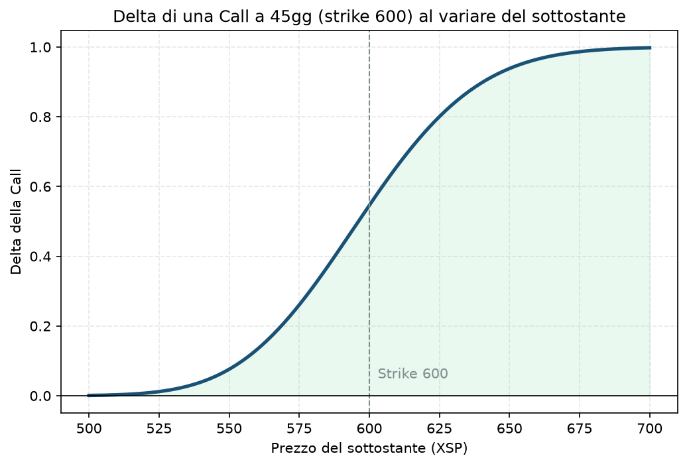

# 01. Delta

Definizione rapida già scritta in [Glossario — Delta](../GLOSSARIO.md): quanto si muove il prezzo dell'opzione rispetto al sottostante, e la sua doppia lettura come probabilità approssimata di scadere ITM. Qui approfondiamo il concetto e lo mettiamo in pratica su più fronti.

## Cos'è, in una frase

Il Delta ti dice, in soldoni: "se il sottostante si muove di 1 punto, quanto si muove il prezzo della mia opzione?". Una call con delta 0,55 guadagna circa 0,55 se il sottostante sale di 1 punto. Una put con delta −0,30 guadagna circa 0,30 se il sottostante scende di 1 punto (il segno meno è lì a ricordarti che le put vanno nella direzione opposta).

Va da 0 a 1 per le call, da −1 a 0 per le put. Un'opzione molto OTM ha delta vicino a 0 (si muove pochissimo, "non partecipa" al movimento). Un'opzione molto ITM ha delta vicino a 1 (o −1), e si comporta quasi come il sottostante stesso — è per questo che comprare una call deep ITM è, in pratica, un modo più economico di "avere" l'azione (è il principio dietro la [12 - Poor Man's Covered Call (PMCC)](12%20-%20Poor%20Man's%20Covered%20Call%20%28PMCC%29.md)).

## Perché conta soprattutto per chi vende opzioni

Nel tuo progetto vendi premio (spread di credito, cash-secured put, ecc.), quindi il Delta per te ha un ruolo doppio, non uno solo:

1. **Sizing del rischio direzionale.** Quando vendi una put a delta −0,15, stai dicendo "sono disposto a essere lungo circa 15 quote equivalenti del sottostante, con l'85% di probabilità stimata che quell'esposizione non si materializzi mai". Se ignori il delta e guardi solo il premio incassato, puoi ritrovarti con un'esposizione direzionale molto più grande di quanto pensassi.
2. **Scelta dello strike come proxy di probabilità.** È il motivo per cui il Piano usa "delta 10-20" per lo strike short invece di una distanza fissa in punti (vedi [Piano](../PIANO.md) §6): il delta si adatta da solo alla volatilità del momento. Una put a delta 15 con IV alta sarà molto più lontana in punti da una put a delta 15 con IV bassa — ed è giusto così, perché la probabilità stimata di essere toccati resta comparabile.

Se lo ignori: puoi finire per vendere strike che *sembrano* lontani in punti ma sono in realtà vicini in probabilità (regime di alta volatilità), oppure il contrario — vendere premio "sicuro" che in realtà è più vicino al sottostante di quanto pensassi.

## Il grafico

Call a 45 giorni, strike 600 (stile XSP), IV 16%. Nota tre cose:

- La curva è quasi piatta vicino agli estremi (molto OTM o molto ITM): lì il delta cambia poco al variare del sottostante.
- È più ripida vicino allo strike: è lì che il delta cambia più velocemente al muoversi del prezzo — quella ripidità è la **gamma** (vedi [02 - Gamma](02%20-%20Gamma.md)).
- A parità di strike, una call ATM non ha delta 0,50 esatto ma leggermente sopra (qui 0,55): l'asimmetria viene dal drift positivo atteso nel prezzo forward — un dettaglio tecnico, non serve ricordarlo a memoria, basta sapere che "0,50 esatto" è un'approssimazione, non un valore garantito.

## Esempio numerico concreto

Esempio didattico, numeri arrotondati, non quotazioni reali. XSP a 600, call ATM strike 600, 45 giorni a scadenza, IV 16%, tasso 4%:

- Delta ≈ **0,546**
- Se XSP sale da 600 a 601 (+1 punto), il prezzo della call sale di circa 0,546 (su un contratto XSP, che vale 100× il prezzo, sono circa 54,6$ di variazione sul singolo contratto)
- Se invece guardi una put venduta a delta −0,15 sullo stesso sottostante: XSP che scende di 3 punti ti fa perdere circa 0,45 sul premio incassato (3 × 0,15) — prima che il delta stesso cambi, perché sta cambiando anche lui (gamma)

## Errori comuni e pericoli di ignorarlo

- **Confondere delta della singola gamba con delta netto della struttura.** Uno spread di credito ha un delta che è la somma (con segno) delle due gambe — è più basso del delta della sola gamba venduta, perché la gamba comprata lo compensa in parte. Guardare solo la gamba venduta sovrastima il rischio direzionale reale, ma **sottostimarlo guardando solo il netto senza sapere come si comporrà quando il sottostante si muove è altrettanto pericoloso** — il delta netto di uno spread non è costante, cambia in modo diverso da quello di una singola opzione.
- **Trattare "delta 15" come garanzia,** non come stima. È una probabilità implicita nel prezzo, calcolata sotto ipotesi di modello — non è un dato storico verificato. In regimi di mercato anomali (codice violato dal Piano, tipo prima di un FOMC) il delta può sottostimare il vero rischio di coda.
- **Non ricalcolare il delta di portafoglio dopo aver aperto più posizioni.** Il Piano richiede di controllare le greche di portafoglio aggregate dopo ogni apertura (vedi [Piano](../PIANO.md) §5.2, e il caso pratico in Primo Trade §4) — sommare delta di strutture diverse, non solo controllarle una per una.

## Collegamenti nella guida

Il Delta è centrale per praticamente ogni strategia direzionale: [06 - Long Call](06%20-%20Long%20Call.md), [07 - Long Put](07%20-%20Long%20Put.md), [17 - Bull Put Spread](17%20-%20Bull%20Put%20Spread.md), [18 - Bear Call Spread](18%20-%20Bear%20Call%20Spread.md). È il protagonista assoluto di [33 - Delta Hedging](33%20-%20Delta%20Hedging.md), dove lo si usa attivamente per riportare un portafoglio a neutralità direzionale. Per capire perché cambia nel tempo e nello spazio, vedi [02 - Gamma](02%20-%20Gamma.md) (il "delta del delta").
