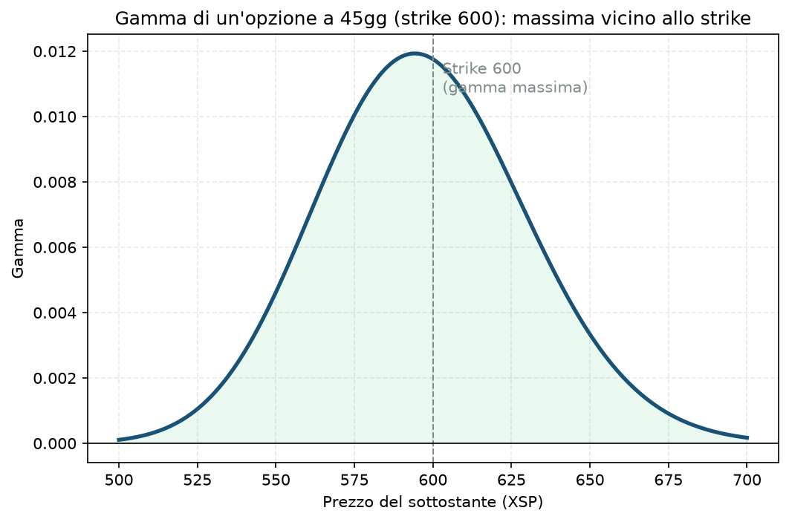

# 02. Gamma

## Cos'è, in una frase

Se il Delta ([01 - Delta](01%20-%20Delta.md)) ti dice "quanto si muove l'opzione", la Gamma ti dice "quanto velocemente cambia il Delta stesso". È l'accelerazione, non la velocità. Un'opzione con gamma alta ha un delta che cambia rapidamente al muoversi del sottostante — è instabile, nel senso buono o cattivo a seconda di che parte del trade sei.

Tecnicamente: Gamma = variazione del Delta per ogni punto di movimento del sottostante. Stessa per call e put allo stesso strike (a differenza del delta, che ha segno opposto).

## Perché conta soprattutto per chi vende opzioni

Qui la gamma è quasi più importante del delta stesso, e per un motivo specifico: **se vendi opzioni, sei strutturalmente short gamma.** Vuol dire che, quando il sottostante si muove contro di te, il tuo delta netto peggiora esattamente nella direzione sbagliata — più il prezzo si avvicina al tuo strike venduto, più velocemente la tua esposizione direzionale cresce contro di te. È l'opposto di chi compra opzioni (long gamma): a loro, il delta migliora sempre più velocemente a loro favore quando il mercato si muove nella direzione giusta.

Questo è il motivo tecnico per cui l'hedge di coda (le put OTM lunghe, bucket C del [Piano](../PIANO.md) §7) è *long gamma* — è lì apposta per compensare la gamma corta strutturale del core che vende premio.

Se lo ignori: puoi trovarti con una posizione che sembrava "sicura" (delta piccolo) diventare rapidamente molto direzionale proprio nei giorni finali prima della scadenza, quando la gamma esplode — è il classico scenario in cui un trader viene sorpreso da un movimento che "in teoria" non doveva fargli così male.

## Il grafico

Opzione a 45 giorni, strike 600, IV 16%. La gamma è a campana: quasi zero lontano dallo strike (l'opzione si muove poco e in modo stabile), massima esattamente vicino allo strike (lì il delta cambia più rapidamente). Nota che la forma della campana si restringe e si alza man mano che ci si avvicina alla scadenza — è per questo che la gamma "fa paura" soprattutto nell'ultima settimana di vita di un'opzione ATM.

## Esempio numerico concreto

Esempio didattico, numeri arrotondati. Call ATM strike 600, 45 giorni, IV 16%:

- Gamma ≈ **0,0118**
- Vuol dire: se XSP sale da 600 a 601, il delta della call passa da ~0,546 a circa 0,546 + 0,0118 ≈ **0,558**
- Se XSP continua a salire di un altro punto, il delta sale ancora, ma sempre di più (perché anche la gamma cambia, aumentando mano a mano che ci si avvicina, per poi ridursi quando l'opzione diventa molto ITM)
- Con 5 giorni alla scadenza invece di 45, la stessa opzione ATM avrebbe una gamma molto più alta (anche 3-4 volte tanto) — stesso strike, rischio "di velocità" completamente diverso

## Errori comuni e pericoli di ignorarla

- **Vendere spread molto vicini alla scadenza pensando "tanto il delta è basso".** Un delta basso oggi non garantisce che resti basso: con pochi giorni a scadenza, un movimento anche modesto del sottostante può far esplodere il delta di uno strike che sembrava tranquillo. È il motivo per cui il Piano preferisce la finestra 30-60 giorni per il core (Manuale §1.4/§2.3): fuori da lì la gamma diventa scomoda da gestire.
- **Sottovalutare il rischio nei giorni di scadenza (0DTE, weeklies molto vicine).** È il territorio dove la gamma è più estrema: piccoli movimenti generano oscillazioni enormi di P&L. Non è lo stile del tuo Piano, ma è utile sapere perché certi trader la evitano categoricamente per gli account piccoli.
- **Dimenticare che l'hedge di coda serve anche qui, non solo per la direzione.** Una put lunga OTM non è solo "assicurazione contro un crollo" in senso di prezzo — è anche ciò che ti tiene long gamma quando il resto del portafoglio è corto gamma, riducendo la velocità con cui un movimento avverso ti fa male.

## Collegamenti nella guida

Rilevante ovunque tu venda opzioni vicino al sottostante: [17 - Bull Put Spread](17%20-%20Bull%20Put%20Spread.md), [18 - Bear Call Spread](18%20-%20Bear%20Call%20Spread.md), [23 - Iron Condor](23%20-%20Iron%20Condor.md), [20 - Short Straddle](20%20-%20Short%20Straddle.md), [22 - Short Strangle](22%20-%20Short%20Strangle.md) (le short straddle/strangle sono le strutture più esposte alla gamma in assoluto, perché vendono ATM/vicino ATM su entrambi i lati). Per la gestione attiva del delta che la gamma continua a spostare, vedi [33 - Delta Hedging](33%20-%20Delta%20Hedging.md). Per il tempo, l'altro asse lungo cui la gamma cresce, vedi [03 - Theta](03%20-%20Theta.md).
