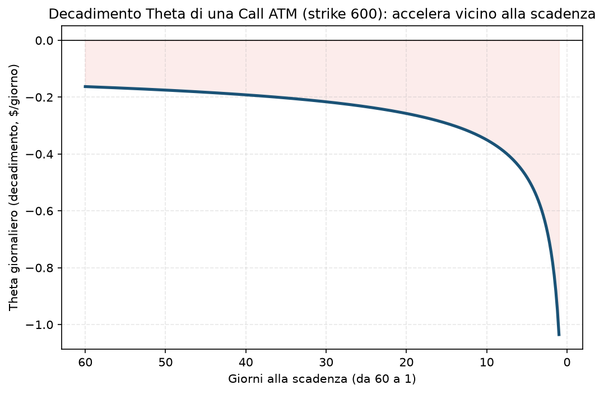

# 03. Theta

## Cos'è, in una frase

Theta è quanto valore perde un'opzione ogni giorno che passa, a parità di tutto il resto (sottostante fermo, volatilità implicita ferma). È il "costo dell'affitto del tempo" per chi compra opzioni, ed è il motore di guadagno per chi le vende — che è esattamente la posizione del tuo progetto.

Si esprime quasi sempre come numero giornaliero e negativo per chi è lungo l'opzione (perde valore ogni giorno) e positivo per chi l'ha venduta (guadagna quel valore ogni giorno, a parità di condizioni).

## Perché conta soprattutto per chi vende opzioni

Theta è, in un certo senso, *il* motivo per cui il tuo intero progetto esiste. Il Manuale lo dice fin dal principio (§1.1): non stai scommettendo sulla direzione, stai vendendo assicurazioni — e il premio che incassi è in buona parte proprio la remunerazione del tempo che passa. Se il sottostante non si muove, se la volatilità non cambia, uno spread venduto guadagna comunque, giorno dopo giorno, per puro effetto Theta.

Ma occhio: Theta positivo non è un pasto gratis. È la ricompensa per essere corto gamma ([02 - Gamma](02%20-%20Gamma.md)) — stai vendendo la possibilità che il sottostante si muova molto, in cambio di un flusso costante se non si muove. I due sono sempre in tensione: un trade che guadagna bene da Theta è quasi sempre lo stesso che perde velocemente se la gamma ti colpisce.

Se lo ignori (nel senso opposto, se compri opzioni senza pensarci): puoi avere ragione sulla direzione e perdere comunque soldi, perché il tempo che passa ha eroso il premio più velocemente di quanto il movimento del sottostante lo abbia fatto guadagnare.

## Il grafico

Call ATM, strike 600, IV 16%, dai 60 giorni alla scadenza fino a 1 giorno. Nota la forma: il decadimento è relativamente lento e costante nella parte lontana dalla scadenza, poi **accelera vistosamente** nelle ultime 1-2 settimane. È la ragione pratica, non solo teorica, per cui il Piano preferisce vendere premio nella finestra 30-60 giorni: è lì che il rapporto tra Theta guadagnato e Gamma subita è più favorevole a chi vende. Nell'ultima settimana il Theta è massimo (ottimo se sei venditore), ma lo è anche la Gamma (pessimo se sei venditore) — è un compromesso, non un pasto gratis nemmeno lì.

## Esempio numerico concreto

Esempio didattico, numeri arrotondati. Call ATM strike 600, 45 giorni, IV 16%:

- Theta ≈ **−0,183 al giorno** (per chi è lungo l'opzione; chi l'ha venduta lo legge come +0,183/giorno)
- Su un contratto XSP (100×), sono circa 18,3$ al giorno se hai venduto quella call da sola
- Su uno spread di credito (due gambe), il Theta netto è più basso della singola gamba venduta — la gamba comprata "toglie" parte del decadimento, ma anche parte del rischio, è lo scambio che fai comprando l'ala di protezione (vedi [17 - Bull Put Spread](17%20-%20Bull%20Put%20Spread.md))

## Errori comuni e pericoli di ignorarlo

- **Comprare opzioni a scadenza troppo vicina pensando di "risparmiare premio".** È l'errore classico del compratore alle prime armi: l'opzione costa meno, ma il Theta la sta mangiando molto più in fretta. Serve un movimento rapido e deciso per compensare, non basta avere ragione sulla direzione con calma.
- **Vendere Theta senza guardare la Gamma che ci sta dietro.** Un premio alto vicino alla scadenza sembra allettante, ma è il prezzo di un rischio di accelerazione molto più alto — vedi [02 - Gamma](02%20-%20Gamma.md).
- **Aspettarsi il Theta "teorico" in un giorno reale.** Il numero che vedi sul book (es. −0,18/giorno) presuppone che tutto il resto resti fermo. In pratica IV e sottostante si muovono ogni giorno, quindi il P&L giornaliero osservato raramente coincide esattamente col Theta teorico — è una media attesa, non una promessa quotidiana.
- **Dimenticare che il weekend "paga" comunque Theta ma senza rischio di mercato nel mezzo.** Alcuni trader aprono posizioni al venerdì apposta per incassare il decadimento del weekend senza esposizione a movimenti di prezzo nel frattempo — un dettaglio tattico, non una regola assoluta.

## Collegamenti nella guida

Theta è il motore di ogni strategia a credito: [17 - Bull Put Spread](17%20-%20Bull%20Put%20Spread.md), [18 - Bear Call Spread](18%20-%20Bear%20Call%20Spread.md), [23 - Iron Condor](23%20-%20Iron%20Condor.md), [24 - Iron Butterfly](24%20-%20Iron%20Butterfly.md), [10 - Covered Call](10%20-%20Covered%20Call.md), [11 - Cash-Secured Put (CSP)](11%20-%20Cash-Secured%20Put%20%28CSP%29.md). È invece un costo da gestire attivamente in [29 - Calendar Spread](29%20-%20Calendar%20Spread.md) e [30 - Diagonal Spread](30%20-%20Diagonal%20Spread.md), dove lo si sfrutta comprando e vendendo Theta su scadenze diverse nella stessa struttura. Vedi anche [34 - Take Profit e Stop Loss Meccanico](34%20-%20Take%20Profit%20e%20Stop%20Loss%20Meccanico.md) per capire quando "prendere" il Theta guadagnato invece di lasciarlo correre fino a scadenza.
