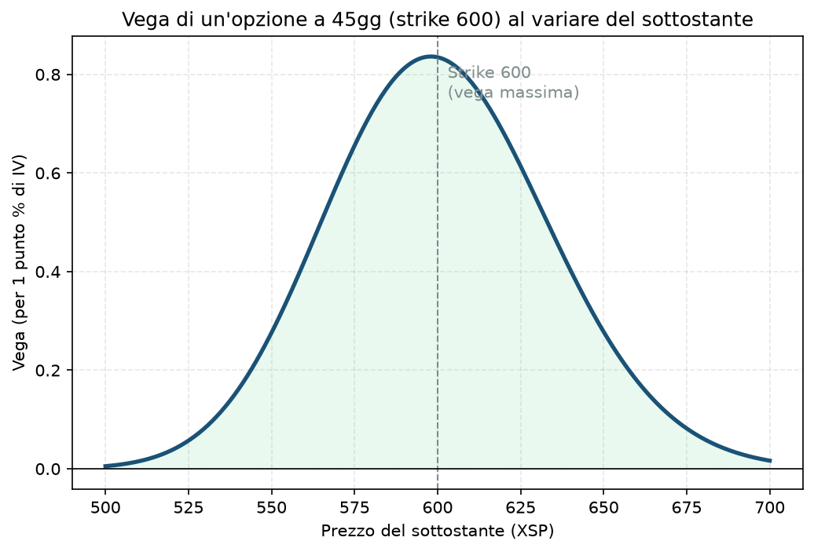

# 04. Vega

## Cos'è, in una frase

Vega ti dice quanto cambia il prezzo di un'opzione se la volatilità implicita (IV) cambia di un punto percentuale, a parità di tutto il resto. Non è in realtà una lettera greca (è il nome di una stella, la convenzione è un po' bizzarra), ma funziona esattamente come le altre: è una sensibilità.

Vega è sempre positiva per chi è lungo un'opzione (call o put, non importa: entrambe guadagnano se l'IV sale) e negativa per chi l'ha venduta.

## Perché conta soprattutto per chi vende opzioni

Qui Vega è il rischio "silenzioso" del tuo progetto. Puoi avere ragione su direzione (delta) e tempo (theta) e perdere comunque soldi se l'IV sale abbastanza — è esattamente lo scenario che il Piano chiama "regime di espansione" o "crisi" (§4), ed è il motivo per cui esiste tutto il bucket C (hedge) e il circuit breaker: entrambi esistono principalmente per gestire il rischio Vega, non il rischio Delta.

Il core del tuo progetto (spread di credito) è strutturalmente **short vega**: vende opzioni, quindi guadagna se l'IV scende o resta ferma, perde se l'IV sale — indipendentemente da dove va il prezzo. L'hedge (put OTM lunghe) è **long vega**, apposta per bilanciare. È per questo che nel Primo Trade §8.3 il portafoglio del primo giorno è risultato vega positivo: mancava ancora il core (short vega) a bilanciare l'hedge e i calendar (entrambi long vega).

Se lo ignori: puoi costruire un portafoglio che sembra ben diversificato per direzione ma è in realtà una scommessa nascosta e concentrata contro un'impennata di volatilità — è il rischio più pericoloso perché non si vede guardando solo il Delta.

## Il grafico

Stessa forma a campana della Gamma ([02 - Gamma](02%20-%20Gamma.md)): Vega è massima quando l'opzione è ATM, quasi zero quando è molto ITM o molto OTM. Motivo intuitivo: un'opzione già "decisa" (molto ITM o molto OTM) cambia poco se cambia l'incertezza sul futuro, mentre un'opzione ATM — dove tutto è ancora possibile — è quella che più beneficia (o soffre) di più o meno incertezza.

## Esempio numerico concreto

Esempio didattico, numeri arrotondati. Call ATM strike 600, 45 giorni, IV 16%:

- Vega ≈ **0,835** (per 1 punto percentuale di IV)
- Se l'IV sale da 16% a 20% (+4 punti, uno scenario da "regime di espansione" nel tuo Piano), il valore della call sale di circa 0,835 × 4 ≈ **3,34** — su un contratto XSP, circa 334$, senza che il sottostante si sia mosso di un centesimo
- Per chi ha venduto quella call, è una perdita non realizzata di pari importo — il motivo per cui un salto improvviso di VIX fa male anche a spread che erano "nella zona giusta" di prezzo

## Errori comuni e pericoli di ignorarlo

- **Guardare solo il Delta di portafoglio e dichiararlo "protetto".** Un portafoglio delta-neutro può essere fortemente esposto a Vega — è un rischio diverso, non sostituibile. Il Piano richiede esplicitamente il controllo della vega di portafoglio in aggregato (§5.2), non solo del delta.
- **Vendere premio proprio quando l'IV è già compressa (IV Rank basso).** Non è tanto un errore di Vega in sé, quanto di timing: vendere vega quando costa poco (IV bassa) offre poco compenso per il rischio che l'IV risalga. È il motivo per cui il Piano, in regime di compressione, sposta peso verso il bucket B invece di forzare il core (vedi il caso pratico in Primo Trade §2-3).
- **Essere corti vega proprio prima di un evento macro binario** (FOMC, BCE, CPI): è uno dei trigger espliciti che il Piano vieta per l'apertura di nuove posizioni a size piena (§6) — è successo davvero nella sessione del 16/09/2026 raccontata in Primo Trade §8.4, dove l'apertura del core è stata rimandata proprio per un FOMC nella stessa giornata.

## Collegamenti nella guida

Vega è il cuore di [19 - Long Straddle](19%20-%20Long%20Straddle.md) e [21 - Long Strangle](21%20-%20Long%20Strangle.md) (scommesse pure sull'aumento di volatilità), ed è il motivo per cui [20 - Short Straddle](20%20-%20Short%20Straddle.md) e [22 - Short Strangle](22%20-%20Short%20Strangle.md) sono le strutture più rischiose in caso di shock di volatilità. Nel tuo Piano è anche il motivo d'essere di [13 - Protective Put (Married Put)](13%20-%20Protective%20Put%20%28Married%20Put%29.md) e [14 - Collar](14%20-%20Collar.md) a livello di singola posizione, e del bucket C nel suo complesso.
