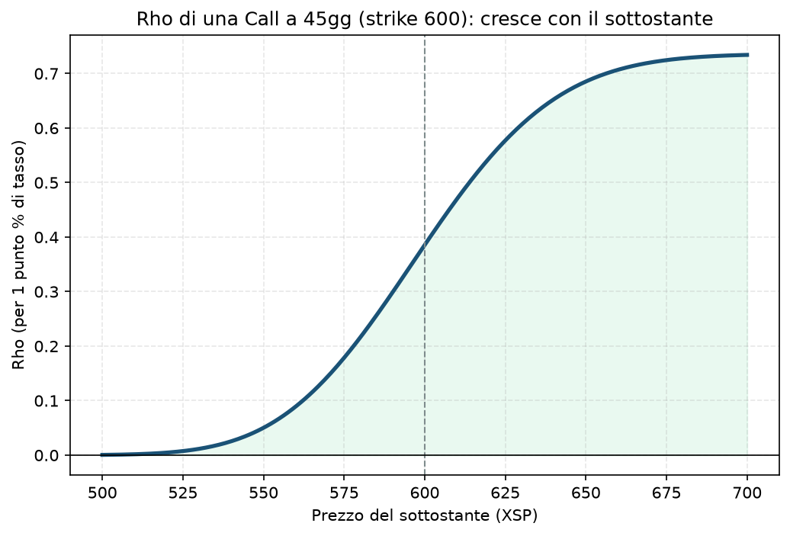

# 05. Rho

## Cos'è, in una frase

Rho ti dice quanto cambia il prezzo di un'opzione se i tassi d'interesse cambiano di un punto percentuale, a parità di tutto il resto. Delle cinque greche di questa guida è quella che, nella pratica quotidiana del tuo progetto, conta meno — ma vale la pena capirla per sapere quando (raramente) diventa rilevante.

Positiva per le call (un tasso più alto aumenta leggermente il valore di una call, per via del costo-opportunità di tenere il capitale invece del sottostante), negativa per le put.

## Perché conta (poco, ma non zero) per chi vende opzioni

Qui la sincerità aiuta più di qualunque tecnicismo: per un portafoglio come il tuo, con scadenze di 30-90 giorni, l'effetto Rho è quasi sempre trascurabile rispetto a Delta, Gamma, Theta e Vega. I tassi si muovono lentamente (variazioni tipiche di 0,25-0,50 punti per riunione di banca centrale), e su scadenze brevi l'impatto sul prezzo dell'opzione è piccolo.

Dove diventa rilevante: scadenze molto lunghe (LEAPS, come nella gamba lunga di una [12 - Poor Man's Covered Call (PMCC)](12%20-%20Poor%20Man's%20Covered%20Call%20%28PMCC%29.md)), oppure in periodi di forte incertezza sui tassi (come i cicli di rialzo aggressivo che il mercato ha vissuto in passato). In quei casi Rho smette di essere un dettaglio accademico.

Se lo ignori: nella stragrande maggioranza delle tue operazioni, non succede nulla di rilevante. Il rischio reale è l'opposto — perdere tempo a ottimizzare per Rho quando ci sono rischi molto più grandi (Vega, Gamma) che meritano l'attenzione.

## Il grafico

Call a 45 giorni, strike 600, IV 16%. A differenza di Gamma e Vega (a campana, massime ATM), Rho cresce in modo più graduale e monotono con il sottostante: più l'opzione è ITM, più si comporta "come il sottostante stesso", quindi più risente del costo del capitale nel tempo.

## Esempio numerico concreto

Esempio didattico, numeri arrotondati. Call ATM strike 600, 45 giorni, IV 16%, tasso 4%:

- Rho ≈ **0,386** (per 1 punto percentuale di tasso)
- Se la Fed alza i tassi dello 0,25% (un quarto di punto, il movimento tipico di una riunione FOMC), il valore della call si muove di circa 0,386 × 0,25 ≈ **0,097** — meno di 10 centesimi su un contratto XSP da 100×, un impatto minimo
- Confronta con lo stesso scenario per Vega ([04 - Vega](04%20-%20Vega.md)): un movimento di IV di 4 punti (plausibile in un giorno di stress) valeva 3,34 — trentacinque volte di più. È il motivo per cui Rho non è mai il primo pensiero quando si controlla il rischio di portafoglio.

## Errori comuni e pericoli di ignorarlo

- **Non è quasi mai un pericolo reale per il tuo tipo di portafoglio** — l'errore più comune è opposto: perdere tempo a studiarlo in dettaglio pensando che sia importante quanto le altre quattro greche. Non lo è, per scadenze brevi.
- **Attenzione se mai introdurrai LEAPS** (opzioni a 1-2 anni, come nella gamba lunga di una PMCC): lì Rho comincia a pesare, soprattutto in periodi di aspettative di rialzo o taglio tassi molto forti e rapide.
- **Un'eccezione da conoscere, non da temere ora:** in scenari di stress finanziario sistemico, i tassi possono muoversi rapidamente insieme alla volatilità (es. una crisi di fiducia che fa salire contemporaneamente VIX e rendimenti) — in quei casi Rho e Vega si muovono insieme e amplificano l'effetto totale, ma è comunque Vega a dominare il conto.

## Collegamenti nella guida

Rho è più rilevante nella gamba LEAPS di [12 - Poor Man's Covered Call (PMCC)](12%20-%20Poor%20Man's%20Covered%20Call%20%28PMCC%29.md) rispetto a qualunque altra strategia di questa guida. Per il resto del Piano (scadenze 30-90 giorni) è più una nota di completezza accademica che un rischio operativo — le greche che meritano davvero la tua attenzione quotidiana restano [01 - Delta](01%20-%20Delta.md), [02 - Gamma](02%20-%20Gamma.md), [03 - Theta](03%20-%20Theta.md) e [04 - Vega](04%20-%20Vega.md).
