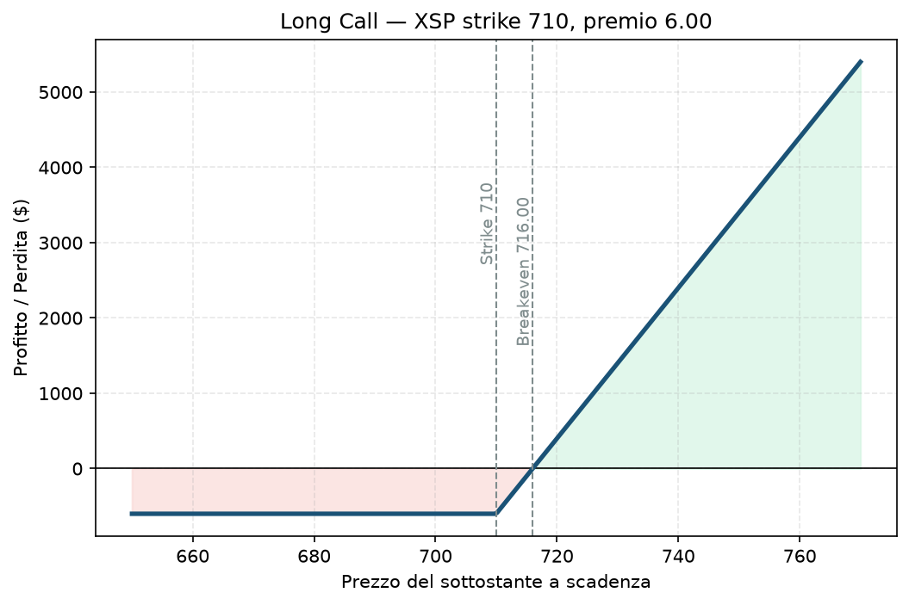

# 06. Long Call

Compri una Call. Punto. È la strategia più intuitiva di tutte, quella che chiunque immagina quando sente parlare di opzioni per la prima volta: "se penso che sale, compro il diritto di comprarlo a un prezzo fisso". Semplice da capire, ma — spoiler — è anche la strategia che fa perdere più soldi ai principianti, perché sembra economica e invece è una delle più difficili da far funzionare in modo sistematico. Vale la pena capire bene perché, visto che il progetto dell'utente è costruito quasi al contrario di questa logica (si vende premio, non si compra).

## Cos'è e come funziona

Compri il diritto (non l'obbligo) di acquistare il sottostante a un prezzo fisso (lo strike) entro una certa data. Paghi un premio per questo diritto. Se a scadenza il sottostante è sopra lo strike, eserciti (o più spesso rivendi l'opzione prima) e incassi la differenza. Se è sotto, l'opzione scade senza valore e perdi tutto il premio pagato — non un centesimo di più.

Una sola gamba: 1 Call comprata. Nient'altro.

**View:** rialzista, spesso molto rialzista — ti serve un movimento deciso, non un timido rialzo, perché devi prima "ripagarti" il premio.

## Il grafico payoff

Sotto lo strike (710 nell'esempio) l'opzione non vale nulla e perdi tutto il premio pagato — è una linea piatta orizzontale, la tua perdita non peggiora mai oltre quella cifra, per quanto il sottostante scenda. Sopra lo strike il profitto sale linearmente, un dollaro di sottostante in più è quasi un dollaro di profitto in più (quando l'opzione è ben dentro il denaro). Il breakeven è strike + premio pagato: è lì che il profitto diventa positivo, non allo strike stesso — un errore da principianti è pensare "se supera lo strike guadagno", ma finché non superi anche il costo del premio sei ancora in perdita.

## Esempio numerico concreto

*Esempio didattico, numeri arrotondati — non quotazioni reali.*

XSP quota 700. Compri 1 Call strike 710, scadenza 45 giorni, premio 6,00 → costo **600 $** (moltiplicatore 100).

- **Breakeven:** 716 (710 + 6)
- **Perdita massima:** 600 $ (tutto il premio, se XSP resta sotto 710 a scadenza)
- **Profitto:** se XSP arriva a 730, l'opzione vale almeno 20 punti (2.000 $) → profitto **1.400 $**, +233% sul capitale investito
- **Profitto illimitato** in teoria: più sale, più guadagni, senza un tetto

## Quando si usa (casi d'uso)

- Aspetti un catalizzatore preciso (earnings, notizia, evento macro) e vuoi un'esposizione rialzista con rischio definito e noto in anticipo.
- Vuoi leva senza usare margine: con 600 $ controlli un'esposizione equivalente a molte azioni.
- Alternativa a comprare il sottostante quando vuoi impegnare meno capitale e accetti di pagare un "premio" per quella comodità.

## Pericoli e cosa può andare storto

- **Il tempo lavora contro di te (Theta negativo):** ogni giorno che passa l'opzione perde valore anche se il sottostante non si muove. Puoi avere ragione sulla direzione e perdere comunque, se ci arrivi troppo tardi o troppo lentamente.
- **Serve un movimento vero, non un'opinione vaga:** molti principianti comprano Call "perché pensano salga" senza calcolare che serve superare il breakeven, non solo lo strike — un rialzo del 2% può non bastare.
- **Il rischio della volatilità implicita (Vega):** se compri prima di un evento (es. earnings) e l'evento passa senza sorprese, la IV crolla ("volatility crush") e l'opzione perde valore anche se il titolo si muove nella direzione giusta — un classico errore da principianti.
- **Esempio di come si perde:** compri la Call a 6,00, XSP sale a 705 (giusta direzione!) ma resta sotto strike a scadenza → perdi comunque tutti i 600 $.

## Capitale richiesto

Il costo è **il premio pagato, niente margine aggiuntivo** — è l'esposizione più semplice da dimensionare perché la perdita massima è nota e pagata subito. Nell'esempio, 600 $ su un capitale di 30.000 € (il capitale reale attuale del progetto dell'utente) sono circa il 2% del NAV — una size ragionevole per una singola scommessa direzionale, ma da tenere ben presente che se lo fai ripetutamente il conto delle perdite si accumula in fretta, visto quanto spesso le Long Call scadono senza valore.

## Legami con altre strategie

Specularmente ribassista: [07 - Long Put](07%20-%20Long%20Put.md). Il tuo controparte naturale sul mercato è chi vende: [08 - Short Call (Naked Call)](08%20-%20Short%20Call%20%28Naked%20Call%29.md). Per ridurre il costo (e il Theta negativo) rinunciando a parte del guadagno oltre un certo livello, guarda [15 - Bull Call Spread](15%20-%20Bull%20Call%20Spread.md). Per capire perché il tempo ti è nemico qui, leggi [03 - Theta](03%20-%20Theta.md); per capire la leva e la probabilità implicita nello strike scelto, [01 - Delta](01%20-%20Delta.md).
