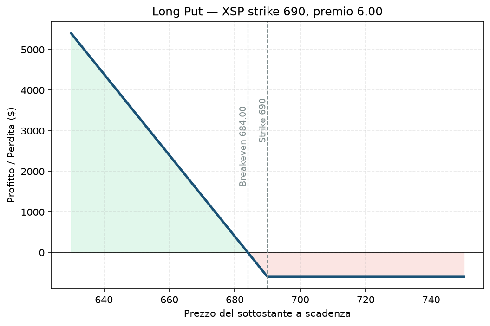

# 07. Long Put

Lo specchio della Long Call, ma con un ruolo doppio nel mondo reale: non serve solo a scommettere sui ribassi, è anche il mattoncino con cui si costruisce l'assicurazione di portafoglio — esattamente quello che l'utente usa come hedge di coda (bucket C) nel suo progetto, comprando put OTM su XSP ed ESTX50. Qui la vediamo nella sua forma "pura", come scommessa direzionale.

## Cos'è e come funziona

Compri il diritto di vendere il sottostante a un prezzo fisso (lo strike) entro la scadenza. Paghi un premio. Se a scadenza il sottostante è sotto lo strike, l'opzione vale la differenza. Se è sopra, scade senza valore e perdi il premio.

Una sola gamba: 1 Put comprata.

**View:** ribassista, o — nel caso dell'hedge di portafoglio — "voglio essere protetto se tutto va storto", anche senza una view direzionale attiva sul resto del portafoglio.

## Il grafico payoff

Sopra lo strike (690 nell'esempio) l'opzione non vale nulla, perdita massima = premio pagato, piatta. Sotto lo strike il profitto cresce linearmente man mano che il prezzo scende — ma non all'infinito come nella Call: il sottostante non può scendere sotto zero, quindi il profitto massimo teorico è comunque limitato (anche se enorme). Il breakeven è strike **meno** premio pagato.

## Esempio numerico concreto

*Esempio didattico, numeri arrotondati — non quotazioni reali.*

XSP quota 700. Compri 1 Put strike 690, scadenza 45 giorni, premio 6,00 → costo **600 $**.

- **Breakeven:** 684 (690 − 6)
- **Perdita massima:** 600 $ (se XSP resta sopra 690 a scadenza)
- **Profitto:** se XSP crolla a 660, l'opzione vale almeno 30 punti (3.000 $) → profitto **2.400 $**, +400%
- Questo è esattamente il meccanismo (a scadenze più lunghe, 90 giorni) dietro l'hedge XSP che il Piano tiene sempre attivo

## Quando si usa (casi d'uso)

- Scommessa diretta su un ribasso atteso (earnings negativo, deterioramento macro).
- **Protezione di portafoglio (il caso più importante nel contesto del progetto):** possiedi posizioni che soffrirebbero un crollo, e compri Put OTM lontane per limitare il danno — è il bucket C, l'hedge di coda "sempre attivo anche quando sembra inutile".
- Alternativa a vendere allo scoperto il sottostante: rischio limitato e noto, niente margine da mantenere indefinitamente.

## Pericoli e cosa può andare storto

- **Theta negativo, come la Call:** ogni giorno che passa senza movimento ti costa valore temporale. È il motivo per cui un hedge comprato "a caso" e lasciato lì troppo a lungo senza mai pagare si consuma lentamente — è un costo di gestione del rischio, non un investimento che deve rendere.
- **Serve un movimento sotto il breakeven, non solo sotto lo strike:** stesso errore da principianti della Long Call, specchiato.
- **Volatility crush:** se compri prima di un evento e l'esito è "nella norma", la IV scende e ti mangia parte del guadagno anche se il prezzo si muove un po' nella direzione giusta.
- **Esempio di come si perde:** compri la Put a 6,00, XSP scende a 692 (direzione giusta) ma resta sopra strike a scadenza → perdi comunque i 600 $.

## Capitale richiesto

Costo = premio pagato, nessun margine aggiuntivo. Nell'esempio, 600 $ su 30.000 € di capitale reale è circa il 2% del NAV. Per un hedge di portafoglio (non una scommessa speculativa) il Piano dedica un budget annuo ben preciso al bucket C — un dettaglio operativo che trovi in `Piano.md`, non ripetuto qui per evitare duplicazioni.

## Legami con altre strategie

Specularmente rialzista: [06 - Long Call](06%20-%20Long%20Call.md). La controparte che vende questa protezione: [09 - Short Put (Naked Put)](09%20-%20Short%20Put%20%28Naked%20Put%29.md). Per ridurre il costo rinunciando a parte del guadagno oltre un certo livello di ribasso, guarda [16 - Bear Put Spread](16%20-%20Bear%20Put%20Spread.md). Come componente di protezione di un portafoglio più ampio, si collega direttamente a [14 - Collar](14%20-%20Collar.md) e a [13 - Protective Put (Married Put)](13%20-%20Protective%20Put%20%28Married%20Put%29.md).
