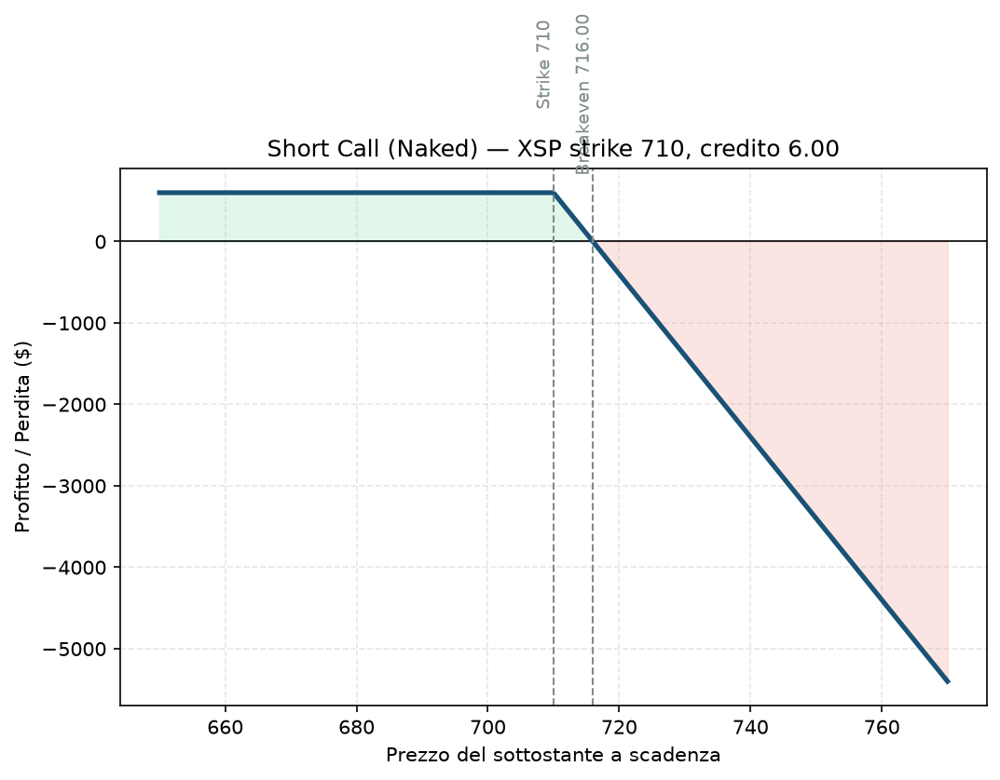

# 08. Short Call (Naked Call)

Qui cambiamo completamente registro: non compri più protezione o leva, vendi. Incassi subito un premio e speri che non succeda nulla (o che il mercato scenda/resti fermo). È la prima delle due strategie "nude" della guida, ed è probabilmente la più pericolosa delle 34 — motivo per cui nel piano dell'utente è esplicitamente esclusa (§7.1: "solo rischio definito, mai naked"). La spieghiamo comunque per intero perché capire *perché* fa così paura è formativo quanto sapere come funziona.

## Cos'è e come funziona

Vendi (scrivi) una Call senza possedere il sottostante a copertura. Incassi il premio subito. Se a scadenza il sottostante è sotto lo strike, l'opzione scade senza valore e tieni tutto il premio — hai vinto. Se è sopra, devi consegnare il sottostante allo strike (o ricomprare l'opzione a un prezzo molto più alto di quanto l'hai venduta) e la perdita cresce linearmente, senza un tetto teorico.

Una sola gamba: 1 Call venduta, nessuna copertura.

**View:** ribassista o neutrale — vuoi che il sottostante resti sotto lo strike, il tuo migliore amico è che non succeda nulla.

## Il grafico payoff

Esattamente l'immagine speculare della Long Call vista da [06 - Long Call](06%20-%20Long%20Call.md) — dove uno guadagna, l'altro perde, dollaro per dollaro. Sotto lo strike il profitto è piatto e pari al premio incassato (il massimo che potrai mai guadagnare). Sopra lo strike la perdita cresce senza limite apparente man mano che il sottostante sale — nel grafico si vede benissimo quanto velocemente la linea scenda sotto zero rispetto a quanto lentamente sale sopra: è la firma visiva del rischio asimmetrico.

## Esempio numerico concreto

*Esempio didattico, numeri arrotondati — non quotazioni reali.*

XSP quota 700. Vendi 1 Call strike 710, scadenza 45 giorni, incassi premio 6,00 → credito **600 $**.

- **Breakeven:** 716 (710 + 6)
- **Profitto massimo:** 600 $ (l'intero credito, se XSP resta sotto 710)
- **Perdita se XSP arriva a 750:** intrinseco 40 punti (4.000 $) meno il credito incassato → **−3.400 $**, cioè 5,6 volte il premio incassato
- **Non c'è un tetto:** se XSP (teoricamente) raddoppiasse, la perdita raddoppierebbe di conseguenza

## Quando si usa (casi d'uso)

Onestamente: quasi mai da sola, se fai gestione del rischio seria. I casi in cui compare nella pratica:
- Come **gamba di una struttura più ampia** (una Bear Call Spread la "copre" comprando una Call più lontana — vedi [18 - Bear Call Spread](18%20-%20Bear%20Call%20Spread.md) — trasformandola in rischio definito).
- Trader esperti con capitale molto ampio e sistemi di margine sofisticati, che la usano su indici molto liquidi accettando consapevolmente il rischio di coda.
- Come "copertura" implicita quando possiedi già il sottostante (a quel punto si chiama Covered Call, non più naked — vedi [10 - Covered Call](10%20-%20Covered%20Call.md), rischio completamente diverso).

## Pericoli e cosa può andare storto

- **Rischio illimitato, punto.** Non è un modo di dire: se il sottostante fa un gap del 30% al rialzo per una notizia overnight, nessuno stop ti salva, perché non hai la possibilità di chiudere prima che il danno sia fatto.
- **Margine che esplode in crisi:** il broker richiede margine variabile in base al rischio percepito — in un mercato che sale violentemente, il margine richiesto sale insieme alla perdita, un doppio colpo.
- **Assegnazione anticipata:** se l'opzione va molto ITM (specialmente su titoli con dividendi), puoi essere assegnato prima della scadenza, con conseguenze operative impreviste.
- **L'errore classico da principianti:** vendere Call "tanto non sale mai così tanto" — è esattamente il ragionamento che precede ogni blow-up di conto che si legge nelle storie di trading finite male. Un singolo evento avverso può cancellare mesi di premi incassati con calma.

## Capitale richiesto

Qui la parola "capitale richiesto" è ingannevole: il margine iniziale richiesto dal broker (calcolo SPAN o simile) può sembrare gestibile, ma **non è un tetto**, è solo una stima basata su scenari "normali" — può crescere rapidamente in una crisi, fino a costringerti a chiudere in perdita per mancanza di margine (margin call) nel momento peggiore possibile. Per questo genere di esposizione non ha senso ragionare in % di NAV come per le altre strategie: il rischio reale non è quantificabile in anticipo con la stessa precisione di uno spread a rischio definito.

## Legami con altre strategie

Aggiungendo una Call comprata più lontana come protezione, diventa [18 - Bear Call Spread](18%20-%20Bear%20Call%20Spread.md) — la versione "a rischio definito" di questa stessa idea, ed è quella effettivamente usata nel core del piano dell'utente. Lo specchio ribassista è [09 - Short Put (Naked Put)](09%20-%20Short%20Put%20%28Naked%20Put%29.md). Se possiedi già il sottostante, la stessa vendita di Call diventa [10 - Covered Call](10%20-%20Covered%20Call.md), con un profilo di rischio completamente diverso.
