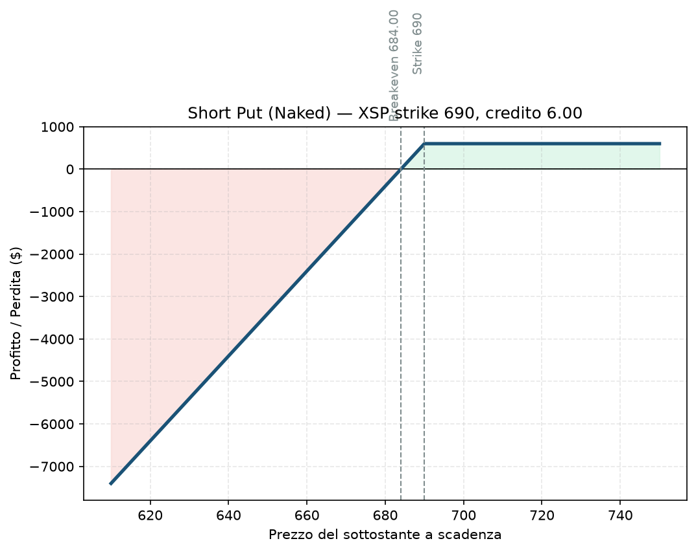

# 09. Short Put (Naked Put)

La sorella "gestibile" della Short Call — non ha un rischio teoricamente infinito (il sottostante non può scendere sotto zero), ma può fare comunque molto male. È anche la base concettuale della Cash-Secured Put ([11 - Cash-Secured Put (CSP)](11%20-%20Cash-Secured%20Put%20%28CSP%29.md)): stessa struttura, diversa gestione del margine/capitale a copertura.

## Cos'è e come funziona

Vendi (scrivi) una Put senza avere una posizione a copertura. Incassi il premio subito. Se a scadenza il sottostante è sopra lo strike, l'opzione scade senza valore e tieni tutto il premio. Se è sotto, sei obbligato a comprare il sottostante allo strike (o a chiudere in perdita prima) — e la perdita cresce man mano che il prezzo scende, fino al limite teorico di "il sottostante arriva a zero".

Una sola gamba: 1 Put venduta.

**View:** rialzista o neutrale — vuoi che il sottostante resti sopra lo strike.

## Il grafico payoff

Speculare alla Long Put di [07 - Long Put](07%20-%20Long%20Put.md). Sopra lo strike, profitto piatto pari al premio incassato. Sotto lo strike, la perdita cresce linearmente man mano che il sottostante scende — non ha un tetto "matematico" ma ha un limite pratico: nel peggiore dei casi il sottostante vale zero, quindi la perdita massima teorica è nota (anche se enorme e improbabile).

## Esempio numerico concreto

*Esempio didattico, numeri arrotondati — non quotazioni reali.*

XSP quota 700. Vendi 1 Put strike 690, scadenza 45 giorni, incassi premio 6,00 → credito **600 $**.

- **Breakeven:** 684 (690 − 6)
- **Profitto massimo:** 600 $ (l'intero credito, se XSP resta sopra 690)
- **Perdita se XSP crolla a 650:** intrinseco 40 punti (4.000 $) meno il credito incassato → **−3.400 $**
- **Perdita teorica massima:** se XSP andasse a zero (scenario di scuola, non realistico su un indice), sarebbe (690 × 100) − 600 = **68.400 $** — un numero enorme rispetto al premio incassato, utile proprio per capire visivamente quanto sia sproporzionato il rischio rispetto al guadagno potenziale

## Quando si usa (casi d'uso)

- **Accumulo azionario a sconto:** su un singolo titolo che vorresti comprare comunque, vendere una Put nuda equivale a dire "se scende fino a lì, lo compro volentieri, e nel frattempo incasso un premio" — è l'idea dietro la Cash-Secured Put.
- Su indici, quasi mai da sola in un piano di gestione del rischio serio (il Piano la esclude esplicitamente, §7.1).
- Come componente di strutture più ampie: aggiungendo una Put comprata più lontana diventa una Bull Put Spread ([17 - Bull Put Spread](17%20-%20Bull%20Put%20Spread.md)), la versione a rischio definito.

## Pericoli e cosa può andare storto

- **Il rischio non è "piccolo" solo perché è limitato:** su un titolo o un indice, una perdita del 30-40% dello strike è comunque devastante per un conto non dimensionato correttamente.
- **Assegnazione anticipata:** puoi ritrovarti a possedere il sottostante prima della scadenza, con un esborso di capitale improvviso che magari non avevi pianificato per quel momento.
- **Gap improvviso (weekend, notizia overnight):** nessuno stop protegge da un salto di prezzo che scavalca completamente lo strike durante la notte — lo stress test S4 del piano dell'utente esiste apposta per pensare a questo scenario.
- **Errore classico:** vendere Put "tanto quel titolo/indice non crolla mai così" proprio nei momenti di massima euforia di mercato — quando i premi sono più bassi e il rischio di un'inversione è più alto, non più basso.

## Capitale richiesto

Se davvero "nuda" (senza mettere da parte la liquidità per l'eventuale acquisto), il margine richiesto dal broker è comunque significativo e variabile — stesso discorso della Short Call: non è un tetto fisso, cresce con il rischio percepito dal mercato. Se invece accantoni tutta la liquidità necessaria per comprare il sottostante allo strike, la struttura è identica ma cambia nome e gestione: è la Cash-Secured Put, vedi [11 - Cash-Secured Put (CSP)](11%20-%20Cash-Secured%20Put%20%28CSP%29.md) per il dettaglio del capitale richiesto lì.

## Legami con altre strategie

Versione "coperta in liquidità": [11 - Cash-Secured Put (CSP)](11%20-%20Cash-Secured%20Put%20%28CSP%29.md). Aggiungendo una Put comprata più lontana per definire il rischio, diventa [17 - Bull Put Spread](17%20-%20Bull%20Put%20Spread.md) — è esattamente lo strumento core del piano dell'utente. Lo specchio ribassista è [08 - Short Call (Naked Call)](08%20-%20Short%20Call%20%28Naked%20Call%29.md).
