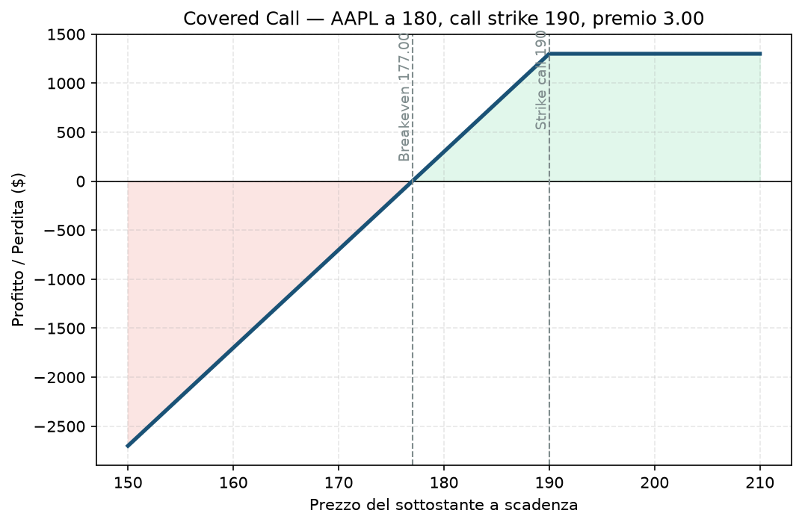

# 10. Covered Call

Probabilmente la prima strategia con le opzioni che chiunque impara, perché è quella con cui è più difficile farsi davvero male: possiedi già le azioni, quindi vendere una Call sopra non ti espone a un rischio nuovo, ti fa solo "regalare" il rialzo oltre un certo livello in cambio di un premio subito. Il rischio non è nella Call — è già tutto nell'azione che possiedi.

## Cos'è e come funziona

Possiedi 100 azioni del sottostante e vendi 1 Call OTM contro di esse. Incassi il premio. Se a scadenza il titolo è sotto lo strike, tieni le azioni e il premio, e puoi ripetere il mese dopo. Se è sopra, le azioni ti vengono "chiamate via" (assegnazione) allo strike — vendi a un prezzo che avevi già accettato in anticipo, più il premio incassato.

Due componenti: 100 azioni possedute + 1 Call venduta OTM.

**View:** moderatamente rialzista o neutrale — va bene anche se il titolo resta fermo, il premio lo incassi comunque.

## Il grafico payoff

Sopra lo strike (190 nell'esempio) il profitto si appiattisce: hai rinunciato a tutto il rialzo oltre quel livello in cambio del premio già incassato — è il "tetto" caratteristico di questa strategia. Sotto lo strike, il profilo segue esattamente quello delle azioni possedute, semplicemente traslato in alto del valore del premio incassato: il premio riduce il tuo breakeven rispetto a possedere solo le azioni, offrendo un piccolo cuscinetto contro un calo moderato.

## Esempio numerico concreto

*Esempio didattico, numeri arrotondati — non quotazioni reali.*

Possiedi 100 azioni Apple (AAPL) comprate a 180 $ (costo 18.000 $). Vendi 1 Call strike 190, scadenza 30 giorni, incassi premio 3,00 → credito **300 $**.

- **Breakeven:** 177 (180 − 3), più basso del semplice possesso azionario
- **Profitto massimo:** (190 − 180 + 3) × 100 = **1.300 $**, se AAPL chiude sopra 190 a scadenza — un ROI del 7,2% sul capitale in azioni, in 30 giorni
- **Se AAPL resta a 182:** tieni le azioni, tieni il premio, profitto **500 $** (200 $ di rialzo azioni + 300 $ di premio), pronto a vendere un'altra Call il mese dopo
- **Se AAPL crolla a 150:** perdita sulle azioni −3.000 $, parzialmente attutita dai 300 $ di premio → **−2.700 $** netti — il premio aiuta, ma non ti salva da un vero crollo

## Quando si usa (casi d'uso)

- Possiedi già un titolo che pensi resterà stabile o salirà moderatamente nel breve, e vuoi "affittarlo" per un reddito extra mentre aspetti.
- Strategia classica di accumulo/reddito su un portafoglio azionario di lungo periodo (buy-and-hold + Covered Call sistematica, mese dopo mese).
- Vuoi ridurre il tuo breakeven su una posizione già aperta, accettando di limitare il rialzo.

## Pericoli e cosa può andare storto

- **Il rischio vero è quello delle azioni, non della Call:** un crollo del sottostante fa perdere molto più del premio incassato — la Call non è un'assicurazione, riduce solo marginalmente il danno.
- **Ti "perdi" i grandi rialzi:** se il titolo esplode (acquisizione, notizia clamorosa), il tuo profitto è tappato allo strike — è il classico rimpianto di chi vende Covered Call sistematicamente su titoli volatili.
- **Assegnazione anticipata su titoli con dividendi:** se c'è uno stacco dividendo imminente e la Call è ITM, puoi essere assegnato prima del previsto, perdendo il dividendo che ti aspettavi.
- **Errore comune da principianti:** scegliere uno strike troppo vicino "per incassare più premio", finendo per farsi chiamare via le azioni troppo spesso e rincorrere il prezzo in salita per rientrare in posizione.

## Capitale richiesto

Il grosso del capitale è nelle **azioni possedute**, non nell'opzione: nell'esempio, 18.000 $ per 100 azioni Apple — su un capitale di esempio di 30.000 € sarebbe circa il 60% del NAV concentrato in un solo titolo, decisamente sopra i limiti di concentrazione che il suo piano applica ai singoli strumenti (§3). È il motivo per cui la Covered Call "pura" è più adatta a un portafoglio azionario di lungo periodo con posizioni già diversificate, non a un capitale dedicato interamente alla vendita di premio come quello di questo progetto.

## Legami con altre strategie

Versione a capitale ridotto (compri un'opzione lunga invece delle azioni vere): [12 - Poor Man's Covered Call (PMCC)](12%20-%20Poor%20Man's%20Covered%20Call%20%28PMCC%29.md). Aggiungendo anche una Put comprata a protezione del ribasso, diventa un [14 - Collar](14%20-%20Collar.md). La struttura "gemella" senza possedere azioni, dove il rischio al ribasso è sul tuo capitale liquido invece che sul titolo: [11 - Cash-Secured Put (CSP)](11%20-%20Cash-Secured%20Put%20%28CSP%29.md).
