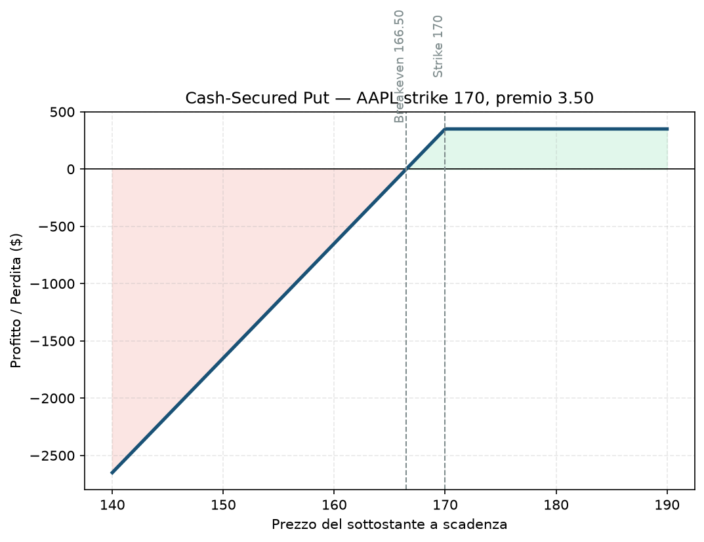

# 11. Cash-Secured Put (CSP)

Stessa identica struttura della Short Put nuda ([09 - Short Put (Naked Put)](09%20-%20Short%20Put%20%28Naked%20Put%29.md)), ma con una differenza di disciplina che cambia tutto: qui tieni da parte, in contanti, tutto il capitale necessario per comprare il sottostante se vieni assegnato. Non è più "nuda", è coperta — e questo la rende una delle strategie di reddito più popolari tra i trader retail, perché ha una logica facile da spiegare: "vengo pagato per aspettare di comprare a un prezzo che mi andrebbe bene comunque".

## Cos'è e come funziona

Vendi una Put OTM su un titolo che saresti felice di possedere, e metti da parte in contanti l'intero controvalore necessario per comprare 100 azioni allo strike (non un margine ridotto: il 100% del capitale). Incassi il premio subito. Se il titolo resta sopra lo strike, tieni il premio e nient'altro succede. Se scende sotto, ti viene assegnato — compri le azioni allo strike, usando la liquidità già accantonata, con un costo effettivo pari a strike meno premio incassato.

Una gamba (la Put venduta) + capitale accantonato a copertura.

**View:** rialzista o neutrale, con la disponibilità psicologica ad accettare "sì, va bene anche se mi tocca comprare".

## Il grafico payoff

Identico, matematicamente, al payoff della Short Put nuda — la differenza tra le due non si vede nel grafico P&L, si vede in come è gestito il capitale a copertura (vedi sotto). Sopra lo strike, profitto piatto pari al premio. Sotto, la perdita (sulla carta) cresce linearmente, ma qui "perdita" è un termine un po' fuorviante: stai solo comprando azioni a un prezzo più alto di quello di mercato in quel momento, non stai subendo un margin call.

## Esempio numerico concreto

*Esempio didattico, numeri arrotondati — non quotazioni reali.*

Vuoi comprare Apple (AAPL), che quota 180 $, ma solo se scende un po'. Vendi 1 Put strike 170, scadenza 30 giorni, incassi premio 3,50 → credito **350 $**. Accantoni **17.000 $** in contanti (170 × 100), il costo pieno se assegnato.

- **Breakeven:** 166,50 (170 − 3,50)
- **Se AAPL resta sopra 170:** tieni il premio, **350 $**, ROI del 2,06% sul capitale accantonato in 30 giorni (circa 25% annualizzato, semplificando)
- **Se AAPL scende a 165 e vieni assegnato:** compri 100 azioni a 170, costo effettivo netto 166,50 per azione (grazie al premio incassato) — 3,50 $ meglio del prezzo di mercato del momento in cui hai deciso di comprare
- **Se AAPL crolla a 130:** possiedi comunque le azioni al costo netto di 166,50, con una perdita non realizzata di 36,50 per azione finché non le rivendi — qui il rischio reale si manifesta

## Quando si usa (casi d'uso)

- **Accumulo azionario disciplinato:** hai una lista di titoli che vorresti comprare "se scendono un po'", e la CSP ti paga per aspettare invece di mettere un semplice ordine limite.
- Genera reddito su liquidità che altrimenti resterebbe ferma, su titoli/indici che conosci bene.
- Punto di partenza concettuale per costruire poi una Covered Call sulle azioni assegnate — la combinazione ciclica "wheel strategy" (vendi Put, se assegnato vendi Call sulle azioni, ripeti) è una delle evoluzioni naturali di questa strategia, anche se non è tra i 34 moduli di questa guida.

## Pericoli e cosa può andare storto

- **Non è "gratis": il capitale resta bloccato** per tutta la durata dell'opzione, anche se il rendimento annualizzato sembra allettante — è capitale che non stai usando altrove.
- **Puoi ritrovarti a possedere un titolo in caduta libera:** la disciplina "va bene comunque, lo volevo comprare" regge finché il crollo è moderato — su un crollo del 40-50% la storia cambia, e il "sarei stato felice di comprarlo" spesso non è più vero quanto sembrava.
- **Concentrazione:** vendere CSP ripetutamente sullo stesso titolo, con size crescente per "recuperare", è un errore classico che espone tutto il portafoglio a un singolo nome.
- **Errore da principianti:** scegliere lo strike troppo vicino al prezzo attuale "per il premio più alto" invece che al livello dove davvero si vorrebbe comprare — trasforma una strategia di accumulo disciplinato in una scommessa short-term travestita.

## Capitale richiesto

Qui il capitale richiesto è **esplicito e importante: l'intero controvalore delle azioni**, non un margine ridotto. Nell'esempio, 17.000 $ su un capitale di 30.000 € del progetto — oltre metà del NAV bloccato in una singola posizione, ben oltre i limiti di concentrazione per singolo strumento che il Piano applica (§3, buying power ≤5% NAV per posizione nel core). È il motivo per cui la CSP "vera" (con capitale pieno accantonato) è più adatta a un portafoglio azionario a parte, non al capitale dedicato agli spread a rischio definito di questo progetto.

## Legami con altre strategie

Versione senza il capitale accantonato (più rischiosa, meno disciplinata): [09 - Short Put (Naked Put)](09%20-%20Short%20Put%20%28Naked%20Put%29.md). Se combinata ciclicamente con la vendita di Call sulle azioni eventualmente assegnate, si collega a [10 - Covered Call](10%20-%20Covered%20Call.md). Per la stessa idea di reddito da vendita di premio ma a rischio (e capitale) definito fin dall'apertura, guarda [17 - Bull Put Spread](17%20-%20Bull%20Put%20Spread.md) — è la struttura che il Piano usa davvero, proprio per evitare il capitale bloccato che la CSP richiede.
