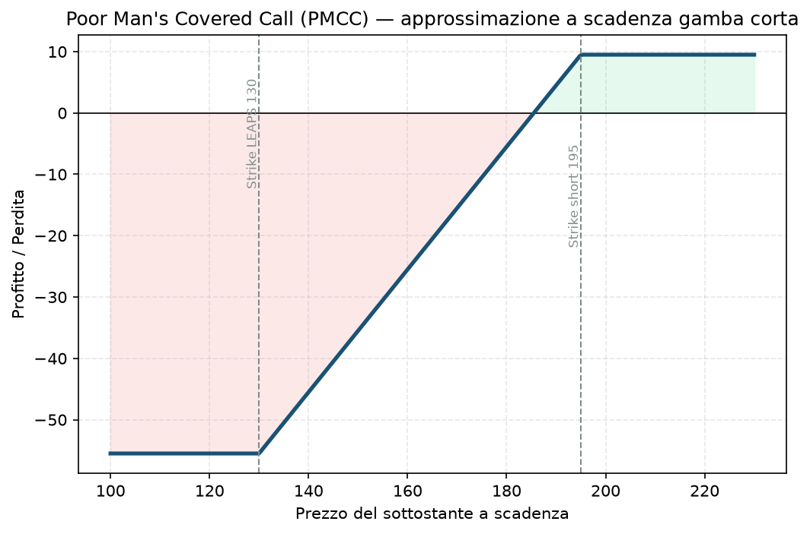

# 12. Poor Man's Covered Call (PMCC)

Il nome dice già tutto: è la Covered Call per chi non ha i soldi (o non vuole immobilizzarli) per comprare 100 azioni vere. Invece di possedere il titolo, compri un'opzione che si comporta *quasi* come il titolo — e poi ci vendi sopra le call come faresti con le azioni vere. Stessa logica di [10 - Covered Call](10%20-%20Covered%20Call.md), capitale molto più basso.

## Cos'è e come funziona

Due gambe, entrambe call, stessa sottostante, scadenze diverse:

1. **Compri 1 call molto ITM (deep in-the-money) a scadenza lunghissima** — parliamo di LEAPS, acronimo per Long-term Equity AnticiPation Securities, cioè opzioni con scadenza tipicamente tra 6 e 24 mesi (a volte anche di più). Vuoi uno strike ben sotto il prezzo attuale, con un **delta alto, indicativamente 0.70-0.80** ([01 - Delta](01%20-%20Delta.md) per il ripasso). Perché il delta alto? Perché più il delta si avvicina a 1, più l'opzione si muove punto a punto come farebbe l'azione — è quello il senso di "sostituire" le 100 azioni.
2. **Vendi 1 call OTM a scadenza corta** (le solite 30-45 giorni che usi nel core del tuo Piano) — esattamente come la call che venderesti sopra un pacchetto di azioni vere in una Covered Call classica.

Il LEAPS fa da "sottostante sintetico": lo tieni per mesi, e ogni 30-45 giorni ci vendi sopra una call corta, incassi premio, la lasci scadere o la richiudi, e ne vendi un'altra. È lo stesso ciclo della Covered Call, ripetuto sulla stessa "azione finta" molte volte prima che il LEAPS stesso scada.

## Il grafico payoff

Il grafico che vedi è una **semplificazione didattica**, e va capita bene prima di fidarsene: mostra il P&L calcolato *come se* il LEAPS scadesse lo stesso giorno della call corta. Nella realtà non è così — il LEAPS ha ancora mesi di vita quando la call corta scade, quindi conserva valore temporale che il grafico non cattura. Il vero P&L a quella data sarebbe leggermente migliore di quanto disegnato (il LEAPS vale più della sua sola parte intrinseca). Il grafico resta comunque utile per capire la forma generale: profitto capped sopra lo strike corto, perdita capped (al debito netto pagato) se il titolo crolla.

- **Zona di profitto:** tra il breakeven e lo strike della call corta, poi piatta.
- **Perdita massima (approssimata):** il debito netto pagato per il LEAPS meno i premi incassati dalle call corte vendute nel tempo — nel grafico, se il titolo va a picco sotto lo strike del LEAPS.

## Esempio numerico concreto

Esempio didattico, numeri arrotondati, non quotazioni reali verificate. Titolo Apple (AAPL), prezzo attuale ~180$.

- **Compri 1 LEAPS Call strike 130, scadenza tra 18 mesi**, premio 58$ → costo 5.800$ (delta stimato ~0.80: si muove quasi come l'azione).
- **Vendi 1 Call strike 195, scadenza 35 giorni**, premio incassato 2,50$ → 250$.
- **Debito netto della prima gamba corta:** 58 − 2,50 = 55,50$ → 5.550$.

Se a scadenza della call corta AAPL è a 195$ o sopra (approssimazione a scadenza simultanea):
- **Profitto massimo ≈** (195 − 130) − 55,50 = 9,50$ → **950$**
- **ROI sulla gamba:** 950 / 5.550 ≈ **17%** in 35 giorni (sul capitale impegnato per il LEAPS, non sul totale conto)

Se AAPL crolla sotto 130$ prima della scadenza del LEAPS, la perdita massima teorica è il debito netto pagato per il LEAPS (5.800$ meno tutti i premi delle call corte incassate fino a quel momento) — molto meno del rischio di possedere 100 azioni vere (che varrebbero 18.000$ e potrebbero, in teoria, andare a zero).

## Quando si usa (casi d'uso)

- Vuoi la stessa meccanica di reddito della Covered Call su un titolo che ti piace, ma **non hai (o non vuoi immobilizzare) 15-20.000$** per comprare 100 azioni vere.
- Sei moderatamente rialzista sul titolo nel lungo periodo (il LEAPS ha bisogno di tempo e di una direzione complessivamente non ribassista per rendere).
- Vuoi diversificare su più titoli con lo stesso capitale che basterebbe per una sola Covered Call tradizionale.

## Pericoli e cosa può andare storto

- **Il LEAPS perde valore temporale più lentamente delle call corte, ma non è immune al decadimento** — se il titolo resta fermo per mesi, anche il LEAPS erode valore, solo più lentamente.
- **Rischio di "diagonal risk":** se il titolo sale troppo e troppo in fretta, la call corta va ITM prima che tu voglia, e potresti essere costretto a chiuderla o a farti assegnare — con meno flessibilità di quanta ne avresti con azioni vere (che semplicemente consegni se assegnato).
- **Se il titolo crolla, il LEAPS perde delta** (si "deitmizza") e smette di comportarsi come 100 azioni — la copertura sintetica si rompe proprio quando ne avresti più bisogno.
- **Liquidità:** i LEAPS deep ITM su titoli poco scambiati hanno spesso bid-ask larghi — verifica sempre lo spread prima di entrare (stesso principio di liquidità che segui nel tuo Piano per gli spread, §3).
- **Errore da principianti:** comprare un LEAPS con delta troppo basso (es. 0.50) pensando di risparmiare — a quel punto non replica più bene l'azione e il PMCC smette di comportarsi come una Covered Call.

## Capitale richiesto

Qui sta il vero vantaggio della PMCC: **5.550$ di debito netto contro i ~18.000$ che servirebbero per comprare 100 azioni AAPL vere** — meno di un terzo del capitale. Su un conto di questa taglia da 30.000€, una Covered Call tradizionale su un singolo titolo come AAPL ti impegnerebbe quasi i due terzi del capitale in una sola posizione; una PMCC equivalente ne impegna meno di un quinto, lasciando spazio per diversificare o per il resto del tuo Piano.

Non serve margine oltre al capitale per comprare il LEAPS (è un'opzione lunga, si paga per intero, cash): la barriera d'ingresso è quindi puramente il prezzo del LEAPS stesso, non un requisito di margine del broker.

## Legami con altre strategie

- È la versione "capital-efficient" della [10 - Covered Call](10%20-%20Covered%20Call.md) — stessa filosofia, gamba lunga sintetica al posto delle azioni vere.
- Concettualmente vicina a un [15 - Bull Call Spread](15%20-%20Bull%20Call%20Spread.md) molto asimmetrico (call lunga profonda ITM + call corta OTM), solo con scadenze diverse invece che uguali — è per questo che si chiama anche "diagonal call spread".
- **[35 - ZEBRA](35%20-%20ZEBRA.md)**: altro modo di replicare la stock con meno capitale, stessa scadenza su entrambe le gambe invece di due scadenze diverse — non richiede il rinnovo mensile della gamba corta che il PMCC richiede.
- Vedi il Manuale del progetto per l'inquadramento generale delle strategie a vega lunga/corta e calendar/diagonal.
