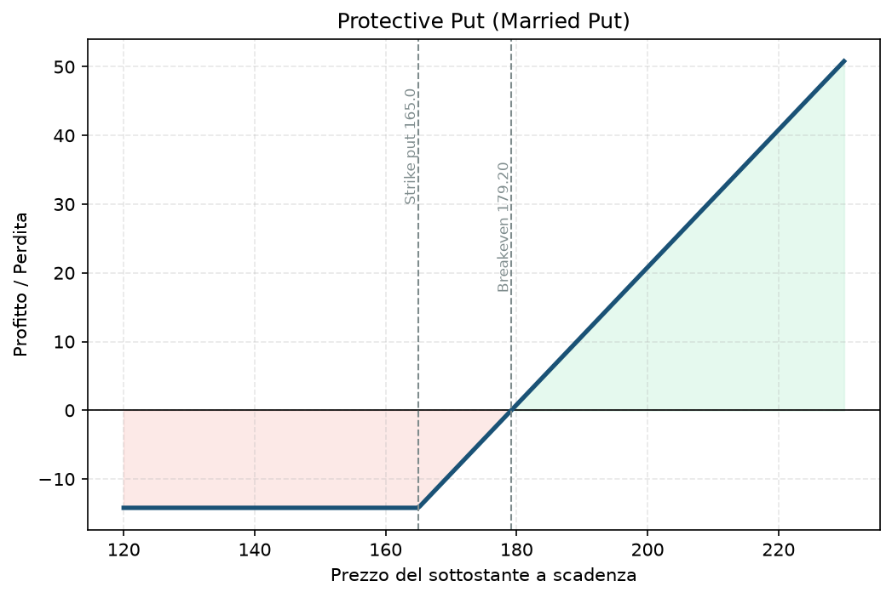

# 13. Protective Put (Married Put)

È l'opzione come assicurazione, nel senso più letterale possibile. Hai delle azioni, ti piacciono, non vuoi venderle — ma non vuoi nemmeno restare scoperto se il mercato crolla domani. Compri una put, e da quel momento il tuo pacchetto azionario ha un pavimento sotto cui non può scendere il tuo conto, qualunque cosa succeda al titolo.

## Cos'è e come funziona

Due componenti, non due opzioni:

1. **Possiedi 100 azioni** del titolo (da qui "married" — sei "sposato" con l'azione, ce l'hai già in portafoglio).
2. **Compri 1 put OTM** sullo stesso titolo, di solito con scadenza qualche settimana o mese in avanti.

La put vale di più quanto più il titolo scende — quindi le perdite sulle azioni, sotto lo strike della put, vengono compensate quasi uno-a-uno dai guadagni della put. Sopra lo strike, la put scade senza valore e perdi solo il premio pagato, ma partecipi per intero al rialzo delle azioni. È esattamente la logica che usi già nel tuo Piano per l'hedge di portafoglio (bucket C, [Piano](../PIANO.md) §7) — solo applicata a un singolo titolo invece che a un indice.

## Il grafico payoff

Nota la forma: **sopra il breakeven la linea sale in diagonale senza limite** (partecipi al rialzo delle azioni, solo un po' più in basso del possesso puro per via del premio pagato), **sotto lo strike della put la linea diventa piatta** — hai un pavimento, non scendi oltre, qualunque cosa faccia il titolo. Questa forma — piatta sotto, diagonale sopra — è identica a quella di una Long Call ([06 - Long Call](06%20-%20Long%20Call.md)): non è un caso, "azioni + put" è matematicamente equivalente (a meno di piccole differenze fiscali/di margine) a una call lunga sullo stesso strike. Vale la pena ricordarlo: se ti sembra di ricreare da zero qualcosa che un'unica opzione farebbe più semplicemente, spesso è così.

## Esempio numerico concreto

Esempio didattico, numeri arrotondati, non quotazioni reali verificate. Titolo Apple (AAPL).

- **Possiedi 100 azioni**, prezzo di carico 175$ → valore posizione 17.500$.
- **Compri 1 put strike 165, scadenza 60 giorni**, premio 4,20$ → costo 420$.
- **Breakeven:** 175 + 4,20 = **179,20$** (il titolo deve salire un po' solo per "ripagare l'assicurazione").
- **Perdita massima:** (175 − 165) + 4,20 = 14,20$/azione → **1.420$ totali**, l'8,1% della posizione, qualunque cosa succeda sotto 165$.
- **Upside:** illimitato meno il premio pagato — se AAPL vola a 220$, guadagni (220 − 175 − 4,20) × 100 = **4.080$**.

## Quando si usa (casi d'uso)

- Hai un titolo con una plusvalenza importante e **non vuoi vendere ora** (motivi fiscali, convinzione di lungo periodo, dividendi) ma temi un evento a breve termine (earning, notizie di settore, macro).
- Vuoi restare esposto al rialzo di un titolo che ti piace mentre attraversi un periodo di incertezza.
- È lo strumento giusto quando la tua view è "voglio tenere l'azione, ma non voglio essere scoperto per le prossime N settimane" — non quando vuoi solo ridurre il costo dell'assicurazione (in quel caso guarda il [14 - Collar](14%20-%20Collar.md)).

## Pericoli e cosa può andare storto

- **Il costo si ripete.** Se compri protezione ogni pochi mesi per anni, il premio pagato erode il rendimento nel tempo — è "assicurazione", e come ogni assicurazione ha un costo ricorrente che va budgetato, non un extra occasionale.
- **Errore da principianti:** comprare la put troppo vicina al prezzo attuale (ATM) pensando "più vicina, meglio protetta" — costa molto di più e spesso non serve, a meno che tu non ti aspetti davvero un evento imminente e specifico.
- **Falso senso di sicurezza sul timing:** la protezione vale solo fino alla scadenza della put. Se il crollo arriva un mese dopo che la put è scaduta (e non l'hai rinnovata), sei di nuovo scoperto come se non l'avessi mai comprata.
- **Decadimento temporale (theta) lavora contro la put** ([03 - Theta](03%20-%20Theta.md)) — se il titolo resta fermo, ogni giorno che passa la put vale un po' meno, a parità di tutto il resto.

## Capitale richiesto

Il grosso del capitale qui non è l'opzione, è il possesso delle azioni: **17.500$ per le 100 azioni + 420$ per la put = 17.920$ totali**. Su un conto di questa taglia da 30.000€, una singola posizione Protective Put su un titolo come AAPL ti impegnerebbe **quasi il 60% del capitale** in un solo nome — un livello di concentrazione ben oltre i limiti di diversificazione che il Piano applica agli spread indicizzati (§5). È uno dei motivi per cui, con capitale limitato, strategie come la [12 - Poor Man's Covered Call (PMCC)](12%20-%20Poor%20Man's%20Covered%20Call%20%28PMCC%29.md) o gli spread su indici restano più efficienti in termini di capitale impiegato.

## Legami con altre strategie

- Equivalente sintetico a una [06 - Long Call](06%20-%20Long%20Call.md) sullo stesso strike — utile saperlo per confrontare i costi (a volte comprare direttamente la call costa meno che ricreare la stessa forma con azioni + put).
- Versione "a costo ridotto" (rinunciando a parte dell'upside): il [14 - Collar](14%20-%20Collar.md), che vende una call sopra per finanziare la put.
- Stesso principio del bucket C (hedge di coda) del tuo Piano — vedi `Manuale.md` del progetto per l'inquadramento generale della copertura di portafoglio.
