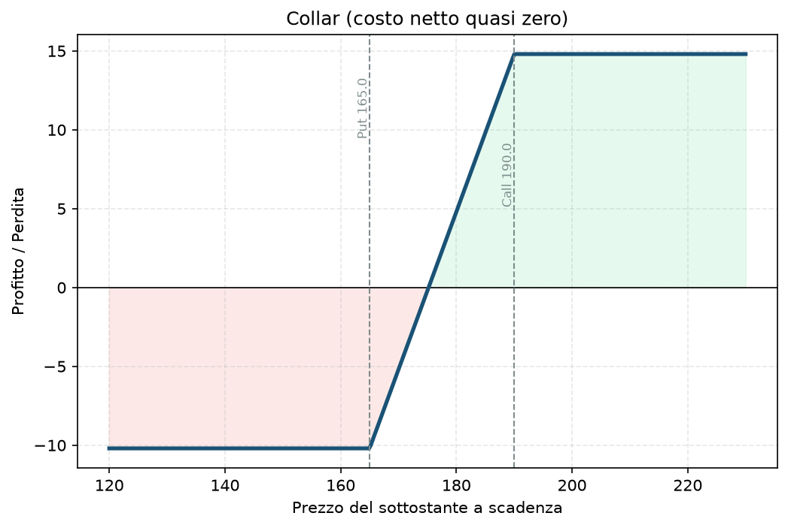

# 14. Collar

Il Collar è il Protective Put per chi trova l'assicurazione troppo cara e non ha problemi a rinunciare a un po' di upside pur di pagarla meno (o quasi niente). L'idea: vendi una call sopra il prezzo attuale per finanziare la put che compri sotto. Il nome viene dalla forma del payoff — un "collare" che tiene il P&L stretto tra un pavimento e un tetto.

## Cos'è e come funziona

Tre componenti:

1. **Possiedi 100 azioni** del titolo.
2. **Compri 1 put OTM** sotto il prezzo attuale — la tua protezione, come nel [13 - Protective Put (Married Put)](13%20-%20Protective%20Put%20%28Married%20Put%29.md).
3. **Vendi 1 call OTM** sopra il prezzo attuale — il premio incassato paga (in parte o del tutto) la put.

Se scegli gli strike bene, il premio incassato dalla call quasi pareggia quello pagato per la put — è il cosiddetto "zero-cost collar", protezione quasi gratis. Il prezzo che paghi non è in denaro, è in potenziale di guadagno: sopra lo strike della call, non partecipi più al rialzo, qualunque cosa faccia il titolo.

## Il grafico payoff

La forma è piatta sotto (protetta dalla put), diagonale in mezzo, e **piatta anche sopra** (limitata dalla call venduta) — a differenza del Protective Put, qui il guadagno non è più illimitato. È la stessa identica forma di un [15 - Bull Call Spread](15%20-%20Bull%20Call%20Spread.md) o di un [17 - Bull Put Spread](17%20-%20Bull%20Put%20Spread.md): un profitto compreso tra un minimo e un massimo definiti, niente di più niente di meno.

## Esempio numerico concreto

Esempio didattico, numeri arrotondati, non quotazioni reali verificate. Titolo Apple (AAPL).

- **Possiedi 100 azioni**, prezzo di carico 175$.
- **Compri 1 put strike 165, scadenza 60 giorni**, premio 4,20$ → costo 420$.
- **Vendi 1 call strike 190, stessa scadenza**, premio incassato 4,00$ → 400$.
- **Costo netto:** 4,20 − 4,00 = 0,20$/azione → **20$ totali** — un collar quasi a costo zero.

- **Pavimento (perdita massima):** (165 − 175) − 0,20 = −10,20$/azione → **−1.020$**, se AAPL crolla sotto 165$.
- **Tetto (profitto massimo):** (190 − 175) − 0,20 = 14,80$/azione → **1.480$**, se AAPL sale sopra 190$, non un centesimo di più anche se vola a 300$.
- Tra 165$ e 190$, il P&L si muove linearmente con il prezzo delle azioni.

Confrontalo con il Protective Put dell'esempio precedente: lì pagavi 420$ per proteggerti e mantenevi l'upside illimitato. Qui paghi 20$ (praticamente gratis) ma rinunci a tutto quello che sta sopra 190$.

## Quando si usa (casi d'uso)

- Vuoi proteggere una posizione importante **senza spendere premio netto** — tipico prima di un evento di cui hai paura (earning, notizia attesa) su un titolo che possiedi da tempo.
- Ti va bene "congelare" il valore del pacchetto azionario in un range per qualche settimana/mese — per esempio se stai per aver bisogno di quella liquidità e non vuoi sorprese in nessuna delle due direzioni.
- Molto usato da chi ha una **posizione concentrata e importante** (magari azioni ricevute come compenso, o una posizione storica con forte plusvalenza) e vuole ridurre il rischio senza vendere (motivi fiscali o di convinzione) e senza sborsare premio.

## Pericoli e cosa può andare storto

- **Rinunci completamente all'upside sopra lo strike della call** — se il titolo fa un rally del 40% mentre sei in un collar, guadagni comunque solo fino al tetto. È l'errore psicologico più comune: mettere un collar e poi essere frustrati quando il titolo "esplode" e tu non ne approfitti. Se non sei disposto ad accettarlo, il collar non è lo strumento giusto — meglio il Protective Put puro.
- **Rischio di assegnazione sulla call venduta** se va ITM prima della scadenza (specialmente vicino a uno stacco dividendo) — potresti ritrovarti a dover consegnare le azioni prima di quanto previsto.
- **Gli strike "zero-cost" cambiano ogni giorno** con la volatilità implicita — un collar a costo zero oggi potrebbe non esserlo più domani se l'IV si muove in modo asimmetrico tra put e call (skew).
- **Errore da principianti:** pensare che "costo zero" significhi "senza rischio" — il rischio c'è, è solo spostato: non paghi in premio, paghi in upside perso.

## Capitale richiesto

Stesso discorso del Protective Put: il grosso del capitale è nelle **100 azioni possedute (17.500$)**, non nelle opzioni — qui il costo netto delle opzioni è quasi zero (20$ nell'esempio). Su un conto da 30.000€, resta una posizione che impegna circa il 58% del capitale in un solo titolo: il vantaggio del Collar rispetto al Protective Put non è liberare capitale, è ridurre il costo dell'assicurazione. Se l'obiettivo è anche liberare capitale, la strada è il [12 - Poor Man's Covered Call (PMCC)](12%20-%20Poor%20Man's%20Covered%20Call%20%28PMCC%29.md) o uno spread su indice.

## Legami con altre strategie

- Combinazione diretta di [13 - Protective Put (Married Put)](13%20-%20Protective%20Put%20%28Married%20Put%29.md) (la put) e [10 - Covered Call](10%20-%20Covered%20Call.md) (la call venduta) — è letteralmente le due strategie sovrapposte sullo stesso pacchetto azionario.
- Stessa forma di payoff di uno spread verticale a rischio/rendimento definiti ([15 - Bull Call Spread](15%20-%20Bull%20Call%20Spread.md), [17 - Bull Put Spread](17%20-%20Bull%20Put%20Spread.md)) — cambia solo che qui il "motore" sotto è un possesso azionario vero, non un'altra opzione.
- Concettualmente è il fratello "azionario" del bucket C del tuo Piano: stessa idea di tenere sempre attiva una protezione, applicata a un singolo titolo invece che al portafoglio di indici — vedi `Manuale.md` del progetto.
