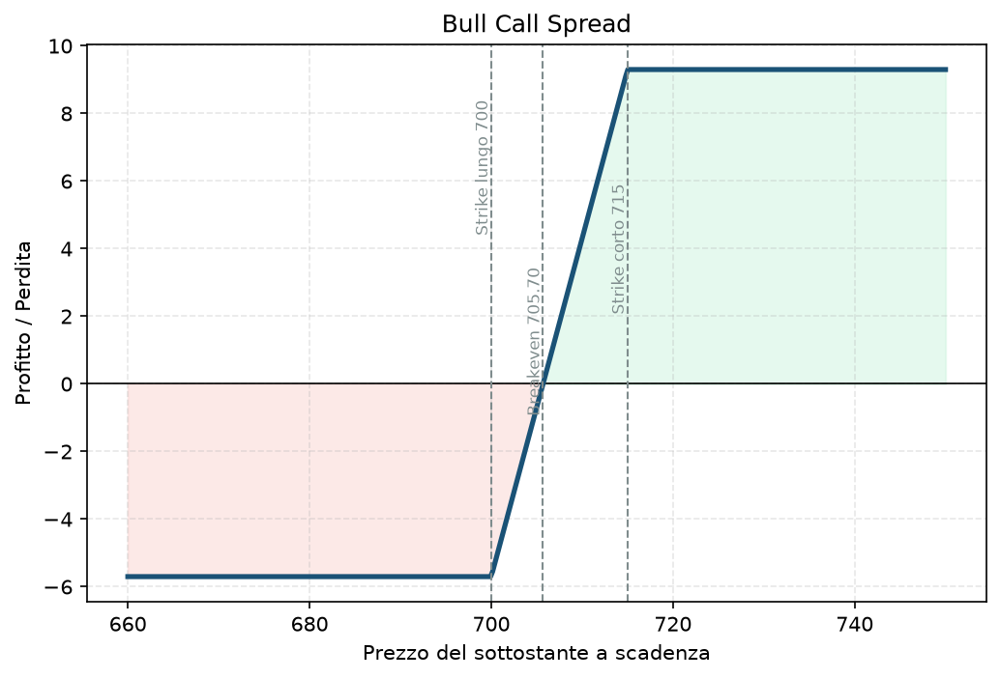

# 15. Bull Call Spread

Il primo dei quattro spread verticali "classici" della guida (gli altri sono [16 - Bear Put Spread](16%20-%20Bear%20Put%20Spread.md), [17 - Bull Put Spread](17%20-%20Bull%20Put%20Spread.md) e [18 - Bear Call Spread](18%20-%20Bear%20Call%20Spread.md)). Il Bull Call Spread è come comprare una Long Call ma con lo sconto — paghi meno, ma accetti un tetto al guadagno. È una strategia a debito (paghi per aprirla), rialzista, a rischio e rendimento entrambi definiti fin dal primo secondo.

## Cos'è e come funziona

Due call, stesso sottostante, stessa scadenza, strike diversi:

1. **Compri 1 call** a uno strike più basso (K1), spesso ATM o leggermente OTM.
2. **Vendi 1 call** a uno strike più alto (K2).

Paghi più di quanto incassi (da qui "debit spread") — il costo netto è la tua perdita massima possibile. La call venduta finanzia parte del costo della call comprata, in cambio rinunci al guadagno sopra K2.

## Il grafico payoff

Forma tipica di ogni spread verticale: **piatta in perdita sotto K1** (perdi solo il debito pagato, mai di più), **diagonale nel mezzo**, **piatta in profitto sopra K2** (guadagno massimo raggiunto, non un centesimo di più anche se il sottostante continua a salire).

## Esempio numerico concreto

Esempio didattico, numeri arrotondati, non quotazioni reali verificate. Sottostante: XSP (indice mini, lo stesso che usi nel tuo Piano), quotato a 700.

- **Compri 1 call strike 700**, premio 12,50 → costo 1.250$.
- **Vendi 1 call strike 715**, premio 6,80 → incasso 680$.
- **Debito netto:** 12,50 − 6,80 = 5,70 → **570$** (moltiplicatore standard 100$ per punto).
- **Breakeven:** 700 + 5,70 = **705,70**.
- **Profitto massimo:** (715 − 700) − 5,70 = 9,30 → **930$**, se XSP chiude a 715 o sopra a scadenza.
- **Perdita massima:** **570$**, se XSP chiude a 700 o sotto.
- **ROI massimo:** 930 / 570 ≈ **163%** sul capitale impegnato, se lo scenario si realizza appieno.

## Quando si usa (casi d'uso)

- Ti aspetti un **rialzo moderato e con una view abbastanza precisa sul target** entro la scadenza — non un rally esplosivo (in quel caso una Long Call pura renderebbe di più, senza il tetto).
- Vuoi ridurre il costo (e quindi il rischio in valore assoluto) rispetto a una Long Call pura, accettando un tetto al guadagno.
- Utile quando la volatilità implicita è relativamente alta e comprare una call nuda costerebbe troppo — vendendo la call più alta compensi parte del costo dell'IV elevata.

## Pericoli e cosa può andare storto

- **Se il sottostante non si muove abbastanza, perdi tutto il debito pagato** — a differenza di un credit spread ([17 - Bull Put Spread](17%20-%20Bull%20Put%20Spread.md)) dove il tempo che passa lavora a tuo favore, qui il decadimento temporale ([03 - Theta](03%20-%20Theta.md)) lavora **contro** di te finché resti sotto il breakeven.
- **Errore da principianti:** scegliere strike troppo larghi pensando "più margine di guadagno" — più larghi sono gli strike, più costa la spread, e il rapporto rischio/rendimento spesso peggiora, non migliora.
- **Rischio di assegnazione anticipata** sulla gamba venduta se va molto ITM prima della scadenza (raro su indici cash-settled come XSP, più rilevante su singole azioni).
- **Liquidità:** su strike poco scambiati il bid-ask può mangiarsi buona parte del vantaggio teorico — verifica sempre (Piano §3: bid-ask ≤5% del mid, open interest ≥500) prima di aprire.

## Capitale richiesto

Il vantaggio principale rispetto a una Long Call pura è proprio questo: **rischio massimo definito e noto in anticipo, pari al debito pagato** — nell'esempio, 570$, cioè meno del 2% di un conto da 30.000€ (esempio). Non serve margine oltre al debito stesso (è una posizione interamente pagata in anticipo, nessuna vendita "nuda" nella struttura): il broker blocca solo il costo netto della spread, non un margine calcolato sul rischio teorico come per una short call nuda ([08 - Short Call (Naked Call)](08%20-%20Short%20Call%20%28Naked%20Call%29.md)).

## Legami con altre strategie

- Il suo equivalente ribassista è il [16 - Bear Put Spread](16%20-%20Bear%20Put%20Spread.md) — stessa logica, direzione opposta.
- Ha lo stesso identico profilo di rischio/rendimento di un [17 - Bull Put Spread](17%20-%20Bull%20Put%20Spread.md) aperto sugli stessi due strike (equivalenza put-call sui verticali) — cambia solo che uno è a debito e l'altro a credito, con implicazioni diverse su margine e gestione del theta.
- È il "mattone" concettuale dietro all'[23 - Iron Condor](23%20-%20Iron%20Condor.md) (che è, in sostanza, un Bull Put Spread + un Bear Call Spread messi insieme).
