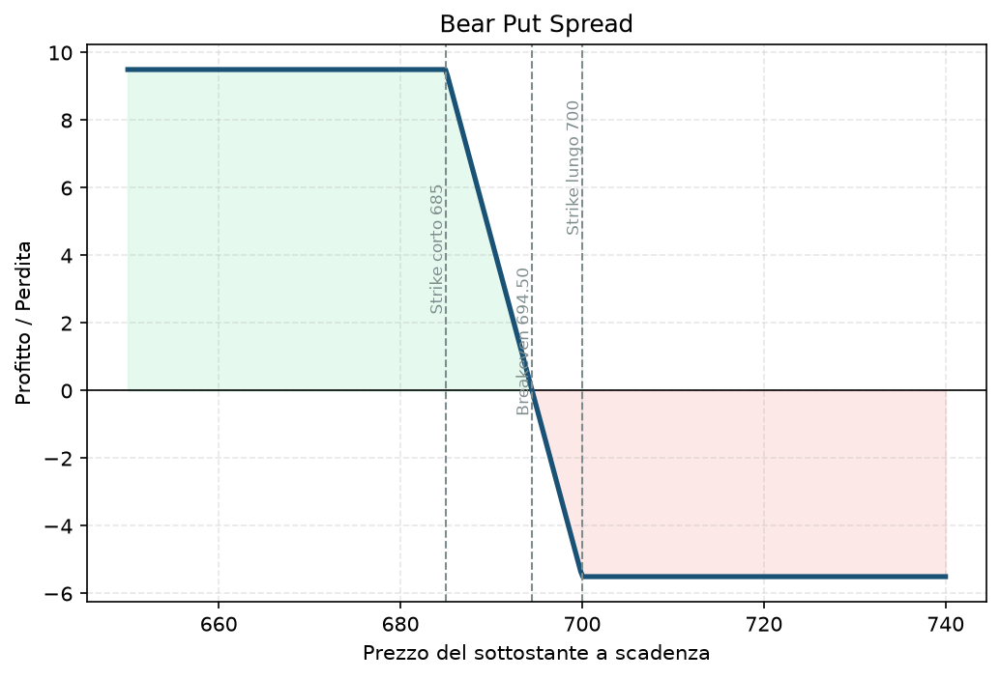

# 16. Bear Put Spread

Lo specchio ribassista del [15 - Bull Call Spread](15%20-%20Bull%20Call%20Spread.md): stessa identica logica — spread a debito, rischio e rendimento definiti — ma costruito con le put e orientato al ribasso invece che al rialzo.

## Cos'è e come funziona

Due put, stesso sottostante, stessa scadenza, strike diversi:

1. **Compri 1 put** a uno strike più alto (K2), di solito ATM o leggermente OTM.
2. **Vendi 1 put** a uno strike più basso (K1).

Paghi più premio di quanto incassi — anche qui, come nel Bull Call Spread, il costo netto è la perdita massima possibile. La put venduta finanzia parte del costo di quella comprata, in cambio rinunci al guadagno sotto K1.

## Il grafico payoff

Forma a specchio rispetto al Bull Call Spread: **piatta in profitto sotto K1** (guadagno massimo raggiunto), **diagonale nel mezzo**, **piatta in perdita sopra K2** (perdi solo il debito pagato, mai di più).

## Esempio numerico concreto

Esempio didattico, numeri arrotondati, non quotazioni reali verificate. Sottostante: XSP, quotato a 700.

- **Compri 1 put strike 700**, premio 11,80 → costo 1.180$.
- **Vendi 1 put strike 685**, premio 6,30 → incasso 630$.
- **Debito netto:** 11,80 − 6,30 = 5,50 → **550$**.
- **Breakeven:** 700 − 5,50 = **694,50**.
- **Profitto massimo:** (700 − 685) − 5,50 = 9,50 → **950$**, se XSP chiude a 685 o sotto a scadenza.
- **Perdita massima:** **550$**, se XSP chiude a 700 o sopra.
- **ROI massimo:** 950 / 550 ≈ **173%** sul capitale impegnato, nello scenario migliore.

## Quando si usa (casi d'uso)

- Ti aspetti un **ribasso moderato e abbastanza definito nel target** entro la scadenza — non un crollo violento (per quello, una Long Put pura senza tetto renderebbe di più).
- Vuoi speculare al ribasso con un rischio massimo noto e contenuto, invece di vendere il sottostante allo scoperto (molto più capitale e rischio teoricamente illimitato).
- Utile per coprire tatticamente un portafoglio in vista di un evento specifico a breve termine, con un costo definito in anticipo.

## Pericoli e cosa può andare storto

- **Stesso problema del Bull Call Spread, specchiato:** se il sottostante non scende abbastanza, il decadimento temporale ([03 - Theta](03%20-%20Theta.md)) lavora contro di te e perdi (parte o tutto) il debito pagato.
- **Errore da principianti:** confondere questa struttura con un [18 - Bear Call Spread](18%20-%20Bear%20Call%20Spread.md) — sembrano entrambi "ribassisti", ma uno è a debito (Put) e l'altro a credito (Call): meccanica di margine, gestione del theta e profilo di rischio sono diversi, non intercambiabili a caso.
- **Rischio di assegnazione anticipata** sulla put venduta se va molto ITM (più rilevante su singole azioni che su indici cash-settled come XSP).
- **Su un mercato che sale invece di scendere**, la spread perde valore rapidamente e resta comunque limitata al debito — la buona notizia è che sai sempre, fin dall'apertura, qual è il tuo peggior scenario in euro.

## Capitale richiesto

Come nel Bull Call Spread, il rischio massimo è **noto e pari al debito pagato** — 550$ nell'esempio, meno del 2% di un conto da 30.000€ (esempio). Nessun margine ulteriore richiesto oltre al costo netto della spread: il broker blocca solo quello, a differenza di una put nuda ([09 - Short Put (Naked Put)](09%20-%20Short%20Put%20%28Naked%20Put%29.md)) che richiederebbe un margine calcolato sul rischio teorico molto più ampio.

## Legami con altre strategie

- Speculare del [15 - Bull Call Spread](15%20-%20Bull%20Call%20Spread.md) — stessa filosofia, direzione opposta.
- Stesso profilo di rischio/rendimento di un [18 - Bear Call Spread](18%20-%20Bear%20Call%20Spread.md) aperto sugli stessi due strike (di nuovo, equivalenza put-call) — a debito qui, a credito lì.
- Insieme a un Bull Put Spread forma la base concettuale di condor e iron condor ([23 - Iron Condor](23%20-%20Iron%20Condor.md), [26 - Condor Spread](26%20-%20Condor%20Spread.md)) quando serve una view neutrale invece che direzionale.
