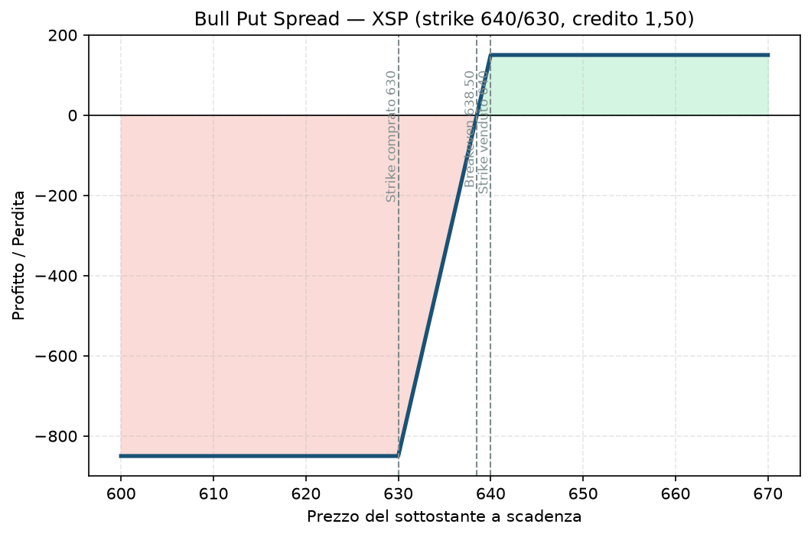

# 17. Bull Put Spread

Questa non è una strategia qualsiasi per te: è **esattamente** la struttura che usi come core del tuo piano reale su XSP ed ESTX50 (bucket A). Quindi qui non stiamo solo studiando teoria — stiamo guardando sotto il cofano di quello che fai già ogni volta che apri un trade "core".

## Cos'è e come funziona

Un Bull Put Spread è un **credit spread** a due gambe, entrambe put, entrambe sullo stesso sottostante e sulla stessa scadenza:

- **Vendi** una put a uno strike più alto (più vicino al prezzo attuale) → incassi un premio.
- **Compri** una put a uno strike più basso (più lontano, più economica) → paghi un premio minore, che funge da protezione.

La differenza tra i due premi è il **credito netto** che incassi subito, ed è anche il tuo profitto massimo possibile. È una strategia **moderatamente rialzista/neutrale**: guadagni se il sottostante sale, resta fermo, o scende ma non abbastanza da toccare lo strike venduto.

La put comprata è quello che trasforma un rischio teoricamente enorme (come nella put nuda, vedi [09 - Short Put (Naked Put)](09%20-%20Short%20Put%20%28Naked%20Put%29.md)) in un rischio **definito e noto in anticipo** — è la differenza fondamentale rispetto a vendere una put nuda.

## Il grafico payoff

Con XSP intorno a 665, vendi la put strike 640 e compri la put strike 630 (ampiezza 10 punti), incassando un credito di 1,50. Il grafico mostra tre zone:

- Sopra 640 (lo strike venduto): l'opzione venduta scade senza valore, incassi tutto il credito, **profitto massimo**.
- Tra 630 e 640: la perdita cresce linearmente man mano che il prezzo scende verso lo strike comprato.
- Sotto 630 (lo strike comprato): la protezione entra in gioco, la perdita smette di crescere — **perdita massima**, piatta da lì in giù.

Il **breakeven** è a 638,50 (strike venduto meno il credito incassato): sotto quel livello a scadenza sei in perdita netta.

## Esempio numerico concreto

*Esempio didattico, numeri arrotondati, non prezzi live verificati.*

XSP a 665. Vendi put 640 Nov'26 a 2,00, compri put 630 Nov'26 a 0,50 (stessa scadenza, ampiezza 10 punti). Multiplier XSP: 100$ per punto.

- **Credito incassato:** (2,00 − 0,50) × 100 = **150$**
- **Larghezza dello spread:** (640 − 630) × 100 = 1.000$
- **Perdita massima:** 1.000$ − 150$ = **850$**
- **Breakeven:** 640 − 1,50 = **638,50**
- **ROI sul rischio:** 150 / 850 ≈ **17,6%** se il trade va a bersaglio (profitto massimo sul capitale davvero a rischio)

Per confronto: il Piano richiede perdita massima ≤1-2% del NAV. Su 30.000€, 850$ (circa 780€) è già nell'ordine di grandezza di quel 2-3% — è il tipo di calcolo che fai (o dovresti fare) prima di ogni apertura, non dopo.

## Quando si usa (casi d'uso)

- **View moderatamente rialzista o neutrale**: non ti serve prevedere un rally, ti basta che il sottostante non crolli sotto lo strike venduto entro la scadenza.
- **Regime di volatilità normale o elevata**, dove i premi delle put OTM sono abbastanza ricchi da rendere il credito interessante rispetto al rischio (esattamente il filtro IV Rank ≥30 del tuo Piano).
- **Dopo un pullback che ti sembra esagerato**: vendi put sotto un supporto tecnico che pensi regga, incassando premio mentre aspetti che il mercato si stabilizzi.
- **Accumulo di reddito mensile sistematico**: è lo strumento standard per "vendere volatilità" con un rischio che conosci fin dal primo giorno — il motivo per cui è il pilastro del tuo bucket A.

## Pericoli e cosa può andare storto

- **Il rischio non è piccolo solo perché è "definito"**: 850$ di perdita massima contro 150$ di guadagno massimo è un rapporto rischio/rendimento di quasi 6 a 1. Vinci spesso (alta probabilità, delta basso), ma quando perdi, perdi molto di più di quanto guadagni in un trade vincente — la matematica funziona solo se il tasso di successo è davvero alto e disciplinato nel tempo.
- **Assegnazione anticipata sulla gamba venduta**: se il sottostante scende parecchio sotto 640 prima della scadenza, la put venduta può essere assegnata prima del previsto (più probabile su opzioni su singoli titoli con dividendi che su indici cash-settled come XSP, ma va sempre controllato). Su XSP, essendo cash-settled, l'assegnazione si traduce in un semplice regolamento in contanti, non in azioni da comprare — comunque un evento da monitorare.
- **Movimento improvviso e violento (gap)**: uno spread di 10 punti si "riempie" tutto in un attimo con un gap overnight — non hai modo di uscire a metà strada come farebbe un ordine stop in un mercato liquido e continuo.
- **Errore comune da principiante**: aprire lo spread troppo vicino al prezzo attuale (delta alto) per incassare più premio, sottovalutando quanto questo alzi la probabilità di finire in perdita. Il Piano fissa delta 10-20 apposta per evitare questa tentazione.
- **Esempio di come si perde**: XSP crolla da 665 a 625 in due settimane per una correzione di mercato. Lo spread 640/630 è ora completamente ITM: perdi l'intera perdita massima di 850$, a fronte di un guadagno massimo che era solo di 150$ — un trade che sembrava "sicuro" (delta 15 sulla put venduta, quindi teoricamente ~85% di probabilità di successo) si trasforma nel peggior esito possibile.

## Capitale richiesto

Il broker blocca come margine la **perdita massima potenziale** dello spread, non l'intero valore nozionale — è uno dei vantaggi principali rispetto a una put nuda. Nell'esempio sopra: **850$ di margine bloccato** per un singolo spread.

Su un capitale di esempio di 30.000€, il Piano impone buying power impegnato ≤5% NAV per posizione (≤1.500€ circa) — quindi un singolo spread da 850$ è già vicino al limite superiore consentito per trade, non è "piccolo" nella tua scala attuale. Su un capitale di 100.000€ target, lo stesso spread diventerebbe una frazione trascurabile del portafoglio, permettendo di diversificare su più scadenze e sottostanti contemporaneamente (il "laddering" di cui parla il Piano).

Con **portfolio margin** (accessibile con capitali più alti, tipicamente oltre 100-125k$ su IBKR) il margine richiesto per spread di questo tipo può essere calcolato in modo più efficiente rispetto al Reg-T standard, liberando capitale per altre posizioni — ma non è la modalità con cui operi oggi sui 30.000€.

## Legami con altre strategie

- È l'immagine speculare del [18 - Bear Call Spread](18%20-%20Bear%20Call%20Spread.md): combinandoli sullo stesso sottostante e scadenza ottieni un [23 - Iron Condor](23%20-%20Iron%20Condor.md).
- Rispetto alla [09 - Short Put (Naked Put)](09%20-%20Short%20Put%20%28Naked%20Put%29.md), sacrifichi una parte del premio incassato per comprare un tetto alla perdita massima — è il prezzo della "assicurazione" sulla tua stessa posizione.
- Se il mercato ti va contro dopo l'apertura, le tecniche di [31 - Rolling](31%20-%20Rolling.md) e [32 - Inversione e Trasformazione](32%20-%20Inversione%20e%20Trasformazione.md) sono gli strumenti per difendere o trasformare la posizione invece di chiuderla subito in perdita.
- Per il dettaglio completo di come lo strike e la scadenza si scelgono nel tuo piano reale (delta 10-20, 30-60 giorni, IV Rank), vedi il Manuale del progetto.
