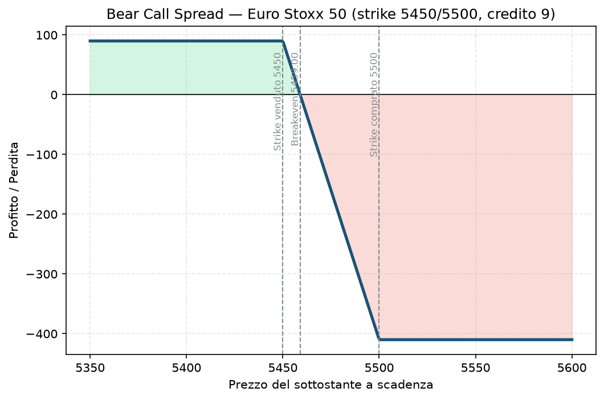

# 18. Bear Call Spread

Il gemello ribassista del [17 - Bull Put Spread](17%20-%20Bull%20Put%20Spread.md) — e come quello, è una struttura che potresti usare direttamente nel tuo core su ESTX50 quando la view è "non salirà molto", non necessariamente "crollerà".

## Cos'è e come funziona

Un Bear Call Spread è un **credit spread** a due gambe, entrambe call, stesso sottostante e stessa scadenza:

- **Vendi** una call a uno strike più basso (più vicino al prezzo attuale) → incassi il premio maggiore.
- **Compri** una call a uno strike più alto (più lontana, più economica) → paghi un premio minore, che ti protegge se il mercato scappa al rialzo.

Il credito netto incassato è il tuo profitto massimo. È una strategia **moderatamente ribassista/neutrale**: guadagni se il sottostante scende, resta fermo, o sale ma non abbastanza da superare lo strike venduto.

Stessa logica del Bull Put Spread ma specchiata: la call comprata trasforma il rischio teoricamente illimitato di una [08 - Short Call (Naked Call)](08%20-%20Short%20Call%20%28Naked%20Call%29.md) in un rischio definito.

## Il grafico payoff

Con Euro Stoxx 50 intorno a 5.350, vendi la call strike 5.450 e compri la call strike 5.500 (ampiezza 50 punti), incassando un credito di 9 punti. Tre zone:

- Sotto 5.450 (strike venduto): la call scade senza valore, incassi il credito intero — **profitto massimo**.
- Tra 5.450 e 5.500: la perdita cresce linearmente man mano che il prezzo sale oltre lo strike venduto.
- Sopra 5.500 (strike comprato): la protezione limita la perdita — **perdita massima**, costante da lì in su.

**Breakeven** a 5.459 (strike venduto più il credito incassato).

## Esempio numerico concreto

*Esempio didattico, numeri arrotondati, non prezzi live verificati.*

Euro Stoxx 50 a 5.350. Vendi call 5.450 Nov'26 a 15, compri call 5.500 Nov'26 a 6 (ampiezza 50 punti). Multiplier ESTX50 (Eurex, OESX): 10€ per punto.

- **Credito incassato:** (15 − 6) × 10 = **90€**
- **Larghezza dello spread:** (5.500 − 5.450) × 10 = 500€
- **Perdita massima:** 500€ − 90€ = **410€**
- **Breakeven:** 5.450 + 9 = **5.459**
- **ROI sul rischio:** 90 / 410 ≈ **22%** se il trade centra il bersaglio

## Quando si usa (casi d'uso)

- **View moderatamente ribassista o neutrale**: non serve indovinare un crollo, basta che il mercato non salga sopra lo strike venduto.
- **Dopo un rally che ti sembra eccessivo**: vendi call sopra una resistenza tecnica che pensi possa contenere il movimento.
- **Regime con IV Rank elevato**, dove i premi sulle call OTM sono abbastanza ricchi da giustificare il rischio preso — stesso filtro del tuo Piano (IV Rank ≥30, ora letto sulla finestra a 13 settimane).
- **Bilanciare un portafoglio troppo rialzista**: se hai già molte posizioni long-delta (core put spread, azioni), un Bear Call Spread aggiunge delta negativo senza scommettere davvero su un crollo.

## Pericoli e cosa può andare storto

- **Rischio/rendimento sbilanciato come nel Bull Put Spread**: 410€ di perdita massima contro 90€ di guadagno massimo, un rapporto di oltre 4,5 a 1 — funziona solo se il tasso di successo è alto e costante.
- **I rally sono spesso più violenti dei ribassi**: un mercato euforico può superare lo strike venduto molto rapidamente (short squeeze, notizie macro positive a sorpresa) — a differenza di un ribasso "lento", un rally forte lascia poco tempo per reagire con un aggiustamento.
- **Assegnazione anticipata sulla gamba corta**, soprattutto vicino a dividendi se il sottostante fosse un'azione — su ESTX50 (cash-settled) il rischio di assegnazione anomala è minore ma il regolamento in contanti resta da monitorare.
- **Errore comune**: vendere la call troppo vicino al prezzo attuale per un credito più alto, aumentando la probabilità che il mercato la raggiunga — esattamente il motivo per cui il Piano fissa un range di delta preciso invece di lasciare la scelta "a sensazione".
- **Esempio di come si perde**: l'Euro Stoxx 50 sale da 5.350 a 5.550 in tre settimane per un'ondata di ottimismo sui tassi. Lo spread 5.450/5.500 è completamente ITM: perdi la perdita massima di 410€, contro un guadagno massimo che era di soli 90€.

## Capitale richiesto

Il margine bloccato è la perdita massima potenziale, **410€** nell'esempio, non il valore nozionale dell'indice. Su un capitale di esempio di 30.000€, il limite del Piano (buying power ≤5% NAV per posizione, ~1.500€) lascia spazio per più spread di questa taglia contemporaneamente, a differenza del Bull Put Spread su XSP visto in [17 - Bull Put Spread](17%20-%20Bull%20Put%20Spread.md) che con 850$ (~780€) occupava già gran parte del budget per singolo trade — un motivo pratico in più per bilanciare le posizioni tra i due mercati invece di concentrarle su uno solo.

Su ESTX50 il multiplier più basso (10€ contro i 100$ di XSP) rende più facile dimensionare posizioni piccole e granulari con un capitale ridotto — un vantaggio pratico quando operi ancora sui 30.000€ invece dei 100.000€ target.

## Legami con altre strategie

- Speculare al [17 - Bull Put Spread](17%20-%20Bull%20Put%20Spread.md): insieme sullo stesso sottostante/scadenza formano un [23 - Iron Condor](23%20-%20Iron%20Condor.md).
- Rispetto alla [08 - Short Call (Naked Call)](08%20-%20Short%20Call%20%28Naked%20Call%29.md), la gamba comprata elimina il rischio teoricamente illimitato al rialzo — è il costo di quella protezione a ridurre il tuo credito netto.
- Le tecniche di [31 - Rolling](31%20-%20Rolling.md) (in particolare il roll up dello strike) sono lo strumento principale per difendere questa posizione se il mercato si avvicina troppo allo strike venduto prima della scadenza.
- Dettaglio operativo completo (come si sceglie strike/scadenza nel Piano reale) nel Manuale del progetto.
