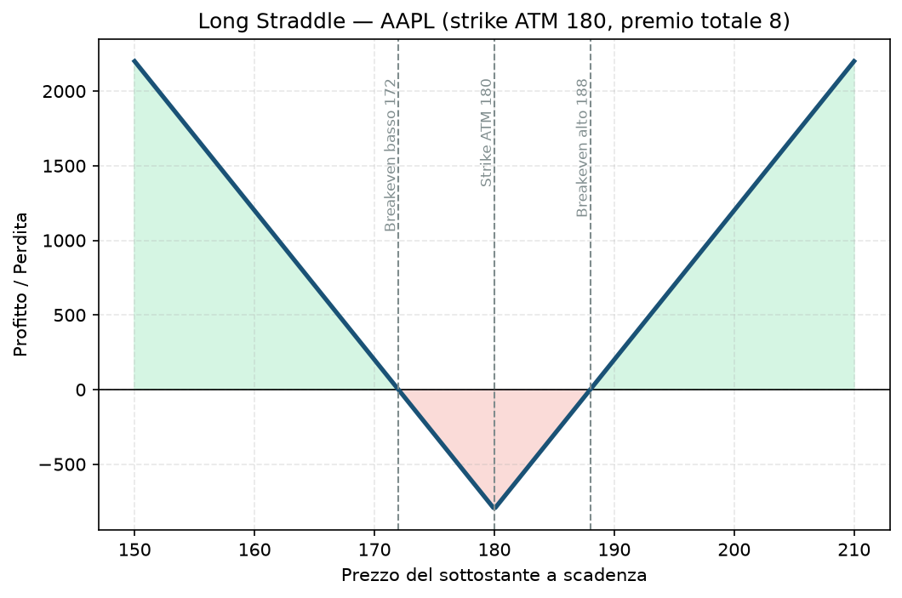

# 19. Long Straddle

Fin qui hai visto soprattutto strategie che vendono premio (il tuo pane quotidiano nel core). Con il Long Straddle entriamo in un mondo diverso: qui **compri** volatilità invece di venderla, e scommetti su un movimento grande, non su una direzione precisa.

## Cos'è e come funziona

Un Long Straddle è semplicissimo da descrivere e molto delicato da usare bene:

- **Compri** una call ATM (at-the-money, strike vicino al prezzo attuale).
- **Compri** una put ATM, stesso strike, stessa scadenza.

Paghi due premi. Non ti interessa se il sottostante sale o scende — ti interessa **quanto** si muove. Se il movimento (in qualsiasi direzione) è più grande di quanto costato in premio, guadagni. Se il sottostante resta fermo, perdi tutto quello che hai pagato: è una posizione **long vega e long gamma**, l'esatto opposto del profilo delle strutture che vendi nel tuo core.

## Il grafico payoff

Strike ATM a 180, premio totale pagato 8 (call + put insieme). La forma a "V" è la firma visiva di questa strategia:

- Sotto il breakeven basso (172) o sopra il breakeven alto (188): sei in profitto, che cresce senza limite teorico man mano che il movimento è più ampio.
- Tra i due breakeven: sei in perdita, massima esattamente sullo strike (180) dove nessuna delle due gambe vale nulla e hai perso tutto il premio pagato.

## Esempio numerico concreto

*Esempio didattico, numeri arrotondati, non prezzi live verificati.*

AAPL a 180$ prima di una trimestrale. Compri call 180 a 4$ e put 180 a 4$, stessa scadenza a ridosso dell'evento. Multiplier standard azionario: 100$ per punto.

- **Premio totale pagato:** (4 + 4) × 100 = **800$** — questa è anche la tua **perdita massima**, fissa e nota da subito.
- **Breakeven basso:** 180 − 8 = **172$**
- **Breakeven alto:** 180 + 8 = **188$**
- **Guadagno:** teoricamente illimitato al rialzo, molto ampio al ribasso (limitato solo dal fatto che il titolo non può scendere sotto zero).
- Se AAPL sale a 200$ dopo la trimestrale: la call vale 20$, la put vale 0. Guadagno netto = (20 − 8) × 100 = **1.200$**, un ROI del 150% sul capitale rischiato.

## Quando si usa (casi d'uso)

- **Eventi con esito binario e sconosciuto**: trimestrali, sentenze regolatorie, decisioni FDA su un farmaco, referendum — situazioni dove sai che il movimento sarà grande ma non sai in che direzione.
- **Volatilità implicita ancora bassa prima dell'evento**: comprare "assicurazione sul movimento" quando costa poco (IV Rank basso) è lo stesso principio del tuo hedge di coda (bucket C), applicato qui in chiave speculativa invece che protettiva.
- **Breakout attesi da compressione tecnica**: un titolo che si muove in un range strettissimo da settimane, dove ti aspetti un'uscita violenta ma non sai da che lato.

## Pericoli e cosa può andare storto

- **Il nemico numero uno è il theta**: ogni giorno che passa senza movimento, entrambe le opzioni perdono valore — è l'esatto opposto della posizione da cui trai reddito nel tuo core, qui il tempo lavora contro di te, non per te.
- **Il "volatility crush" post-evento**: anche se hai indovinato la direzione, se l'IV era già molto alta prima dell'evento (tutti si aspettavano un grande movimento) e il movimento effettivo è più piccolo del previsto, il crollo della volatilità implicita subito dopo l'evento può farti perdere valore anche con il sottostante che si muove nella direzione "giusta". È l'errore da principiante più comune con questa strategia: comprare uno straddle a ridosso di un evento molto atteso, quando l'IV è già gonfiata al massimo.
- **Esempio di come si perde**: compri lo straddle su AAPL a 180 pagando 8$ di premio (IV Rank alto perché tutti si aspettano volatilità dalla trimestrale). Il titolo si muove solo del 3% dopo l'annuncio, a 185$. La call ora vale forse 6$ (ha guadagnato poco perché l'IV è crollata), la put vale quasi zero. Perdita netta anche con un movimento nella direzione "giusta".
- **Serve un movimento più grande di quanto sembri**: il breakeven a ±8 punti dallo strike vuol dire che il titolo deve muoversi di oltre il 4,4% solo per andare in pareggio — un movimento che il mercato spesso ha già in parte "prezzato" nell'IV.

## Capitale richiesto

A differenza dei credit spread, qui **il capitale richiesto è semplicemente il premio pagato** — niente margine aggiuntivo, perché il rischio massimo è già tutto pagato in anticipo. Nell'esempio: **800$ per uno straddle**, capitale bloccato fino alla chiusura o scadenza.

Su un capitale piccolo (es. 30.000€), è una posizione relativamente piccola e ben definita — ma attenzione: essendo una strategia che **perde per definizione la maggior parte delle volte** (il movimento grande è l'eccezione, non la norma), il rischio reale non è il singolo trade ma l'abitudine di aprirne troppi senza un tasso di successo sufficiente a compensare theta e volatility crush nel tempo.

## Legami con altre strategie

- Il [21 - Long Strangle](21%20-%20Long%20Strangle.md) è la versione "economica" della stessa idea: stessa view, premio minore, ma serve un movimento ancora più ampio per andare in profitto.
- Lo [20 - Short Straddle](20%20-%20Short%20Straddle.md) è l'esatto opposto: lì vendi volatilità invece di comprarla, con profilo di rischio rovesciato.
- Concettualmente è il parente più vicino, in chiave speculativa/direzionale, del tuo hedge di coda (bucket C) — entrambi sono long vega, ma l'hedge protegge il portafoglio, lo straddle scommette su un evento specifico.
