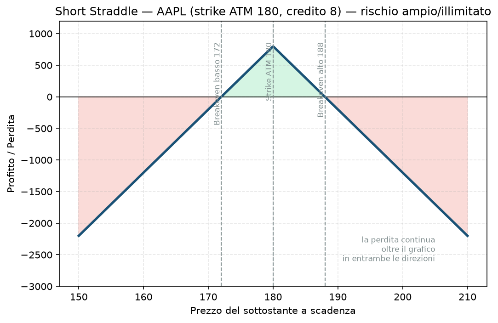

# 20. Short Straddle

Questa è probabilmente la strategia più aggressiva che incontrerai in questa guida. Vale la pena leggerla con attenzione anche solo per capire **perché** il Piano non la usa mai in forma pura, e usa invece spread a rischio definito.

## Cos'è e come funziona

Specchio esatto del [19 - Long Straddle](19%20-%20Long%20Straddle.md):

- **Vendi** una call ATM.
- **Vendi** una put ATM, stesso strike, stessa scadenza.

Incassi due premi subito. Guadagni se il sottostante **resta fermo** — è una scommessa sulla bassa volatilità, l'opposto dello straddle comprato. Ma qui il rischio non è più "limitato al premio pagato": è **molto ampio al ribasso e teoricamente illimitato al rialzo**, perché sei short sia la call che la put, senza nessuna protezione comprata.

## Il grafico payoff

Strike ATM 180, credito incassato 8. La forma è una "Λ" rovesciata rispetto allo straddle comprato:

- Tra i due breakeven (172 e 188): sei in profitto, massimo esattamente sullo strike dove entrambe le opzioni scadono senza valore.
- Fuori da quel range: la perdita cresce linearmente e **non si ferma mai** sul lato call (rischio illimitato) ed è comunque molto ampia sul lato put (limitata solo dal fatto che il titolo non può scendere sotto zero).

Nel grafico l'asse è tagliato apposta: la perdita reale continua oltre i bordi mostrati.

## Esempio numerico concreto

*Esempio didattico, numeri arrotondati, non prezzi live verificati.*

AAPL a 180$, IV alta (magari proprio prima di una trimestrale che pensi sarà "un buco nell'acqua"). Vendi call 180 e put 180 a 4$ ciascuna, stessa scadenza. Multiplier 100$.

- **Credito incassato:** (4 + 4) × 100 = **800$** — è anche il tuo **profitto massimo**, se AAPL scade esattamente a 180.
- **Breakeven basso:** 172$ — **Breakeven alto:** 188$
- **Se AAPL scade a 180 esatto:** guadagni l'intero credito, 800$.
- **Se AAPL sale a 220$** (un movimento non impossibile su una singola trimestrale): la call venduta vale 40$, ben oltre il credito incassato. Perdita netta = (40 − 8) × 100 = **3.200$**, quattro volte il guadagno massimo possibile — e non è nemmeno il worst case, solo un esempio a titolo illustrativo.

## Quando si usa (casi d'uso)

- **Aspettativa di bassissima volatilità**, quando pensi che il mercato abbia sovrastimato quanto un titolo o un indice si muoverà (IV Rank molto alto rispetto al movimento realizzato storico).
- **Trader istituzionali o molto esperti**, quasi sempre **con protezione aggiuntiva** — cioè quasi mai in forma pura come descritta qui, ma trasformata subito in un [24 - Iron Butterfly](24%20-%20Iron%20Butterfly.md) comprando ali di protezione.
- **Su indici molto liquidi e a bassa volatilità strutturale**, dove i movimenti estremi sono statisticamente più rari che su singoli titoli — ma "più raro" non vuol dire "impossibile", ed è proprio questo il punto.

## Pericoli e cosa può andare storto

- **Il rischio è davvero illimitato al rialzo**: non esiste un tetto teorico a quanto un titolo può salire. Una notizia di acquisizione, un short squeeze, un evento macro a sorpresa — il conto può arrivare a cifre multiple del margine iniziale depositato.
- **Al ribasso il rischio è "solo" molto ampio, non infinito**, ma comunque enorme rispetto al premio incassato: un crollo del 30-40% del sottostante può generare una perdita molte volte superiore al credito ricevuto.
- **È esattamente il motivo per cui il Piano non la usa mai in questa forma**: la regola "solo rischio definito, mai naked" (Piano, difese strutturali sempre attive) esiste apposta per evitare situazioni come questa. Uno short straddle è concettualmente vicino a vendere sia una call nuda che una put nuda contemporaneamente.
- **Errore da principiante**: farsi attirare dal credito alto (sembra "tanto premio per poco sforzo") senza calcolare che il rapporto rischio/rendimento è drammaticamente sbilanciato rispetto a un credit spread definito come [17 - Bull Put Spread](17%20-%20Bull%20Put%20Spread.md) o [18 - Bear Call Spread](18%20-%20Bear%20Call%20Spread.md).
- **Se una posizione di questo tipo viene minacciata** (il prezzo si avvicina troppo a uno dei due breakeven), le tecniche di [32 - Inversione e Trasformazione](32%20-%20Inversione%20e%20Trasformazione.md) — in particolare trasformarla in un Iron Condor comprando protezione ulteriore, oppure spostare lo strike minacciato più lontano — sono lo strumento per limitare il danno prima che diventi catastrofico. Aspettare senza agire è la scelta peggiore.

## Capitale richiesto

Qui il margine richiesto **non è semplice**: essendo una posizione a rischio potenzialmente illimitato, il broker calcola un margine di mantenimento basato su scenari di stress (tipicamente il maggiore tra una percentuale del valore del sottostante e altre formule), non un numero fisso come per uno spread a rischio definito. Su IBKR, aspettati un margine iniziale che può essere anche il 15-20% del valore nozionale del sottostante, e che **si muove** (aumenta) se il prezzo si avvicina a uno degli strike venduti.

Su un capitale di esempio di 30.000€, uno short straddle su un titolo come AAPL a 180$ (valore nozionale per contratto: 18.000$) potrebbe già impegnare buona parte del tuo capitale disponibile in margine — ben oltre il limite del 5% NAV per posizione che il Piano impone sui credit spread definiti. È un altro modo di vedere perché questa strategia, in forma pura, è semplicemente fuori scala per il tuo piano attuale.

## Legami con altre strategie

- Specchio esatto del [19 - Long Straddle](19%20-%20Long%20Straddle.md).
- Il [22 - Short Strangle](22%20-%20Short%20Strangle.md) è la versione "più larga" della stessa idea (strike OTM invece che ATM), con premio minore ma range di profitto più ampio — stesso problema di rischio ampio/illimitato di fondo.
- Aggiungendo una call comprata sopra e una put comprata sotto ottieni un [24 - Iron Butterfly](24%20-%20Iron%20Butterfly.md): stessa idea di base, ma con rischio finalmente definito — il modo in cui questa strategia diventa effettivamente utilizzabile in un piano disciplinato come il tuo.
