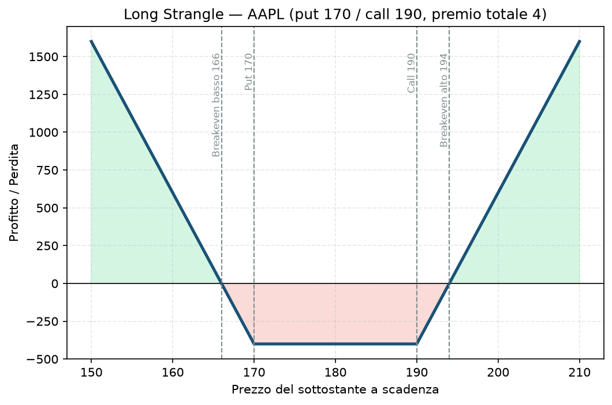

# 21. Long Strangle

Pensa al Long Strangle come alla versione "budget" del [19 - Long Straddle](19%20-%20Long%20Straddle.md): stessa filosofia (scommetti sul movimento, non sulla direzione), ma paghi meno e in cambio ti serve un movimento più ampio per andare in profitto.

## Cos'è e come funziona

- **Compri** una call OTM (strike sopra il prezzo attuale).
- **Compri** una put OTM (strike sotto il prezzo attuale).

A differenza dello straddle, i due strike sono diversi e entrambi fuori dal denaro — questo rende ogni singola gamba più economica (le opzioni OTM costano meno di quelle ATM), quindi il costo totale della posizione è minore. Il compromesso: il sottostante deve muoversi di più prima che una delle due gambe valga qualcosa.

## Il grafico payoff

Put strike 170, call strike 190, premio totale pagato 4. La forma è un "piatto" tra i due strike, poi sale su entrambi i lati:

- Tra 170 e 190: entrambe le opzioni sono OTM o al più ATM, la perdita è piatta al livello del premio pagato — la **perdita massima**, ma più contenuta rispetto allo straddle a parità di sottostante.
- Sotto il breakeven basso (166) o sopra il breakeven alto (194): profitto crescente, teoricamente illimitato al rialzo.

## Esempio numerico concreto

*Esempio didattico, numeri arrotondati, non prezzi live verificati.*

AAPL a 180$. Compri put strike 170 a 2$ e call strike 190 a 2$, stessa scadenza. Multiplier 100$.

- **Premio totale pagato:** (2 + 2) × 100 = **400$** — perdita massima, meno della metà dello straddle equivalente (800$ nell'esempio del file 19).
- **Breakeven basso:** 170 − 4 = **166$**
- **Breakeven alto:** 190 + 4 = **194$**
- Se AAPL sale a 210$: la call vale 20$, guadagno netto = (20 − 4) × 100 = **1.600$**, ROI 400% sul capitale rischiato — ma nota che serviva un movimento più ampio (+16,7% da 180 a 210) rispetto allo straddle per arrivare a un guadagno importante.

## Quando si usa (casi d'uso)

- **Stessa logica dello straddle ma con budget più contenuto**: eventi ad alto impatto dove vuoi esposizione al movimento ma non vuoi (o non puoi) impegnare il capitale di uno straddle ATM.
- **Quando ti aspetti un movimento davvero grande**, non solo "sopra la media": il range di pareggio più ampio (166-194 contro 172-188 dello straddle) significa che questa strategia rende meno in caso di movimento moderato, ma costa meno se il movimento non arriva affatto.
- **Trading su eventi macro con esito a due code** (decisioni di banca centrale con scenari molto diversi tra loro), dove non vuoi pagare il premio pieno di uno straddle ATM.

## Pericoli e cosa può andare storto

- **Serve un movimento ancora più ampio dello straddle per andare in profitto** — è il rovescio della medaglia del costo minore. Un movimento "solo" moderato (che magari avrebbe fatto guadagnare uno straddle) qui può comunque chiudersi in perdita.
- **Stesso nemico theta**, e in proporzione può essere anche più insidioso: essendo entrambe le gambe OTM, il valore-tempo che si consuma ogni giorno pesa relativamente di più sul valore totale della posizione.
- **Stesso rischio di volatility crush** post-evento descritto per lo straddle: se l'IV era già gonfiata e il movimento reale delude, perdi anche con il sottostante che si muove nella direzione giusta.
- **Errore comune**: scegliere strike troppo OTM "perché costano poco", senza rendersi conto che il movimento necessario a raggiungerli diventa statisticamente sempre più improbabile — il premio basso non è un affare se la probabilità di successo scende ancora di più.
- **Esempio di come si perde**: compri il Long Strangle prima di un dato macro. Il dato esce in linea con le attese, il mercato si muove di appena l'1%. Entrambe le opzioni restano OTM, il valore-tempo si consuma nei giorni successivi, chiudi vicino alla perdita massima di 400$.

## Capitale richiesto

Come per lo straddle, il capitale richiesto è **il solo premio pagato**, senza margine aggiuntivo — nell'esempio, **400$**. È strutturalmente la strategia "long volatilità" più economica da aprire tra quelle di questa guida, proprio per questo è spesso il primo strumento con cui ci si avvicina a scommettere sulla volatilità invece che venderla.

Su un capitale di 30.000€, è una posizione piccola in termini assoluti — ma vale lo stesso avvertimento dello straddle: il vero rischio non è il singolo trade, è l'abitudine di ripeterlo troppo spesso senza un edge reale, lasciando che theta e volatility crush erodano il capitale un po' alla volta.

## Legami con altre strategie

- Versione "premium" (più cara, range di profitto più stretto) di questa stessa idea: [19 - Long Straddle](19%20-%20Long%20Straddle.md).
- Speculare esatto: [22 - Short Strangle](22%20-%20Short%20Strangle.md), dove vendi invece di comprare la stessa combinazione di strike.
- Stesso principio "vega lunga a sconto" che trovi, in forma diversa, nel [29 - Calendar Spread](29%20-%20Calendar%20Spread.md) — lì però il costo si abbassa sfruttando il decadimento differenziale tra due scadenze, non tra due strike.
