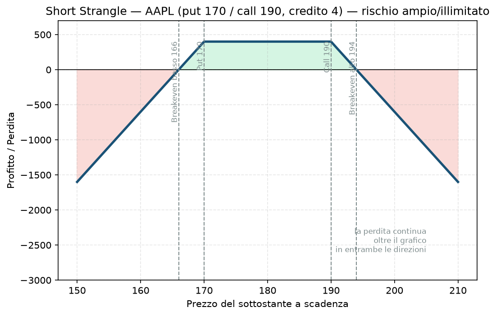

# 22. Short Strangle

L'ultima delle quattro combinazioni straddle/strangle, e la "cugina più educata" dello [20 - Short Straddle](20%20-%20Short%20Straddle.md): stesso rischio ampio/illimitato di fondo, ma un range di profitto più largo che la rende, nella pratica, un po' più gestibile — non meno pericolosa.

## Cos'è e come funziona

- **Vendi** una call OTM.
- **Vendi** una put OTM.

Incassi due premi, più piccoli di quelli di uno straddle ATM (perché le opzioni OTM valgono meno), ma in cambio hai un **range di prezzo più ampio** in cui il sottostante può muoversi restando comunque in profitto. È lo strumento "naked" per eccellenza delle strategie neutrali che vendono volatilità — e non a caso è concettualmente identico a vendere contemporaneamente una [08 - Short Call (Naked Call)](08%20-%20Short%20Call%20%28Naked%20Call%29.md) e una [09 - Short Put (Naked Put)](09%20-%20Short%20Put%20%28Naked%20Put%29.md).

## Il grafico payoff

Put strike 170, call strike 190, credito incassato 4. Il "tetto" di profitto è piatto tra i due strike:

- Tra 170 e 190: profitto massimo piatto, pari al credito incassato — più ampio del range di profitto dello short straddle (172-188).
- Fuori da quel range: la perdita cresce linearmente e continua ben oltre i limiti del grafico, senza un tetto teorico sul lato call.

## Esempio numerico concreto

*Esempio didattico, numeri arrotondati, non prezzi live verificati.*

AAPL a 180$. Vendi put 170 e call 190 a 2$ ciascuna, stessa scadenza. Multiplier 100$.

- **Credito incassato:** (2 + 2) × 100 = **400$** — profitto massimo se AAPL scade tra 170 e 190.
- **Breakeven basso:** 166$ — **Breakeven alto:** 194$
- Se AAPL sale a 220$: la call venduta vale 30$, perdita netta = (30 − 4) × 100 = **2.600$**, sei volte e mezzo il guadagno massimo possibile.

## Quando si usa (casi d'uso)

- **Aspettativa di movimento contenuto ma non nullo**: a differenza dello short straddle, qui ti va bene anche un piccolo movimento, purché resti dentro il range 170-190.
- **IV Rank alto su un sottostante che storicamente si muove meno di quanto l'IV suggerisca** — la scommessa classica di chi vende volatilità: il mercato sta "sovraprezzando" la paura.
- **Quasi sempre, nella pratica seria, con protezione aggiuntiva**: proprio come per lo short straddle, la forma "istituzionale" e gestibile di questa strategia è l'[23 - Iron Condor](23%20-%20Iron%20Condor.md), dove comprando due ali si trasforma il rischio da illimitato a definito.

## Pericoli e cosa può andare storto

- **Stesso identico problema dello short straddle, in forma leggermente attenuata**: rischio ampio al ribasso, illimitato al rialzo. Il range più largo riduce la probabilità di essere toccati, ma non elimina la gravità di cosa succede se lo sei.
- **Falso senso di sicurezza**: proprio perché il range di profitto è più ampio e la probabilità di successo per trade è più alta, è facile sottovalutare quanto sia squilibrato il rapporto tra il guadagno tipico (piccolo, frequente) e la perdita rara ma enorme quando arriva — la classica trappola "vinco spesso piccolo, perdo raramente ma tantissimo".
- **Il Piano evita esattamente questo compromesso**: la regola "solo rischio definito, mai naked (tranne strangle su indice ≤20% del bucket A)" mostra che anche il Piano riconosce uno spazio limitato per questa strategia — mai come pilastro centrale, solo come eccezione controllata e piccola.
- **Errore da principiante**: confondere "probabilità alta di successo per singolo trade" con "strategia sicura nel tempo" — su un numero sufficiente di trade ripetuti, l'evento raro arriva, ed è quello che decide il risultato finale cumulato.
- **Difesa in caso di minaccia**: se il prezzo si avvicina a uno dei due strike venduti, le tecniche di [31 - Rolling](31%20-%20Rolling.md) (spostare lo strike minacciato) e [32 - Inversione e Trasformazione](32%20-%20Inversione%20e%20Trasformazione.md) (comprare protezione, trasformando la posizione in un Iron Condor) sono gli strumenti concreti per intervenire prima che la perdita diventi ingestibile.

## Capitale richiesto

Come lo short straddle, il margine richiesto dal broker è calcolato su scenari di stress legati al valore nozionale del sottostante, non un numero fisso — tipicamente un po' meno oneroso dello short straddle a parità di sottostante (gli strike sono più lontani dal prezzo attuale, quindi il rischio "vicino" è percepito come minore), ma comunque significativamente più alto di uno spread a rischio definito equivalente.

Se il Piano prevede uno spazio per lo strangle naked su indice (fino al 20% del bucket A, e solo dopo 6-12 mesi di journal con gli spread standard), quello spazio andrebbe comunque dimensionato con lo stesso rigore usato per il resto del portafoglio: il fatto che sia "permesso in piccola parte" non significa che il singolo trade richieda meno attenzione — anzi, il contrario.

## Legami con altre strategie

- Speculare esatto: [21 - Long Strangle](21%20-%20Long%20Strangle.md).
- Versione con strike più stretti (ATM): [20 - Short Straddle](20%20-%20Short%20Straddle.md).
- Aggiungendo una put comprata sotto lo strike venduto e una call comprata sopra, diventa un [23 - Iron Condor](23%20-%20Iron%20Condor.md) — il modo in cui questa strategia si trasforma da "rischio ampio/illimitato" a "rischio definito e conosciuto in anticipo", ed è la forma in cui la incontrerai davvero, se mai la userai, nel tuo piano reale.
