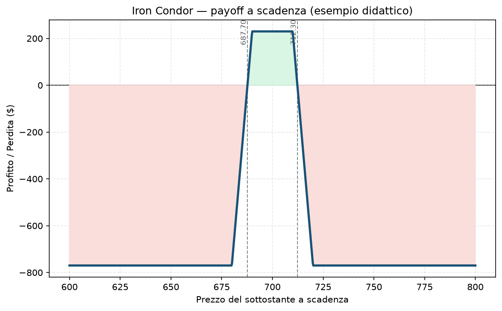

# 23. Iron Condor

L'Iron Condor è probabilmente la struttura più famosa tra chi vende opzioni su indici — non a caso è quella su cui è costruito il core del tuo stesso progetto di trading. L'idea è semplice da dire e un po' meno da eseguire bene: scommetti che il mercato resti dentro un certo range fino a scadenza, e vieni pagato per questa scommessa.

## Cos'è e come funziona

Un Iron Condor è, letteralmente, la somma di due spread verticali che già conosci: un **[17 - Bull Put Spread](17%20-%20Bull%20Put%20Spread.md)** (vendi una put, ne compri un'altra più lontana come protezione) e un **[18 - Bear Call Spread](18%20-%20Bear%20Call%20Spread.md)** (vendi una call, ne compri un'altra più lontana come protezione), aperti insieme sullo stesso sottostante e sulla stessa scadenza.

Quattro gambe in totale:
- **Vendi 1 Put** a uno strike sotto il prezzo attuale (incassi premio)
- **Compri 1 Put** a uno strike ancora più basso (paghi premio, è la tua protezione)
- **Vendi 1 Call** a uno strike sopra il prezzo attuale (incassi premio)
- **Compri 1 Call** a uno strike ancora più alto (paghi premio, è la tua protezione)

Il risultato netto è quasi sempre un **credito** (incassi più di quanto paghi), perché le opzioni vendute sono più vicine al prezzo attuale (quindi più "care") di quelle comprate. Il tuo obiettivo: che il sottostante rimanga tra i due strike venduti fino a scadenza, così tutte e quattro le opzioni scadono senza valore e tu tieni l'intero credito.

## Il grafico payoff

La forma è quella "a trapezio" tipica: un plateau di profitto piatto al centro (tra i due strike venduti), due rampe di perdita ai lati, e poi la perdita si stabilizza a un livello massimo fisso — non cresce più oltre un certo punto, perché ogni gamba venduta ha la sua protezione comprata a coprirla. Nell'esempio del grafico: put venduta a 690 / put comprata a 680, call venduta a 710 / call comprata a 720, per un credito netto di 2,30. Il profitto massimo (230 $ per contratto, moltiplicatore 100) si ottiene per qualsiasi prezzo tra 690 e 710 a scadenza. I due breakeven sono a 687,70 e 712,30. Oltre quei punti la perdita cresce fino a un massimo di 770 $ per lato, poi resta lì piatta.

## Esempio numerico concreto

*Esempio didattico, numeri arrotondati — non sono quotazioni reali.*

Indice a 700 punti, moltiplicatore 100:
- Vendi put 690 (incassi 1,85) / Compri put 680 (paghi 0,65) → credito put spread 1,20
- Vendi call 710 (incassi 1,70) / Compri call 720 (paghi 0,60) → credito call spread 1,10
- **Credito totale: 2,30 → 230 $ incassati subito**

- **Profitto massimo:** 230 $ (se il sottostante scade tra 690 e 710)
- **Perdita massima:** larghezza dello spread (10 punti = 1.000 $) meno il credito incassato (230 $) = **770 $** per lato
- **Breakeven:** 687,70 (basso) e 712,30 (alto)
- **ROI sul margine:** margine richiesto ≈ perdita massima = 770 $. Rendimento potenziale 230/770 ≈ **30%** sul capitale a rischio, se il trade va a buon fine

## Quando si usa (casi d'uso)

- **View neutrale/laterale:** ti aspetti che il mercato non faccia grandi mosse fino a scadenza — è lo scenario ideale, non uno dei tanti.
- **Volatilità implicita alta o comunque "cara" rispetto al passato recente** (IV Rank alto): più IV vendi, più premio incassi per la stessa distanza di strike, quindi il rapporto rischio/rendimento migliora. È lo stesso principio con cui il Piano decide quando aprire core: IV Rank basso → premio compresso → meno conveniente.
- **Indici, non singole azioni:** meno rischio di gap improvvisi da earnings o notizie societarie specifiche — motivo per cui XSP ed Euro Stoxx 50 sono candidati naturali, non azioni singole.
- **Dopo un evento di volatilità (es. FOMC, CPI) quando la IV si "sgonfia":** puoi vendere un condor per catturare il crollo della volatilità implicita (effetto "IV crush"), oltre al semplice passare del tempo.

## Pericoli e cosa può andare storto

- **Il rischio è asimmetrico rispetto al rendimento:** rischi 770 $ per guadagnarne 230. Serve un tasso di successo alto (storicamente il 70-85% per strike a delta 10-20) solo per pareggiare nel lungo periodo — un errore comune è pensare "vinco quasi sempre" senza fare i conti su quanto si perde le poche volte che va male.
- **Gamma risk vicino a scadenza:** se il prezzo finisce vicino a uno dei due strike venduti negli ultimi giorni di vita dell'opzione, il valore della posizione può oscillare violentemente per piccoli movimenti del sottostante — il classico motivo per cui il Piano prevede di chiudere prima, non aspettare la scadenza.
- **Rischio di assegnazione anticipata sulla gamba corta** (soprattutto su opzioni su singole azioni con dividendi — molto meno rilevante su indici cash-settled come XSP/SPX/ESTX50, che si regolano in contanti e non prevedono assegnazione di azioni).
- **Movimento improvviso e violento in entrambe le direzioni non ti salva:** a differenza di una posizione direzionale, qui perdi se il mercato si muove *comunque*, in qualsiasi verso, oltre gli strike — è per questo che nel tuo Piano l'Iron Condor (nella forma di bull put + bear call separati) vive sempre insieme a un hedge di coda che lo protegga dai movimenti estremi.
- **Errore da principianti:** aprire troppi Iron Condor sulla stessa scadenza contemporaneamente (concentrazione di rischio) — è esattamente il motivo del limite di laddering nel tuo Piano (mai più del 30% del rischio su una sola scadenza).

## Capitale richiesto

Il margine per un Iron Condor è definito e pari alla perdita massima (770 $ nell'esempio sopra), non di più — è uno dei vantaggi di questa struttura rispetto a vendere opzioni nude. Su un capitale di esempio di **30.000 €**, un singolo Iron Condor con questi parametri impegna circa il **2,5-3%** del NAV, coerente con il limite del tuo Piano (buying power ≤ 5% NAV per posizione). Su un capitale target di 100.000 € lo stesso trade scalato proporzionalmente (in size, non in struttura) impegnerebbe una frazione ancora più piccola del portafoglio, permettendo più laddering su scadenze diverse. Con **portfolio margin** (IBKR, richiede requisiti minimi di capitale) il margine può risultare più basso di quello Reg-T standard perché il broker valuta il rischio netto del portafoglio invece che gamba per gamba — utile saperlo, ma da verificare sempre col Risk Navigator prima di contarci.

## Legami con altre strategie

- **[17 - Bull Put Spread](17%20-%20Bull%20Put%20Spread.md)** e **[18 - Bear Call Spread](18%20-%20Bear%20Call%20Spread.md)**: l'Iron Condor non è altro che questi due spread aperti insieme. Se capisci bene quei due, l'Iron Condor non aggiunge nulla di concettualmente nuovo — solo due gambe in più.
- **[24 - Iron Butterfly](24%20-%20Iron%20Butterfly.md)**: la versione "concentrata" dell'Iron Condor, con gli strike venduti nello stesso punto (ATM) invece che separati — più premio, ma range di profitto molto più stretto.
- Per il dettaglio operativo di come il portafoglio sceglie strike, IV Rank e sizing per strutture di questo tipo, vedi l'approfondimento nel `Manuale.md` del progetto.
