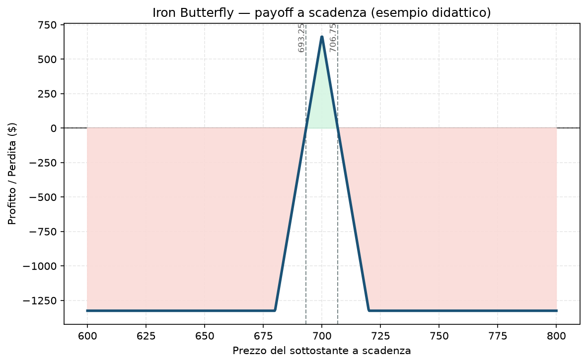

# 24. Iron Butterfly

Se l'[23 - Iron Condor](23%20-%20Iron%20Condor.md) è una scommessa "il mercato resta in un range", l'Iron Butterfly è la versione estrema della stessa idea: "il mercato resta *esattamente qui*, più o meno". Incassi molto di più, ma la finestra in cui hai ragione è molto più stretta.

## Cos'è e come funziona

Quattro gambe, stessa scadenza:
- **Vendi 1 Put ATM** (allo strike più vicino al prezzo attuale)
- **Vendi 1 Call ATM** (stesso strike della put venduta)
- **Compri 1 Put OTM** più in basso (protezione)
- **Compri 1 Call OTM** più in alto (protezione)

La differenza chiave con l'Iron Condor: lì vendevi put e call a strike *diversi* (uno sotto, uno sopra il prezzo attuale, con una zona di profitto larga in mezzo). Qui vendi put e call allo **stesso strike**, di solito il più vicino possibile al prezzo corrente. Stai letteralmente vendendo uno straddle ATM (vedi [20 - Short Straddle](20%20-%20Short%20Straddle.md)) e comprando ai lati una put e una call più lontane per definire il rischio — è un modo di dire "trasformo uno short straddle, che avrebbe rischio illimitato, in una struttura a rischio definito".

## Il grafico payoff

Il profitto massimo si ottiene solo se il sottostante scade esattamente allo strike centrale (700 nell'esempio) — da lì la curva scende ripidamente su entrambi i lati, molto più velocemente che nell'Iron Condor, per poi appiattirsi alla perdita massima una volta superate le opzioni comprate agli estremi. È una "tenda" stretta e alta, non un trapezio largo e basso.

## Esempio numerico concreto

*Esempio didattico, numeri arrotondati — non sono quotazioni reali.*

Indice a 700 punti, moltiplicatore 100:
- Vendi put 700 (incassi 4,20) e vendi call 700 (incassi 3,80) → **7,00** di premio ATM
- Compri put 680 (paghi 0,65) e compri call 720 (paghi 0,60) → **1,25** di protezione
- **Credito netto: 5,75 → 575 $ incassati**

- **Profitto massimo:** 575 $, solo se il sottostante chiude esattamente a 700
- **Perdita massima:** larghezza di ciascuna ala (20 punti = 2.000 $) meno il credito (575 $) = **1.425 $**
- **Breakeven:** 694,25 e 705,75 — una finestra di appena **11,50 punti** intorno allo strike centrale
- **ROI sul margine:** 575 / 1.425 ≈ **40%**, ma con probabilità di successo molto più bassa dell'Iron Condor: la finestra di profitto pieno è strettissima

## Quando si usa (casi d'uso)

- **View "pin" molto precisa:** ti aspetti che il sottostante resti fermo o quasi, non solo "in un range" — tipicamente in periodi di bassissima volatilità realizzata, o subito prima di un evento dopo cui ti aspetti che il prezzo torni al punto di partenza.
- **Vuoi il massimo credito possibile e accetti una probabilità di successo più bassa:** l'Iron Butterfly incassa molto di più dell'Iron Condor a parità di larghezza delle ali, ma serve un mercato molto più cooperativo.
- **Ridurre a rischio definito uno short straddle già in mente:** se stavi valutando uno [20 - Short Straddle](20%20-%20Short%20Straddle.md) ma il rischio illimitato ti spaventa (giustamente), l'Iron Butterfly è la sua versione "assicurata".

## Pericoli e cosa può andare storto

- **Gamma altissima intorno allo strike centrale, soprattutto a ridosso della scadenza:** un piccolo movimento del sottostante negli ultimi giorni può far oscillare il valore della posizione in modo molto più violento che in un Iron Condor — è la stessa gamba dello short straddle, solo con un tetto di perdita.
- **Pin risk alla scadenza:** se il sottostante chiude esattamente vicino allo strike centrale, può non essere chiaro in anticipo se le opzioni vendute scadranno ITM o OTM di pochi centesimi — attenzione a come il broker gestisce l'esercizio automatico, specie su opzioni con regolamento fisico (su indici cash-settled come XSP/SPX/ESTX50 il problema è molto minore, dato che il regolamento è sempre in contanti).
- **Probabilità di successo bassa rispetto all'Iron Condor:** un errore comune è confrontare solo il credito incassato ("guarda quanto rende!") senza notare che la finestra di profitto pieno è molto più stretta — un Iron Butterfly può avere probabilità di successo del 30-40%, contro il 70-85% di un Iron Condor ben costruito.
- **Gestione più impegnativa:** con una finestra di profitto così stretta, spesso conviene chiudere molto prima della scadenza (ad esempio al 25-50% del credito massimo) invece di aspettare, aumentando il turnover e i costi di transazione.

## Capitale richiesto

Margine definito, pari alla perdita massima (1.425 $ nell'esempio). Su un capitale di esempio di **30.000 €** un solo Iron Butterfly di questa dimensione impegna quasi il **5%** del NAV — al limite superiore di quanto il Piano permette per singola posizione, quindi in pratica da dimensionare più piccolo (ali più strette, o meno contratti) per restare dentro i limiti operativi del progetto. Su 100.000 € target la stessa struttura scala a una frazione più gestibile del portafoglio.

## Legami con altre strategie

- **[23 - Iron Condor](23%20-%20Iron%20Condor.md)**: la versione "allargata", con strike venduti separati invece che sovrapposti — più probabilità di successo, meno credito.
- **[20 - Short Straddle](20%20-%20Short%20Straddle.md)**: l'Iron Butterfly è esattamente uno short straddle con due ali comprate per definire il rischio.
- **[25 - Butterfly Spread](25%20-%20Butterfly%20Spread.md)**: stesso profilo di payoff "a tenda", costruito però con sole call (o sole put) invece che con la combinazione call+put — risultato economico quasi identico, meccanica leggermente diversa.
- Per come il Piano gestisce strutture ATM ad alta gamma, vedi l'approfondimento nel `Manuale.md` del progetto.
