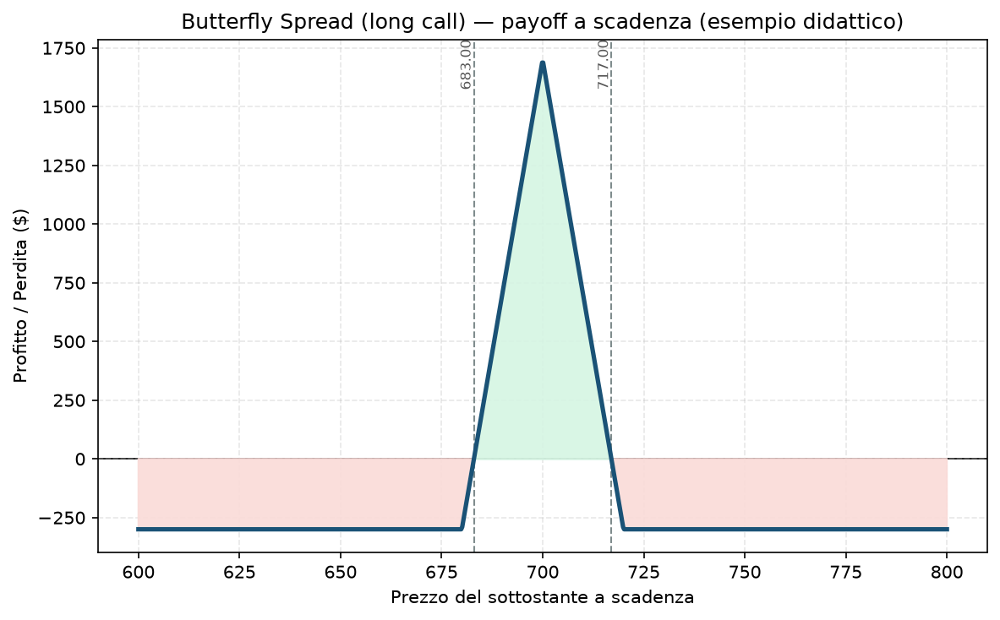

# 25. Butterfly Spread (Long Butterfly)

La Butterfly è l'[24 - Iron Butterfly](24%20-%20Iron%20Butterfly.md) vista da un'altra angolazione: stesso identico profilo di payoff a "tenda", ma costruita con opzioni tutte dello stesso tipo — solo call, oppure solo put — invece che mescolando le due. È una struttura a **debito** (paghi per aprirla), non a credito, e questo cambia il modo in cui la pensi.

## Cos'è e come funziona

Tre strike, quattro contratti, tutti call (o tutti put — qui usiamo le call, il ragionamento è identico specularmente con le put):

- **Compri 1 Call ITM/ATM** allo strike più basso (A)
- **Vendi 2 Call ATM/OTM** allo strike centrale (B)
- **Compri 1 Call OTM** allo strike più alto (C)

Gli strike sono equidistanti (es. 680 / 700 / 720 — 20 punti tra ciascuno). Il costo netto è quasi sempre un piccolo debito, perché vendi due opzioni centrali "care" ma ne compri due laterali più economiche — a conti fatti però il valore intrinseco che ricevi comprando in più vicino al denaro di solito supera quello incassato vendendo due opzioni leggermente più lontane, quindi paghi qualcosa per aprire la struttura.

## Il grafico payoff

Stessa forma a tenda dell'Iron Butterfly: profitto massimo esattamente allo strike centrale, perdita massima (limitata al debito pagato) su entrambi i lati oltre gli strike estremi. La differenza pratica: qui il rischio massimo è **quello che hai pagato per entrare**, non una perdita "potenziale" da calcolare come nell'Iron Butterfly — è psicologicamente più semplice da tenere a mente.

## Esempio numerico concreto

*Esempio didattico, numeri arrotondati — non sono quotazioni reali.*

Indice a 700 punti, moltiplicatore 100:
- Compri call 680 (paghi 25,00)
- Vendi 2x call 700 (incassi 14,00 ciascuna = 28,00)
- Compri call 720 (paghi 6,00)
- **Debito netto: 25 − 28 + 6 = 3,00 → 300 $ pagati**

- **Profitto massimo:** larghezza tra strike adiacenti (20 punti = 2.000 $) meno il debito (300 $) = **1.700 $**, solo se il sottostante chiude esattamente a 700
- **Perdita massima:** il debito pagato, **300 $** — punto, non c'è altro da calcolare
- **Breakeven:** 683 e 717
- **ROI sul capitale a rischio:** 1.700 / 300 ≈ **567%** nello scenario perfetto — ma è lo scenario meno probabile, non il caso base

## Quando si usa (casi d'uso)

- **Stesso identico scenario dell'Iron Butterfly:** ti aspetti che il sottostante resti fermo vicino a un livello preciso fino a scadenza.
- **Preferisci pensare in termini di "quanto rischio" invece di "quanto margine mi blocca il broker":** essendo una struttura a debito, il rischio massimo è il capitale che sborsi subito, senza calcoli aggiuntivi — alcuni trader lo trovano più intuitivo da gestire mentalmente rispetto a una struttura a credito.
- **Come scommessa a basso costo su un livello preciso:** ad esempio dopo un rally o un ribasso forte, se ti aspetti che il prezzo torni e si stabilizzi su un livello tecnico specifico (una media mobile chiave, un livello di supporto/resistenza).

## Pericoli e cosa può andare storto

- **Probabilità di successo bassa, esattamente come l'Iron Butterfly:** la finestra di profitto pieno è stretta, e la maggior parte delle volte la posizione scade con una perdita parziale o totale del debito pagato — è normale, non un segnale che la struttura sia "sbagliata".
- **Liquidità:** con quattro gambe e due contratti sulla centrale, lo spread bid-ask cumulato può erodere gran parte del vantaggio teorico, specialmente su sottostanti meno liquidi — controlla sempre il prezzo "mid" combinato prima di piazzare l'ordine, non gamba per gamba.
- **Errore comune da principianti:** aprire la Butterfly troppo lontana dal prezzo attuale "per giocare sul sicuro" — così facendo il costo si avvicina alla larghezza massima delle ali e il rapporto rischio/rendimento peggiora drasticamente, perché stai pagando quasi tutto il valore potenziale della struttura.
- **Il tempo NON è sempre tuo amico come nel core del tuo Piano:** vicino a scadenza, se il prezzo è lontano dallo strike centrale, il valore della Butterfly tende verso zero (perdi il debito) — se invece è vicino, il valore tende verso il massimo. È una posizione "theta positiva solo se hai ragione sulla direzione/livello", diversa dal theta quasi sempre positivo di un Iron Condor ben posizionato.

## Capitale richiesto

Il capitale richiesto è semplicemente il debito pagato, **300 $** nell'esempio — nessun margine aggiuntivo oltre a questo, perché il rischio massimo è già interamente definito e pagato in anticipo. Su un capitale di esempio di **30.000 €** questo tipo di posizione impegna meno dell'**1%** del NAV: è tra le strutture più economiche da aprire in termini assoluti, anche se il rapporto rischio/rendimento reale (tenendo conto della bassa probabilità di successo) non è "gratis" come potrebbe sembrare guardando solo la size ridotta.

## Legami con altre strategie

- **[24 - Iron Butterfly](24%20-%20Iron%20Butterfly.md)**: stesso profilo di payoff, costruita a credito con call+put invece che a debito con sole call (o sole put) — economicamente quasi equivalenti, differiscono per trattamento del margine e per come "si sente" psicologicamente il rischio.
- **[26 - Condor Spread](26%20-%20Condor%20Spread.md)**: la versione "allargata" della Butterfly, con due strike centrali diversi invece di uno solo raddoppiato — più margine di errore, meno profitto massimo.
- Per la logica di scelta tra strutture a debito e a credito nel tuo progetto, vedi l'approfondimento nel `Manuale.md`.
