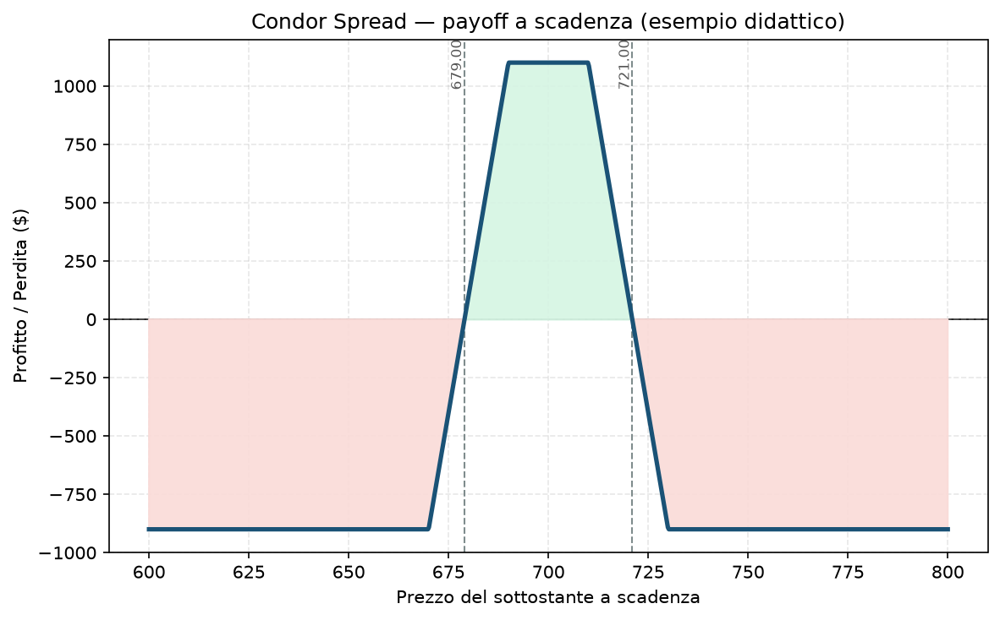

# 26. Condor Spread

Se la [25 - Butterfly Spread](25%20-%20Butterfly%20Spread.md) ti chiede di indovinare un livello preciso, il Condor Spread è la sua versione più "clemente": stessa filosofia, ma con un plateau di profitto massimo largo invece che un unico punto. Il nome non è casuale — è imparentato con l'[23 - Iron Condor](23%20-%20Iron%20Condor.md), solo costruito con opzioni tutte dello stesso tipo invece che a credito misto.

## Cos'è e come funziona

Quattro strike distinti, tutti equidistanti, tutte call (o tutte put):

- **Compri 1 Call ITM** allo strike più basso (A)
- **Vendi 1 Call** allo strike successivo (B)
- **Vendi 1 Call** allo strike ancora successivo (C)
- **Compri 1 Call OTM** allo strike più alto (D)

La differenza con la Butterfly: lì vendevi **due** call allo **stesso** strike centrale. Qui vendi **una** call a due strike **diversi** (B e C). Il risultato è un profilo di payoff quasi identico nella forma, ma con la cima piatta invece che a punta — profitto massimo per qualunque prezzo tra B e C, non solo esattamente in un punto.

## Il grafico payoff

Un trapezio, non una tenda a punta: la salita e la discesa sono identiche a quelle della Butterfly, ma tra i due strike centrali il profitto resta costante al massimo invece di calare subito dopo il picco. È letteralmente il prezzo (in termini di profitto massimo più basso) che paghi per avere più margine di errore su *dove* il sottostante deciderà di fermarsi.

## Esempio numerico concreto

*Esempio didattico, numeri arrotondati — non sono quotazioni reali.*

Indice a 700 punti, moltiplicatore 100, strike distanziati di 20 punti:
- Compri call 670 (paghi 40,00)
- Vendi call 690 (incassi 24,00)
- Vendi call 710 (incassi 13,00)
- Compri call 730 (paghi 6,00)
- **Debito netto: 40 − 24 − 13 + 6 = 9,00 → 900 $ pagati**

- **Profitto massimo:** larghezza tra i due strike interni (690→710 = 20 punti = 2.000 $) meno il debito (900 $) = **1.100 $**, per qualsiasi prezzo tra 690 e 710
- **Perdita massima:** il debito pagato, **900 $**
- **Breakeven:** 679 e 721
- **ROI sul capitale a rischio:** 1.100 / 900 ≈ **122%** nello scenario di successo — molto più raggiungibile della Butterfly (dove serve un prezzo esatto), ma con rendimento massimo proporzionalmente più basso

## Quando si usa (casi d'uso)

- **View "in un range", non "su un livello preciso":** la scelta naturale quando hai un'idea di dove il mercato si fermerà ma non hai la presunzione di indovinare il punto esatto — molto più realistico nella pratica della Butterfly.
- **Alternativa a debito all'Iron Condor:** stesso tipo di scommessa (range) ma costruita come struttura a debito con opzioni omogenee — utile se preferisci ragionare "quanto rischio in assoluto" invece che in termini di margine su una struttura a credito.
- **Dopo un evento di volatilità, quando ti aspetti un range di consolidamento** più ampio di quanto un singolo Iron Butterfly potrebbe catturare, ma comunque contenuto.

## Pericoli e cosa può andare storto

- **Quattro gambe, quattro spread bid-ask da pagare:** ancora più che nella Butterfly, i costi di esecuzione possono mangiare una fetta importante del vantaggio teorico — fondamentale usare ordini a prezzo combinato (combo/spread order) e non gamba per gamba.
- **Il profitto massimo è più basso rispetto a una Butterfly della stessa larghezza totale:** il compromesso "più probabilità di successo" si paga in "meno guadagno se va bene" — un errore è dimenticarsi questo trade-off e confrontare solo la probabilità senza guardare il rendimento atteso complessivo.
- **Gestione vicino a scadenza:** come per Butterfly e Iron Butterfly, il valore della posizione diventa molto sensibile a dove si trova il prezzo negli ultimi giorni — se il prezzo è appena fuori dal plateau, il valore può cambiare rapidamente con piccoli movimenti.
- **Errore da principianti:** costruire un Condor con strike troppo vicini tra loro pensando di "risparmiare" sul debito — così facendo si restringe il plateau di profitto massimo fino quasi ad annullare il vantaggio rispetto a una semplice Butterfly.

## Capitale richiesto

Anche qui il capitale richiesto coincide con il debito pagato: **900 $** nell'esempio, nessun margine ulteriore. Su un capitale di esempio di **30.000 €**, questa posizione impegna circa il **3%** del NAV — dentro i limiti tipici di size per singolo trade del tuo Piano. Su un capitale target di 100.000 € la stessa struttura, scalata, diventa una frazione ancora più piccola del portafoglio.

## Legami con altre strategie

- **[25 - Butterfly Spread](25%20-%20Butterfly%20Spread.md)**: la versione "concentrata", con un unico strike centrale raddoppiato invece di due strike separati — più profitto massimo, meno margine di errore.
- **[23 - Iron Condor](23%20-%20Iron%20Condor.md)**: stessa identica idea di "range di profitto", costruita a credito con call+put invece che a debito con sole call (o sole put).
- Per capire quando il Piano preferisce strutture a debito rispetto a quelle a credito, vedi l'approfondimento nel `Manuale.md`.
