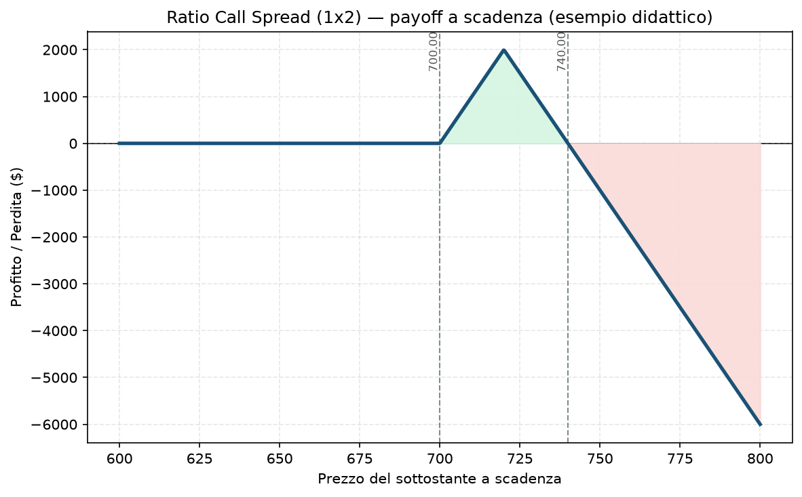

# 27. Ratio Call Spread

Qui entriamo in territorio più pericoloso. Il Ratio Call Spread è spesso venduto come "il trade quasi gratis" — e in un certo senso lo è, nella parte centrale del grafico. Il problema è cosa succede se il mercato sale davvero tanto: lì il "quasi gratis" si trasforma in una perdita che cresce senza un vero tetto.

## Cos'è e come funziona

Due strike, ma non in quantità 1-a-1 come in un normale [15 - Bull Call Spread](15%20-%20Bull%20Call%20Spread.md):

- **Compri 1 Call** a uno strike più vicino al prezzo attuale (ITM o ATM)
- **Vendi 2 (o più) Call** a uno strike più lontano (OTM)

Il rapporto tipico è 1x2 (compri una, vendi due), ma esistono varianti 1x3. Vendendo più opzioni di quante ne compri, incassi un premio maggiore — spesso abbastanza da coprire quasi interamente (o del tutto) il costo della call comprata, rendendo l'apertura quasi a costo zero.

Il punto cruciale, spesso sottovalutato: **dallo strike venduto in su, hai una call "scoperta" netta.** La call comprata copre solo una delle due vendute — l'altra resta senza protezione, esattamente come una [08 - Short Call (Naked Call)](08%20-%20Short%20Call%20%28Naked%20Call%29.md) a tutti gli effetti.

## Il grafico payoff

Guarda bene la parte destra del grafico: dopo il picco di profitto (allo strike venduto), la linea non si appiattisce come in uno spread normale — **continua a scendere linearmente, senza fine.** È la firma visiva del rischio illimitato di questa struttura. Nell'esempio: comprando 1 call 700 e vendendo 2 call 720 a costo netto zero, il profitto massimo (2.000 $) si ottiene esattamente a 720, il breakeven superiore è 740, e oltre quel punto ogni punto in più del sottostante costa 100 $ di perdita in più, senza limite teorico.

## Esempio numerico concreto

*Esempio didattico, numeri arrotondati — non sono quotazioni reali.*

Indice a 700 punti, moltiplicatore 100:
- Compri 1 call 700 (paghi 18,00)
- Vendi 2 call 720 (incassi 9,00 ciascuna = 18,00)
- **Costo netto: 18 − 18 = 0,00 → trade "a costo zero"**

- **Sotto 700 a scadenza:** profitto/perdita = 0 (nessun costo, nessun guadagno)
- **Tra 700 e 720:** il profitto cresce fino al massimo di **2.000 $** esattamente a 720
- **Sopra 720:** il profitto cala e diventa perdita oltre **740** (il breakeven superiore) — da lì, **ogni punto in più costa 100 $ in più**, indefinitamente. Un rialzo a 800 (100 punti sopra il breakeven) costerebbe **10.000 $** di perdita — dieci volte il "premio a rischio zero" che sembrava di aver pagato

## Quando si usa (casi d'uso)

- **View moderatamente rialzista, ma con convinzione che un rally violento sia improbabile:** il Ratio Call Spread paga bene se il sottostante sale fino allo strike venduto e si ferma lì — è una scommessa su "sale, ma non troppo".
- **Come alternativa "a sconto" a un semplice Bull Call Spread:** vendendo una gamba in più incassi premio aggiuntivo, ma accetti il rischio di coda al rialzo in cambio.
- **Trader esperti che gestiscono attivamente la posizione:** raramente si tiene fino a scadenza — si aggiusta o si chiude se il sottostante si avvicina troppo allo strike venduto, trasformandolo eventualmente in un [23 - Iron Condor](23%20-%20Iron%20Condor.md) comprando protezione ulteriore, o si rolla la gamba scoperta più lontano.

## Pericoli e cosa può andare storto

- **Il rischio illimitato è reale, non teorico:** un gap up violento su una notizia (fusione, earnings sorprendenti su una singola azione, un evento macro estremo su un indice) può generare una perdita enorme rispetto al capitale apparentemente "a rischio zero" messo in campo all'apertura. Questo è esattamente il tipo di rischio che il Piano esclude per principio (bucket A: "solo rischio definito, mai naked").
- **L'illusione del "trade gratis":** il fatto che il costo netto sia zero (o vicino a zero) non significa rischio zero — è uno degli errori psicologici più comuni con questa struttura. Il prezzo che paghi per "non pagare nulla" è il rischio di coda scoperto.
- **Margine che può esplodere in caso di rally forte:** anche prima di arrivare a scadenza, se il sottostante si muove rapidamente verso e oltre lo strike venduto, il broker può richiedere margine aggiuntivo in modo consistente, con effetto margin call in scenari estremi.
- **Non adatta a indici cash-settled senza un piano di gestione attivo:** su strumenti come XSP o SPX, dove parliamo di livelli di indice e non di singole azioni, un rally del 10-15% in poche settimane non è uno scenario esotico — è già successo diverse volte negli ultimi anni.

## Capitale richiesto

Qui la faccenda è delicata: il costo di apertura può essere zero o quasi, ma **il margine richiesto dal broker non è zero**, perché la gamba scoperta ha rischio potenzialmente illimitato — IBKR (come la maggior parte dei broker) calcola il margine sulla base dello scenario di perdita, non sul costo di apertura. In pratica il margine bloccato può essere significativo, spesso paragonabile a quello di una short call nuda della stessa size. Su un capitale di esempio di **30.000 €**, questa è una struttura da evitare o da usare solo con size minima e un piano di gestione attivo — è coerente con la decisione già presa nel tuo progetto di **non usare posizioni a rischio non definito nella fase attuale**.

## Legami con altre strategie

- **[15 - Bull Call Spread](15%20-%20Bull%20Call%20Spread.md)**: la versione "sicura" e proporzionata (1 compra, 1 vende) di questa idea — nessun rischio di coda.
- **[08 - Short Call (Naked Call)](08%20-%20Short%20Call%20%28Naked%20Call%29.md)**: la gamba scoperta oltre lo strike venduto si comporta esattamente come una naked call per quella porzione di rischio.
- **[28 - Ratio Put Spread](28%20-%20Ratio%20Put%20Spread.md)**: lo specchio ribassista di questa struttura, con lo stesso identico problema di fondo sul lato opposto.
- **[35 - ZEBRA](35%20-%20ZEBRA.md)**: stesso rapporto 2:1, ma rovesciato (2 lunghe contro 1 corta) — lì il rischio è definito, non illimitato. Non confonderli nonostante la somiglianza superficiale.
- Il Piano attuale non prevede strutture a rischio non definito come questa — vedi `Manuale.md` per il ragionamento completo dietro questa scelta.
