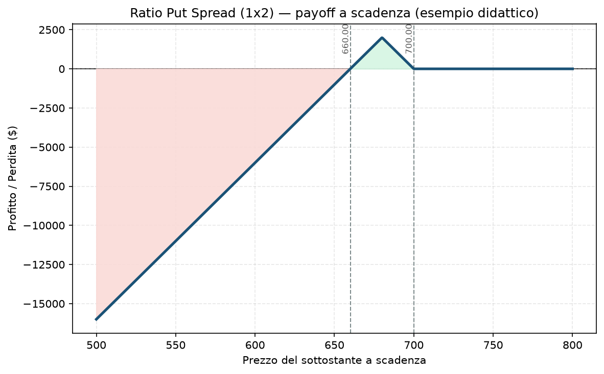

# 28. Ratio Put Spread

Lo specchio ribassista del [27 - Ratio Call Spread](27%20-%20Ratio%20Call%20Spread.md) — stessa logica, stesso "trade quasi gratis" apparente, stesso rischio di coda nascosto. Qui però la direzione del pericolo cambia: non è un rally violento a farti male, è un **crollo** violento. E dato che il tuo intero progetto esiste per proteggersi proprio da quello scenario, questa è la strategia dell'elenco più in contraddizione diretta con la filosofia del tuo Piano.

## Cos'è e come funziona

- **Compri 1 Put** a uno strike più vicino al prezzo attuale (ITM o ATM)
- **Vendi 2 (o più) Put** a uno strike più lontano, più in basso (OTM)

Come nel Ratio Call Spread, vendere più opzioni di quante se ne comprano genera un premio che spesso azzera (o quasi) il costo netto di apertura. E come lì, la gamba scoperta — qui sotto lo strike venduto — si comporta come una put nuda per la parte non coperta.

## Il grafico payoff

Specchiato rispetto al Ratio Call Spread: il profitto massimo si ottiene allo strike venduto, poi la linea scende linearmente man mano che il prezzo continua a scendere sotto il breakeven inferiore. **Una differenza tecnica importante da avere chiara:** con le call il rischio è "illimitato" in senso letterale (il prezzo può salire all'infinito); con le put il rischio è **enorme ma tecnicamente finito**, perché il sottostante non può scendere sotto zero. Non è una consolazione pratica: nell'esempio, un crollo a zero costerebbe comunque circa **66.000 $** di perdita su un trade aperto "a costo zero".

## Esempio numerico concreto

*Esempio didattico, numeri arrotondati — non sono quotazioni reali.*

Indice a 700 punti, moltiplicatore 100:
- Compri 1 put 700 (paghi 18,00)
- Vendi 2 put 680 (incassi 9,00 ciascuna = 18,00)
- **Costo netto: 18 − 18 = 0,00 → trade "a costo zero"**

- **Sopra 700 a scadenza:** profitto/perdita = 0
- **Tra 680 e 700:** il profitto cresce fino al massimo di **2.000 $** esattamente a 680
- **Sotto 680:** il profitto cala e diventa perdita oltre **660** (breakeven inferiore) — da lì, **ogni punto in meno costa 100 $ in più** di perdita. Un crollo a 600 (60 punti sotto il breakeven) costerebbe **6.000 $**; un crollo estremo verso zero, teoricamente fino a circa **66.000 $** — sessantasei volte il "rischio zero" apparente all'apertura

## Quando si usa (casi d'uso)

- **View moderatamente ribassista, ma con convinzione che un crollo violento sia improbabile:** paga bene se il sottostante scende fino allo strike venduto e si ferma lì.
- **Come alternativa "a sconto" a un semplice [16 - Bear Put Spread](16%20-%20Bear%20Put%20Spread.md):** stesso principio del Ratio Call Spread, sul lato opposto.
- **Trader esperti con gestione attiva e capitale sufficiente a reggere margine variabile:** anche qui, raramente si tiene fino a scadenza senza intervento.

## Pericoli e cosa può andare storto

- **È l'esatto contrario di quello che il portafoglio è costruito per fare:** il Piano dedica un intero bucket (C, l'hedge di coda) e un circuit breaker a più livelli specificamente per proteggerti da un crollo violento e improvviso. Un Ratio Put Spread aperto senza pensarci fa l'opposto: **ti espone di più** proprio in quello scenario, con una posizione che si comporta come una put nuda proprio quando il mercato crolla — il momento peggiore possibile per avere rischio scoperto.
- **Il crollo che fa male a questa struttura è esattamente il tipo di evento (VIX che esplode, drawdown a doppia cifra in pochi giorni) che il Piano classifica come scenario da Livello 2/3 del circuit breaker.** Avere una posizione di questo tipo in portafoglio in quel momento significherebbe subire una perdita che cresce proprio mentre il resto del sistema di difesa sta cercando di contenerla altrove.
- **L'illusione del "trade gratis" è ancora più insidiosa qui:** un crollo di mercato spesso arriva insieme a un'esplosione della volatilità implicita, che gonfia ulteriormente il valore delle put vendute (non coperte) ben oltre il solo movimento di prezzo — la perdita mark-to-market può crescere più velocemente di quanto suggerisca il solo payoff a scadenza.
- **Margine variabile e potenzialmente molto elevato in caso di stress**, proprio nel momento in cui la liquidità e il margine disponibile sono più preziosi.

## Capitale richiesto

Come per il Ratio Call Spread, il costo di apertura può essere vicino a zero ma il margine richiesto no — riflette il rischio potenziale della gamba scoperta, e può crescere rapidamente proprio nei momenti di stress di mercato (quando il broker alza i requisiti di margine, esattamente lo scenario S4 del tuo Piano — gap improvviso). **Questa è una struttura da considerare incompatibile con la fase attuale del tuo progetto**, non tanto per il capitale assoluto richiesto quanto per il tipo di rischio: va nella direzione opposta rispetto a "protezione sempre attiva" che è il principio cardine del Piano.

## Legami con altre strategie

- **[27 - Ratio Call Spread](27%20-%20Ratio%20Call%20Spread.md)**: lo specchio rialzista, stesso meccanismo, stesso tipo di rischio di coda sul lato opposto.
- **[16 - Bear Put Spread](16%20-%20Bear%20Put%20Spread.md)**: la versione proporzionata e a rischio definito della stessa view ribassista.
- **[08 - Short Call (Naked Call)](08%20-%20Short%20Call%20%28Naked%20Call%29.md)** e **[09 - Short Put (Naked Put)](09%20-%20Short%20Put%20%28Naked%20Put%29.md)**: la gamba scoperta di questa struttura è, a tutti gli effetti pratici sotto lo strike venduto, una naked put.
- Il Piano esclude esplicitamente le posizioni a rischio non definito nella fase attuale — vedi il ragionamento completo in `Manuale.md`.
