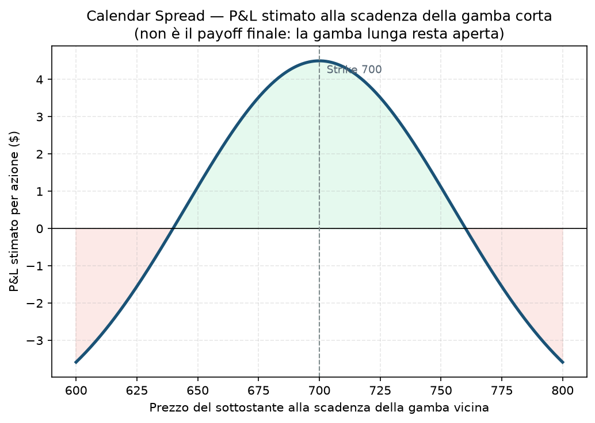

# 29. Calendar Spread

Fin qui tutte le strategie della guida avevano una cosa in comune: un'unica scadenza. Con il Calendar Spread cambia tutto — qui il protagonista non è più "dove va il prezzo" ma "quanto veloce passa il tempo". È la prima strategia della guida che gioca sul fatto che il decadimento temporale (theta) non è uguale per tutte le opzioni: un'opzione vicina alla scadenza perde valore molto più in fretta di una lontana. Il Calendar sfrutta proprio questa differenza di velocità.

Nella pratica capita che il core non si possa aprire (IV Rank troppo basso) e che il calendar sia la struttura giusta per quel regime.

## Cos'è e come funziona

Due gambe, stesso strike, scadenze diverse:
- **Vendi** un'opzione (call o put, di solito ATM o vicina) a scadenza breve (es. 30 giorni).
- **Compri** la stessa opzione (stesso strike, stesso tipo) a scadenza più lunga (es. 90 giorni).

È una posizione **a debito**: paghi di più per la gamba lunga di quanto incassi da quella corta, perché più tempo residuo = più valore estrinseco = premio più alto. Il costo netto (debito pagato) è anche la perdita massima possibile.

**Da cosa trai profitto:** la gamba corta perde valore (theta) più velocemente della gamba lunga, man mano che passano i giorni. Se il sottostante resta vicino allo strike, quando la gamba corta scade puoi richiuderla per pochissimo (o farla scadere) mentre la gamba lunga vale ancora parecchio — il differenziale è il tuo guadagno. È anche **long vega**: se la volatilità implicita sale nel frattempo, la gamba lunga (che ha più tempo, quindi più sensibilità alla IV) guadagna più di quanto perda la gamba corta.

## Il grafico

Nota bene, e questa è la cosa più importante da capire di questa strategia: **il grafico sopra NON è un payoff a scadenza definitivo come quelli delle strategie precedenti**. È una *stima* di quanto varrebbe la posizione nel giorno in cui scade la gamba corta — perché a quel punto la gamba lunga è ancora viva, ha ancora valore temporale, e quel valore dipende da dove si trova il sottostante in quel momento (più o meno vicino allo strike). Il grafico ha quindi la classica forma "a tenda": guadagno massimo vicino allo strike (dove la gamba lunga vale di più), perdita che tende al debito pagato man mano che il prezzo si allontana in entrambe le direzioni (lì le due opzioni, avendo lo stesso strike, si muovono quasi allo stesso modo e si compensano a vicenda).

## Esempio numerico concreto

Esempio didattico su un ipotetico sottostante a 695, calendar call strike 700:
- Vendi 1 call 700, scadenza 30 giorni, incassi **8,5 $**
- Compri 1 call 700, scadenza 90 giorni, paghi **14,0 $**
- **Debito netto (perdita massima teorica): 5,5 $** per azione → 550 $ per 1 contratto standard (100 azioni)

Se tra 30 giorni il sottostante è ancora vicino a 700, la gamba corta scade quasi senza valore (la incassi tutta) mentre la gamba lunga vale ancora, diciamo, 10 $ (ha perso valore anche lei per il passare del tempo, ma meno). Risultato stimato: circa **+4,5 $** per azione (450 $), su un investimento di 550 $ — più del 80% di rendimento sul capitale impegnato in un mese, se il sottostante è rimasto fermo.

## Quando si usa (casi d'uso)

- **IV Rank basso** sul sottostante che vuoi tradare (esattamente il caso del 16/09/2026 nel progetto): comprare volatilità "a sconto" invece di venderla a premi compressi.
- Vista **neutrale/laterale** di breve periodo: ti aspetti che il sottostante resti vicino allo strike scelto per le prossime settimane.
- Come alternativa al core quando il mercato non offre premi sufficienti per un credit spread classico.

## Pericoli e cosa può andare storto

- **Movimento violento del sottostante = il tuo nemico principale.** Se il prezzo scappa lontano dallo strike (in una direzione o nell'altra) prima della scadenza corta, la "tenda" del grafico ti dice tutto: perdi, fino quasi al massimo del debito pagato.
- **Gestione delle due gambe separatamente è più complessa** di uno spread a scadenza unica: devi decidere cosa fare della gamba lunga quando la corta scade (richiuderla tutta, o venderne un'altra a breve termine e "rollare" — vedi [31 - Rolling](31%20-%20Rolling.md)).
- **Rischio di volatilità al contrario:** se la IV crolla invece di salire (o resta compressa più a lungo del previsto), la gamba lunga perde valore più di quanto ti aspetti, anche se il prezzo resta fermo.
- **Liquidità:** verifica sempre bid-ask e open interest su entrambe le scadenze, non solo su quella vicina — una scadenza a 90 giorni su un sottostante poco liquido può avere spread molto larghi.

## Capitale richiesto

Non è un margine in senso classico (come per una posizione a credito): è un **debito** pagato subito, quindi il capitale richiesto è semplicemente il costo netto della posizione. Nell'esempio sopra, 550 $ per 1 contratto. Su un capitale come i 30.000 € della fase attuale del progetto dell'utente, un paio di calendar da 500-700 $/€ ciascuno restano una frazione piccola e gestibile del NAV — coerente con l'idea che il bucket B (le strategie satellite come questa) ha un budget dedicato del 15-20% del rischio totale ([Piano](../PIANO.md) §2).

## Legami con altre strategie

- Variante con strike diversi tra le due gambe: [30 - Diagonal Spread](30%20-%20Diagonal%20Spread.md).
- Quando la gamba corta si avvicina alla scadenza, spesso si decide se "rollarla" in avanti: [31 - Rolling](31%20-%20Rolling.md).
- Concettualmente è l'opposto di uno [Long Straddle](19%20-%20Long%20Straddle.md) o [Long Strangle](21%20-%20Long%20Strangle.md): anche quelli sono long vega, ma senza la componente di vendita a breve termine che qui finanzia parte del costo.
- Per il decadimento temporale (theta) alla base di tutto questo, vedi [03 - Theta](03%20-%20Theta.md).
