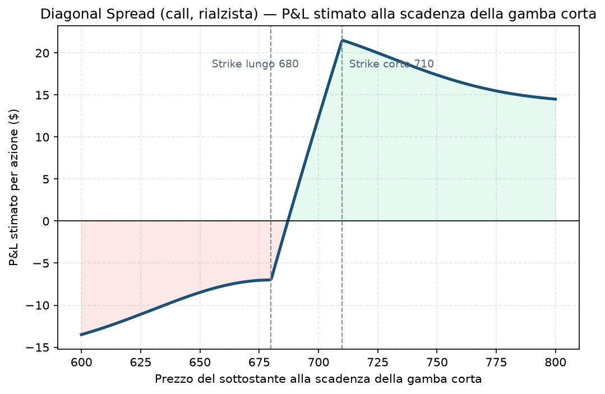

# 30. Diagonal Spread

Prendi un [Calendar Spread](29%20-%20Calendar%20Spread.md) e sposta anche lo strike, non solo la scadenza: hai un Diagonal Spread. Il nome viene proprio da questo — sul foglio delle opzioni (righe = strike, colonne = scadenze), il Calendar si muove solo in orizzontale (stessa riga, colonne diverse), il Diagonal si muove in diagonale (riga e colonna diverse insieme).

Questa è probabilmente la strategia più flessibile della guida, e non a caso: la [Poor Man's Covered Call](12%20-%20Poor%20Man's%20Covered%20Call%20%28PMCC%29.md) che hai già visto è, tecnicamente, un caso particolare di Diagonal Spread (con la gamba lunga molto ITM e a scadenza lunghissima).

## Cos'è e come funziona

Due gambe, strike diversi, scadenze diverse:
- **Compri** un'opzione con più tempo residuo, spesso a uno strike più vicino al prezzo attuale (più valore intrinseco, più "solida").
- **Vendi** un'opzione con meno tempo residuo, a uno strike diverso, di solito più OTM.

Puoi costruirlo rialzista, ribassista o neutrale a seconda di come scegli i due strike — è quello che lo rende così adattabile, ma anche più difficile da padroneggiare rispetto a un Calendar puro.

## Il grafico

Stesso discorso fatto per il Calendar: **questo non è un payoff a scadenza finale**, è una stima di dove sei alla scadenza della gamba corta, con la gamba lunga ancora viva. La forma qui è diversa dalla "tenda" simmetrica del Calendar: sale progressivamente verso lo strike della gamba lunga (dove il suo valore temporale residuo è massimo), poi tende ad appiattirsi su un plateau quando il sottostante è ben sopra entrambi gli strike — a quel punto le due opzioni, essendo entrambe molto ITM, si muovono quasi 1:1 col sottostante e la differenza tra i due prezzi resta all'incirca costante (la larghezza tra i due strike, meno il debito pagato).

## Esempio numerico concreto

Esempio didattico, sottostante a 695, diagonal call rialzista:
- Compri 1 call strike **680**, scadenza 90 giorni, paghi **22,0 $**
- Vendi 1 call strike **710**, scadenza 30 giorni, incassi **6,0 $**
- **Debito netto: 16,0 $** per azione → 1.600 $ per contratto

Se tra 30 giorni il sottostante è salito verso 685-690 (vicino allo strike della gamba lunga, sotto quello della gamba corta), la gamba lunga vale parecchio (intrinseco + tempo residuo) mentre la gamba corta scade quasi senza valore: la posizione può valere anche 21-22 $, per un guadagno stimato di 5-6 $ per azione (500-600 $) sul capitale di 1.600 $ investito.

## Quando si usa (casi d'uso)

- Hai una **view direzionale moderata** (non violenta) e vuoi finanziare parte del costo di una posizione direzionale a lungo termine vendendo tempo a breve termine — è esattamente la logica della PMCC.
- Vuoi **ridurre il costo** di una posizione tipo Calendar aggiungendo un po' di direzionalità, invece di restare puramente neutrale.
- Buon compromesso quando ti aspetti che il sottostante si muova, ma non sai quantificare bene la volatilità attesa — il Diagonal è meno sensibile a un errore di stima della IV rispetto a un Calendar puro sullo stesso strike.

## Pericoli e cosa può andare storto

- **Doppia fonte di rischio:** sbagli sia la direzione sia il timing e perdi su entrambi i fronti — più complesso da leggere di un semplice spread verticale o di un Calendar.
- **Se il sottostante sale troppo velocemente oltre lo strike corto**, la gamba venduta va in perdita rapida (assegnazione anticipata possibile se americana e ITM, specie vicino a dividendi su titoli singoli) mentre la gamba lunga non ha ancora guadagnato abbastanza intrinseco per compensare — soprattutto se il movimento avviene nei primi giorni, quando la gamba lunga ha ancora poco delta.
- **Gestione più delicata della semplice apertura**: quasi sempre un Diagonal richiede un piano di roll per la gamba corta (vedi [31 - Rolling](31%20-%20Rolling.md)) già scritto prima di aprirlo, non improvvisato dopo.
- **Liquidità su due strike e due scadenze diverse**: verifica entrambe, non solo la più liquida delle due.

## Capitale richiesto

Come per il Calendar, il capitale è il **debito netto pagato** — 1.600 $ nell'esempio sopra. È tipicamente più caro di un Calendar puro sullo stesso sottostante (lo strike della gamba lunga è più vicino al prezzo, quindi più costoso), quindi va dimensionato con più attenzione rispetto al bucket satellite del portafoglio: su un capitale di 30.000 €, una singola posizione da 1.500-1.600 € è già il 5% del NAV — al limite superiore di quanto il Piano permette per singola posizione ([Piano](../PIANO.md) §3, buying power ≤5% NAV).

## Legami con altre strategie

- Caso particolare più estremo (strike lunga molto ITM, scadenza lunghissima): [Poor Man's Covered Call](12%20-%20Poor%20Man's%20Covered%20Call%20%28PMCC%29.md).
- Versione "stesso strike" più semplice da leggere: [29 - Calendar Spread](29%20-%20Calendar%20Spread.md).
- La gestione della gamba corta quando si avvicina a scadenza è, di fatto, un roll continuo: vedi [31 - Rolling](31%20-%20Rolling.md).
- Per capire perché lo strike della gamba lunga conta così tanto per quanto "si muove" la posizione, vedi [01 - Delta](01%20-%20Delta.md).
