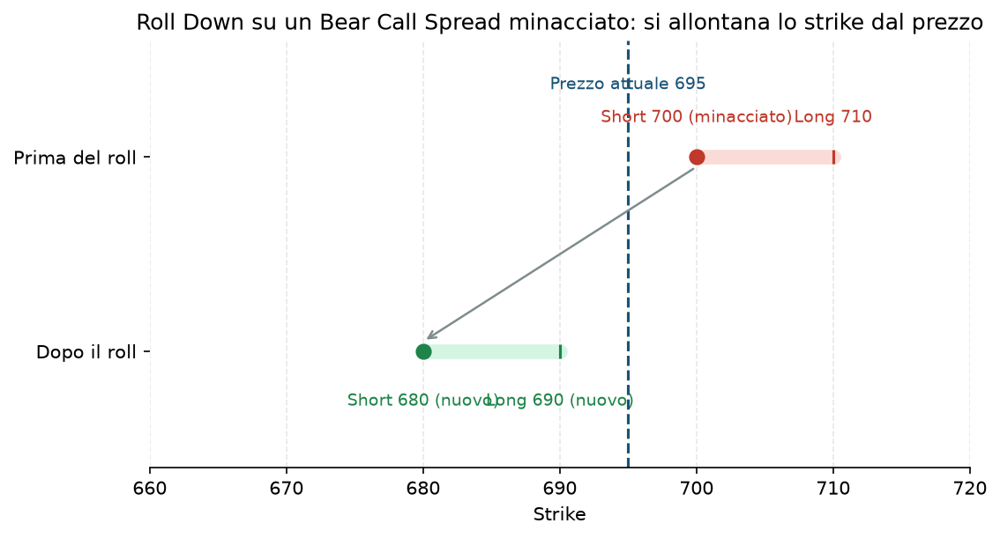

# 31. Rolling (Rollover)

Da qui in poi la guida cambia registro. Le strategie 1-30 rispondevano tutte alla stessa domanda: "che struttura apro?". Da qui in poi (31-34) la domanda è diversa: **ho già una posizione aperta e il mercato mi sta andando contro (o comunque le cose sono cambiate) — cosa faccio adesso?** Il Rolling è la tecnica di aggiustamento più comune di tutte, e probabilmente quella che userai più spesso nella pratica.

## Cos'è e quando si usa

Rollare una posizione significa **chiudere quella attuale e riaprirne subito una nuova, simile ma con parametri diversi** — di solito uno strike più lontano dal prezzo attuale ("roll di strike") e/o una scadenza più lontana nel tempo ("roll temporale"). Non è una tecnica magica che trasforma una perdita in un guadagno: è un modo per **darti più tempo e più spazio** a una view che pensi sia ancora valida, incassando (di solito) un credito aggiuntivo che riduce il rischio netto della posizione.

Si usa quando:
- Uno strike venduto è minacciato (il prezzo si sta avvicinando o lo ha superato) ma **la tua view di fondo sul sottostante non è cambiata** — pensi ancora che tornerà dalla tua parte, solo che i tempi sono stati sbagliati.
- Vuoi evitare l'assegnazione su una posizione che altrimenti scadrebbe ITM.
- Il trigger di stop del Piano non è ancora scattato, ma la posizione è vicina al bordo della zona di comfort.

## Come si fa, passo passo

**Roll di Strike (Roll Down / Roll Up):** sposti lo strike più lontano dal prezzo attuale, nella stessa scadenza o vicino.

Esempio: hai un [Bear Call Spread](18%20-%20Bear%20Call%20Spread.md) su XSP, short 700 / long 710, venduto a credito di 3,5 $. Il sottostante sale a 698, lo strike corto è minacciato. Decidi di rollare:
- Chiudi lo spread 700/710 attuale, pagando per richiuderlo (diciamo 6,0 $, è andato in perdita parziale rispetto al credito incassato).
- Riapri un nuovo spread più lontano, short 715 / long 725, incassando un nuovo credito (diciamo 3,2 $).
- **Costo netto del roll: 6,0 − 3,2 = 2,8 $** di debito aggiuntivo, ma ora hai molto più spazio (15 punti invece di 2) prima che lo strike corto sia di nuovo minacciato.

**Roll in Avanti (Roll Out / Time):** stessa logica, ma sposti principalmente la scadenza, non (solo) lo strike — dai tempo al mercato di tornare dalla tua parte, incassando altro valore temporale nel frattempo.

**Regola pratica che vale per entrambi:** un roll "buono" è quasi sempre fatto **a credito** (o a debito molto piccolo) — se per allontanarti devi pagare più di quanto avevi incassato all'apertura originale, stai solo rimandando il problema, non gestendolo (vedi sotto).

## Grafico

Il grafico mostra esattamente l'esempio sopra: lo spread originale (in rosso, in alto) aveva lo strike corto quasi addosso al prezzo attuale; dopo il roll (in verde, in basso) lo spread è più lontano su entrambi gli strike, con più margine di sicurezza.

## Quando NON farlo (i limiti della tecnica)

Questo è il punto più importante di tutta la voce. Il Rolling ha un limite netto, ed è lo stesso errore che frega quasi tutti i principianti: **"rollare all'infinito" una posizione perdente pur di non realizzare la perdita**. Ogni volta che rolli a debito (paghi più di quanto incassi) stai aumentando il rischio massimo della posizione, non riducendolo — e se il mercato continua ad andarti contro, ti ritrovi con una posizione sempre più grande, sempre più lontana dal breakeven originale, e sempre più difficile da chiudere psicologicamente proprio perché ci hai "investito" di più.

Esempio concreto di come si perde con il rolling: un trader vende un put spread, va in perdita, rolla a debito per allontanare lo strike; il mercato continua a scendere, rolla di nuovo a debito, e di nuovo; dopo tre roll ha trasformato una perdita iniziale gestibile (1-2% del NAV, come da regola del Piano — vedi [34 - Take Profit e Stop Loss Meccanico](34%20-%20Take%20Profit%20e%20Stop%20Loss%20Meccanico.md)) in una posizione enorme che, quando finalmente cede, brucia il 10-15% del capitale in un colpo solo. Il roll non aveva "risolto" nulla: aveva solo nascosto il problema per qualche settimana in più.

**La regola pratica per non caderci:** se un roll richiederebbe un debito netto (non un credito), è quasi sempre il segnale che dovresti chiudere e accettare la perdita secondo la regola di stop, non rollare. Il Piano dell'utente ([Piano](../PIANO.md) §7) usa proprio uno stop meccanico a 1-2x il credito incassato per togliere questa decisione dall'emotività del momento — vedi [34 - Take Profit e Stop Loss Meccanico](34%20-%20Take%20Profit%20e%20Stop%20Loss%20Meccanico.md).

## Pericoli

- **Costi di commissione che si accumulano** ad ogni roll (chiudi due gambe, ne apri due nuove) — su size piccole possono erodere buona parte del beneficio.
- **Rollare "per abitudine"** anche quando la view di fondo è cambiata, invece che con una vera valutazione — il roll deve essere una decisione consapevole, non un riflesso automatico.
- **Perdere la disciplina dello stop loss meccanico** proprio perché il roll dà l'illusione di avere sempre un'opzione in più.

## Legami con altre strategie/tecniche

- È l'alternativa diretta allo stop loss meccanico: vedi [34 - Take Profit e Stop Loss Meccanico](34%20-%20Take%20Profit%20e%20Stop%20Loss%20Meccanico.md) per capire quando è meglio chiudere e basta.
- Concettualmente collegato a [32 - Inversione e Trasformazione](32%20-%20Inversione%20e%20Trasformazione.md): anche lì si modifica una posizione esistente, ma cambiandone la struttura, non solo strike/scadenza.
- Si applica praticamente a qualunque spread a credito della guida: [17 - Bull Put Spread](17%20-%20Bull%20Put%20Spread.md), [18 - Bear Call Spread](18%20-%20Bear%20Call%20Spread.md), [23 - Iron Condor](23%20-%20Iron%20Condor.md) sono i casi più comuni nella pratica di tutti i giorni.
