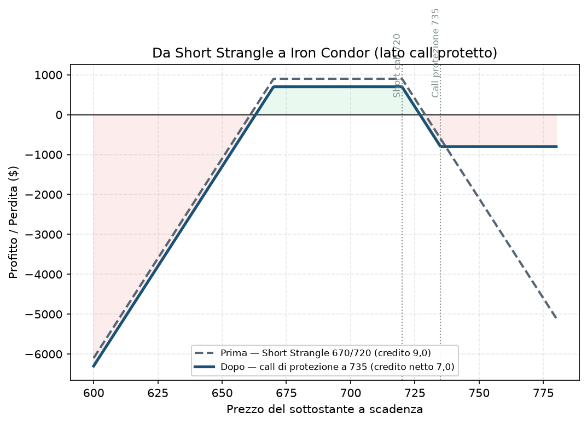

# 32. Inversione e Trasformazione in Strategie Protette

Se il [Rolling](31%20-%20Rolling.md) era "sposto la posizione", questa tecnica è "cambio la forma della posizione". Invece di chiudere e riaprire altrove, aggiungi o modifichi delle gambe alla struttura esistente per cambiarne il profilo di rischio — tipicamente per trasformare qualcosa a rischio illimitato in qualcosa a rischio definito.

## Cos'è e quando si usa

Due varianti principali, entrambe applicabili quando una posizione **a rischio non definito** (o a rischio definito ma sbilanciata) comincia ad andare male:

**Da Short Strangle/Straddle a Iron Condor/Butterfly:** hai una [Short Straddle](20%20-%20Short%20Straddle.md) o uno [Short Strangle](22%20-%20Short%20Strangle.md) (entrambi a rischio teoricamente illimitato) e il mercato inizia a muoversi seriamente in una direzione. Invece di chiudere tutto, **compri opzioni di protezione ancora più OTM** sul lato minacciato — di fatto trasformi lo strangle in un [Iron Condor](23%20-%20Iron%20Condor.md) (o la straddle in un'[Iron Butterfly](24%20-%20Iron%20Butterfly.md)) al volo. Perdi parte del premio incassato (paghi per la protezione) ma trasformi una perdita potenzialmente catastrofica in una perdita definita e nota in anticipo.

**Inversione degli Strike (Inverted Strangle):** variante più aggressiva. Se il prezzo ha superato uno degli strike venduti, invece di limitarti a proteggere il lato minacciato, **sposti l'altro strike (quello dal lato "sicuro") oltre il livello appena violato**, spesso incrociando le gambe. L'obiettivo è incassare un credito aggiuntivo che riduca la perdita netta della gamba violata — una tecnica più avanzata, da usare con consapevolezza piena di cosa sta succedendo al profilo di rischio (a volte questa manovra crea temporaneamente un profilo diverso da quello di partenza, va ricalcolato da zero, non solo "aggiustato a occhio").

## Come si fa, passo passo

Esempio concreto — Short Strangle minacciato → Iron Condor:
- Avevi aperto uno Short Strangle su XSP: short call 720 / short put 670, incassando 9,0 $ totali.
- Il sottostante sale rapidamente verso 715, la call è minacciata, il rischio al rialzo è teoricamente illimitato.
- **Compri una call di protezione a 735** (10 punti oltre la call venduta, coerente con l'ampiezza tipica di un [Iron Condor](23%20-%20Iron%20Condor.md)), pagando 2,0 $.
- Risultato: hai trasformato la posizione in un Iron Condor 670/720/735 (con l'ala put ancora scoperta se non hai protetto anche quel lato — spesso in questi casi si protegge solo il lato minacciato per contenere il costo, lasciando l'altro come "quasi naked" se il tempo residuo e il delta di quel lato lo giustificano, ma è una scelta consapevole da valutare caso per caso, non un default).
- Il credito netto scende da 9,0 a 7,0 $, ma la perdita massima possibile ora è definita e calcolabile (735 − 720 − 7,0 = 8,0 $ per azione nel peggiore dei casi lato call), invece di essere teoricamente illimitata.

## Grafico

La linea grigia tratteggiata è lo Short Strangle originale (670/720, credito 9,0): a destra, oltre 720, la perdita continua a scendere senza un limite visibile nel grafico. La linea blu è la posizione dopo aver comprato la call di protezione a 735: da lì in poi la perdita si appiattisce, esattamente come un [Iron Condor](23%20-%20Iron%20Condor.md) — il "prezzo" pagato è un profitto massimo leggermente più basso (7,0 invece di 9,0) su tutta la zona centrale. Nota che in questo esempio il lato put resta scoperto (coerente col caso descritto sopra): è per questo che la coda a sinistra della linea blu continua a scendere come quella grigia — la protezione qui è stata comprata solo dal lato minacciato.

## Quando NON farlo (i limiti della tecnica)

Comprare protezione dopo che il mercato si è già mosso contro di te è quasi sempre **più caro** che averla comprata all'apertura (la volatilità implicita sale insieme al panico, e le opzioni di protezione costano di più proprio quando ne hai più bisogno). Questa tecnica non è un pasto gratis: stai pagando un premio "in ritardo" per limitare un rischio che, se avessi strutturato la posizione a rischio definito fin dall'inizio (con un [Iron Condor](23%20-%20Iron%20Condor.md) invece di uno Strangle nudo), non avresti mai avuto. Il limite pratico è che **se il costo della protezione supera quasi tutto il credito rimasto**, a quel punto conviene chiudere e basta (vedi [34 - Take Profit e Stop Loss Meccanico](34%20-%20Take%20Profit%20e%20Stop%20Loss%20Meccanico.md)) invece di pagare per trasformare una posizione ormai compromessa.

Errore classico: aspettare troppo a lungo a proteggersi, sperando che il mercato "torni indietro da solo", e ritrovarsi a comprare la protezione quando ormai costa quasi quanto l'intero credito incassato all'apertura — a quel punto il beneficio della trasformazione è quasi nullo.

## Pericoli

- **Costo della protezione tardiva**, come detto sopra — la IV sale proprio quando il mercato si muove, rendendo la copertura più costosa nel momento peggiore.
- **Complessità gestionale**: ora hai quattro gambe invece di due, più commissioni, più cose da monitorare.
- **Falso senso di sicurezza**: trasformare la posizione riduce il rischio ma non lo elimina — resta comunque una perdita, solo definita invece che illimitata.

## Legami con altre strategie/tecniche

- Il profilo "prima": [20 - Short Straddle](20%20-%20Short%20Straddle.md), [22 - Short Strangle](22%20-%20Short%20Strangle.md).
- Il profilo "dopo": [23 - Iron Condor](23%20-%20Iron%20Condor.md), [24 - Iron Butterfly](24%20-%20Iron%20Butterfly.md).
- Il Piano dell'utente ([Piano](../PIANO.md) §7.1, regole strutturali sempre attive) parte già dal principio "solo rischio definito, mai naked (tranne strangle su indice ≤20% del bucket A)" — questa tecnica è esattamente la rete di sicurezza per quel 20% di eccezione, nel caso in cui uno strangle nudo inizi ad andare male.
- Alternativa più semplice nello stesso momento di difficoltà: [31 - Rolling](31%20-%20Rolling.md) (spostare invece di trasformare) o [chiudere e basta](34%20-%20Take%20Profit%20e%20Stop%20Loss%20Meccanico.md).
