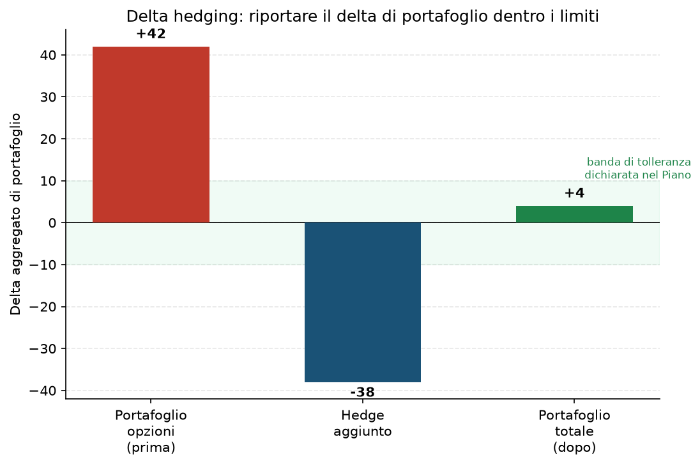

# 33. Hedging Dinamico con il Sottostante (Delta Neutral Hedging)

Tutte le tecniche di aggiustamento viste finora (31, 32) agiscono sulle opzioni stesse — rolli o aggiungi gambe. Il Delta Hedging è diverso: usi **il sottostante stesso** (azioni o future) per riportare il portafoglio in equilibrio, senza toccare le opzioni che hai già.

## Cos'è e quando si usa

Ogni posizione in opzioni ha un delta — vedi [01 - Delta](01%20-%20Delta.md) se non l'hai già letto, è il prerequisito di tutto questo. Sommando i delta di tutte le posizioni ottieni il **delta di portafoglio**: quanto varia il valore totale del tuo conto per un movimento di 1 punto del sottostante. Se questo numero esce dai limiti che ti sei dato (nel Piano dell'utente, un limite di perdita ≤6% NAV per +10 punti di VIX, che si traduce anche in un limite implicito sul delta aggregato — [Piano](../PIANO.md) §5.2), sei più esposto direzionalmente di quanto vorresti, anche se ogni singola posizione presa da sola sembra a posto.

Il Delta Hedging serve esattamente a correggere questo: **comprare o vendere il sottostante (azioni o future) nella quantità giusta per riportare il delta aggregato vicino a zero** (o comunque dentro la banda di tolleranza), senza dover chiudere o modificare nessuna delle opzioni.

## Come si fa, passo passo

Esempio: il tuo portafoglio opzioni ha un delta aggregato di **+42** — significa che per ogni punto in più del sottostante, il portafoglio guadagna circa 42 $ (e per ogni punto in meno, ne perde altrettanti). È troppo esposto al rialzo per i tuoi limiti.

- Un future mini su quell'indice ha un delta di circa −1 per contratto se lo vendi (ogni contratto venduto riduce il delta di portafoglio di 1 punto pieno, moltiplicato per il moltiplicatore del contratto).
- Vendendo il numero giusto di contratti (o di azioni, se lavori su singoli titoli) riduci il delta aggregato di circa 38 punti.
- **Risultato: delta di portafoglio passa da +42 a +4** — dentro la banda di tolleranza, senza aver toccato nessuna opzione.

Questo non è un aggiustamento "una tantum": in un vero programma di delta hedging dinamico lo rifai ogni volta che il delta esce dalla banda (che può succedere spesso, dato che gamma fa cambiare il delta continuamente — vedi [02 - Gamma](02%20-%20Gamma.md)). Nel contesto del Piano dell'utente, più realisticamente, è un controllo che fai nella routine periodica (non in tempo reale come farebbe un market maker), quando il delta aggregato del portafoglio esce dai limiti dichiarati.

## Grafico

Il grafico mostra esattamente l'esempio sopra: il delta di partenza (+42, fuori dalla banda di tolleranza in verde), l'hedge aggiunto (−38), e il risultato finale (+4, dentro la banda).

## Quando NON farlo (i limiti della tecnica)

Il delta hedging ha un costo che si accumula silenziosamente: ogni volta che compri/vendi il sottostante per riportare il delta a zero, paghi commissioni e, soprattutto, ti esponi a **piccole perdite ripetute per via del gamma** (compri alto e vendi basso in modo sistematico se lo fai troppo spesso su un sottostante che oscilla, il classico "whipsaw" del delta hedging troppo frequente). Il limite pratico: farlo troppo spesso, su size piccole, per inseguire uno scostamento minimo dalla banda di tolleranza, costa più di quanto protegge — è una tecnica pensata per correggere deviazioni **significative**, non per azzerare il delta al centesimo ogni ora. Un portafoglio retail gestito con una routine giornaliera/settimanale (come quello dell'utente) non ha bisogno della stessa frequenza di ribilanciamento di un desk di market making.

## Pericoli

- **Costo cumulativo di commissioni e whipsaw** se fatto troppo spesso, come detto sopra.
- **Il delta hedging non protegge dal gamma né dalla vega**: puoi essere perfettamente delta-neutrale e comunque perdere soldi se la volatilità si muove in modo sfavorevole, o se il sottostante fa un movimento improvviso che cambia il delta più in fretta di quanto tu riesca a ribilanciare (gap di weekend, ad esempio — collegato allo scenario C di Primo Trade §3.6).
- **Serve capitale e margine aggiuntivi** per la posizione sul sottostante/future, che va tenuto in considerazione nel buffer di liquidità complessivo del portafoglio.
- **Falsa sicurezza**: "sono delta neutrale" non significa "sono al sicuro" — significa solo che sei neutrale rispetto a UN rischio specifico, in un dato istante.

## Legami con altre strategie/tecniche

- Prerequisito assoluto: [01 - Delta](01%20-%20Delta.md) e [02 - Gamma](02%20-%20Gamma.md) (che spiega perché il delta cambia continuamente e va ricontrollato).
- Alternativa più "chirurgica" quando il problema è concentrato su una singola posizione, non su tutto il portafoglio: [31 - Rolling](31%20-%20Rolling.md) o [32 - Inversione e Trasformazione](32%20-%20Inversione%20e%20Trasformazione.md).
- Collegato al monitoraggio della vega aggregata di portafoglio, che il Piano tiene separata dal delta ([Piano](../PIANO.md) §5.2) — vedi [04 - Vega](04%20-%20Vega.md).
