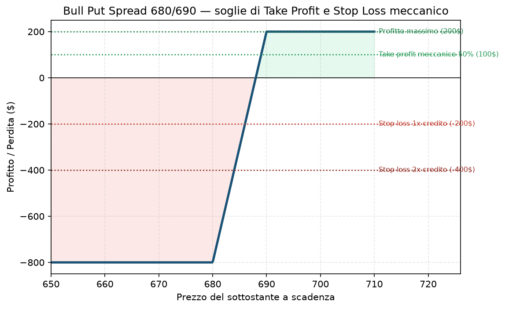

# 34. Chiusura Anticipata e Regola di Presa Profitto/Stop Loss

L'ultima voce della guida, e forse la più importante di tutte — non perché sia tecnicamente complessa (è la più semplice delle quattro tecniche di aggiustamento), ma perché è quella che, applicata con disciplina, previene la maggior parte dei disastri che le altre tecniche (31-33) cercano di limitare dopo il fatto.

## Cos'è e quando si usa

Due regole meccaniche, applicate **prima** di aprire la posizione, non decise a caldo mentre il trade è già in corso — questo è il punto: tolgono la decisione dall'emotività del momento, fissandola quando sei ancora lucido.

**Take Profit Meccanico:** chiudi anticipatamente un Credit Spread o un [Iron Condor](23%20-%20Iron%20Condor.md) quando hai già incassato il **50% del profitto massimo possibile**, invece di aspettare la scadenza per portare a casa il 100%.

**Stop Loss Meccanico:** chiudi la posizione quando la perdita raggiunge **1x-2x il credito incassato originariamente** — non aspetti che la perdita cresca oltre, qualunque cosa tu "pensi" possa succedere dopo.

Si usano sempre, su ogni posizione a credito che apri — non è una tecnica per situazioni eccezionali, è la base della gestione ordinaria. Il Piano dell'utente le ha già incorporate come regole strutturali fin dall'inizio ([Piano](../PIANO.md) §7), proprio per questo motivo.

## Come si fa, passo passo

**Take Profit — esempio:** apri un [Bull Put Spread](17%20-%20Bull%20Put%20Spread.md) incassando un credito di 2,0 $ (profitto massimo possibile, se scade con entrambe le gambe OTM). Non aspetti la scadenza: nel momento in cui il valore della posizione scende a 1,0 $ (cioè potresti richiuderla pagando solo 1,0 $, avendo già "guadagnato" l'altro 1,0 $), la chiudi. Hai incassato il 50% del massimo possibile, in genere molto prima della scadenza — e soprattutto **prima** della fase finale della vita dell'opzione, dove il gamma è più alto e il prezzo può muoversi bruscamente contro di te in poco tempo.

**Stop Loss — esempio:** stesso spread, credito incassato 2,0 $. Se il valore della posizione sale (cioè richiuderla ti costerebbe) fino a 2,0-4,0 $ (1x-2x il credito originale), chiudi, accettando una perdita di 0-2 $ per azione — invece di sperare in un recupero e rischiare una perdita molto più ampia se lo strike venduto finisce ITM.

## Perché il 50% e non il 100% (la logica dietro la regola)

Non è un numero arbitrario: nell'ultima parte della vita di un'opzione il gamma esplode (vedi [02 - Gamma](02%20-%20Gamma.md)) — piccoli movimenti del sottostante producono variazioni sempre più brusche del valore dell'opzione. Il rischio residuo per guadagnare l'ultimo 50% del premio è sproporzionato rispetto al rischio che hai corso per guadagnare il primo 50%. Chiudere presto significa anche liberare capitale e margine per aprire una nuova posizione prima — più rotazioni nel tempo, spesso, rendono di più che spremere ogni singolo trade fino all'ultimo centesimo.

## Grafico

Il grafico mostra il payoff finale (a scadenza) di un Bull Put Spread 680/690 con credito 2,0, con le soglie della regola meccanica sovrapposte come riferimento: il take profit al 50% (100 $) sta a metà tra zero e il profitto massimo (200 $); lo stop loss si attiva quando la perdita non realizzata raggiunge 1x-2x il credito incassato (−200 $ / −400 $). Attenzione: queste soglie si misurano sul **valore mark-to-market della posizione prima della scadenza**, non sul payoff finale — il grafico le mostra come riferimento visivo di grandezza, non come punti che raggiungerai davvero seguendo questa curva (che vale solo all'ultimo giorno).

## Quando NON farlo (i limiti della tecnica)

La regola meccanica è pensata per essere seguita **sempre**, non selettivamente — il suo intero valore sta nel non lasciarti spazio per razionalizzare un'eccezione ("stavolta aspetto, tanto sono sicuro che torna indietro"). Detto questo, due limiti reali da conoscere:

- **Su size molto piccole, le commissioni possono mangiarsi buona parte del beneficio** di chiudere al 50% invece che aspettare la scadenza — su un credito di 0,20-0,30 $ per azione, il costo di chiusura anticipata va confrontato col guadagno residuo.
- **In presenza di un evento macro imminente** (FOMC, CPI, earnings), a volte ha senso chiudere anche sotto la soglia meccanica standard, non aspettarla — è un'eccezione dichiarata dal Piano stesso (§6, niente apertura a size piena prima di eventi macro binari), non un'improvvisazione.

L'errore da non fare è l'opposto: usare "fa eccezione questa volta" come scusa per non rispettare lo stop. È esattamente l'errore che il [Rolling](31%20-%20Rolling.md) indisciplinato produce quando diventa un modo per rimandare la chiusura invece che gestirla — vedi la sezione "quando non farlo" lì.

## Pericoli

- **Disciplina, non tecnica**: il rischio più grande qui non è calcolare male la soglia, è non rispettarla quando arriva il momento.
- **Falso senso di controllo se applicata solo "a volte"**: una regola meccanica seguita nel 70% dei casi non ti protegge dal 30% di volte in cui salta proprio la posizione più grande.
- **Overtrading**: prendere profitto al 50% troppo spesso, su size ridotte, può portare a un numero eccessivo di trade e commissioni che erodono il vantaggio statistico della strategia.

## Legami con altre strategie/tecniche

- È l'alternativa "di default" a [31 - Rolling](31%20-%20Rolling.md) quando la posizione va male: prima valuti lo stop meccanico, il roll è l'eccezione motivata, non il contrario.
- Si applica naturalmente a tutte le strategie a credito con rischio definito della guida: [17 - Bull Put Spread](17%20-%20Bull%20Put%20Spread.md), [18 - Bear Call Spread](18%20-%20Bear%20Call%20Spread.md), [23 - Iron Condor](23%20-%20Iron%20Condor.md), [24 - Iron Butterfly](24%20-%20Iron%20Butterfly.md).
- Il circuit breaker a livelli del Piano ([Piano](../PIANO.md) §7, vedi anche Primo Trade §3.6) è la versione "a livello di portafoglio" della stessa logica: regole meccaniche, decise in anticipo, che tolgono la decisione dall'emotività del momento di crisi.
